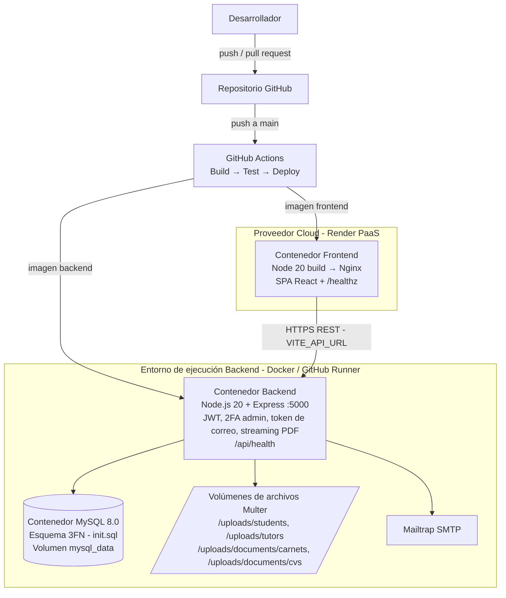
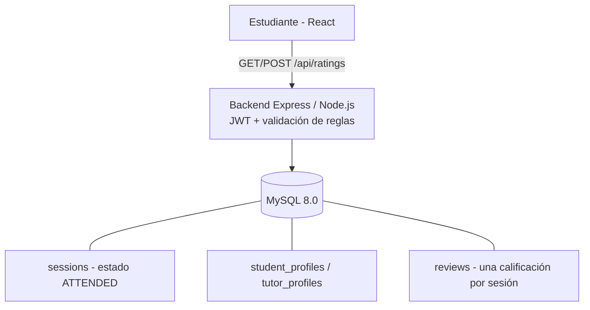
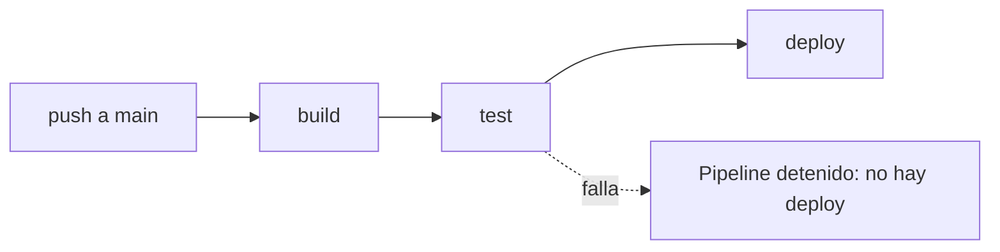

# Arquitectura Cloud, Contenedorización y Modelo CI/CD — Fase 2

**Responsables:** Xavi De León (Paquete B — Infraestructura, Docker y Despliegue Cloud) e Isai (Paquete F — Pipeline CI/CD y Feedback)

---

## 1. Arquitectura física y separación de responsabilidades

En la Fase 2, EduConnect adopta una arquitectura distribuida y contenedorizada que desacopla la capa de presentación (Frontend), la lógica de negocio (Backend API REST) y la capa de persistencia (MySQL 8.0 + volúmenes de documentos). Esto aplica el principio de *Separation of Concerns* solicitado en el enunciado.



| Capa | Tecnología | Responsabilidad | Despliegue |
| :--- | :--- | :--- | :--- |
| Frontend | React + Vite, servido por Nginx | Interfaz de los tres roles (estudiante, tutor, administrador) | Contenedor Docker en Render (URL pública HTTPS) |
| Backend | Node.js 20 + Express | Lógica de negocio, autenticación JWT, validaciones, correos, streaming de PDFs | Contenedor Docker, orquestado con Docker Compose y pipeline de GitHub Actions |
| Base de datos | MySQL 8.0 | Persistencia relacional en 3FN | Instancia contenerizada junto al backend (ruta de implementación permitida por el enunciado para entornos controlados) |
| Archivos | Multer + volúmenes | Fotografías, carnets y CVs | Directorio `/uploads` del backend |
| Correo | Mailtrap SMTP | Token de verificación y notificaciones | Servicio externo (sandbox) |

---

## 2. Contenedorización multi-stage y despliegue del frontend en la nube (HU-050)

### 2.1. Construcción multi-stage (`frontend/Dockerfile`)

Para reducir el tamaño de la imagen de producción y evitar exponer código fuente o dependencias de desarrollo (`node_modules`), el frontend usa un Dockerfile de dos etapas:

1. **Stage 1 (`builder`, `node:20-alpine`):** instala dependencias, recibe `ARG VITE_API_URL` en tiempo de compilación y ejecuta `npm run build`, generando el paquete estático optimizado en `/app/dist`.
2. **Stage 2 (`production`, `nginx:alpine`):** copia únicamente los artefactos compilados hacia `/usr/share/nginx/html` y reemplaza la configuración por defecto con `frontend/nginx.conf`.

> `VITE_API_URL` se incrusta durante el build. Si cambia la URL del backend, es necesario reconstruir la imagen.

### 2.2. Configuración de Nginx y healthchecks (T-050.1 y T-050.2)

`frontend/nginx.conf` resuelve dos requerimientos de arquitectura:

- **Enrutamiento SPA (React Router):** la directiva `try_files $uri $uri/ /index.html;` redirige cualquier recarga en rutas profundas (`/admin`, `/tutor`, `/student`) al índice de React, sin errores `404 Not Found`.
- **Monitoreo de salud:** el contenedor del frontend expone `GET /healthz` (HTTP 200 con JSON) y el backend expone `GET /api/health`. Ambos son verificados periódicamente por las directivas `healthcheck` de `docker-compose.yml` y del proveedor cloud.

### 2.3. Despliegue cloud con URL pública (T-050.3)

El frontend se despliega en **Render** mediante el manifiesto de infraestructura como código `frontend/render.yaml` (runtime `docker`). El contenedor se construye automáticamente desde el Dockerfile del repositorio y queda expuesto bajo una URL pública con HTTPS. El servicio verifica su disponibilidad en `/healthz` y recibe `VITE_API_URL` como variable de entorno.

---

## 3. Almacenamiento y streaming de documentos PDF (HU-029, HU-039 y HU-040)

Para visualizar carnets estudiantiles y CVs de tutores de forma incrustada, sin forzar la descarga en el equipo del administrador:

1. **Ingesta y nomenclatura UUID:** los middlewares `studentRegistrationUpload.js` y `tutorRegistrationUpload.js` procesan las cargas `multipart/form-data` con Multer, validan el MIME type `application/pdf` y un límite máximo de 5 MB. Los archivos se renombran con `crypto.randomUUID()` y se guardan en `/uploads/documents/carnets/` y `/uploads/documents/cvs/`.
2. **Streaming inline en el backend:** `documentController.js` expone los endpoints de la tabla siguiente, sanitiza el nombre del archivo con `path.basename` (previene *path traversal*) y envía:
   - `Content-Type: application/pdf`
   - `Content-Disposition: inline; filename="..."`
3. **Visor embebido en el frontend:** `PendingStudents.jsx` y `PendingTutors.jsx` integran el componente `<PdfViewer />`, que renderiza el flujo binario dentro de un `<iframe>` en el modal de revisión del administrador.

| Método | Endpoint | Propósito |
| :--- | :--- | :--- |
| `GET` | `/api/admin/students/pending` | Lista estudiantes pendientes con referencia a `carnet_pdf_url`. |
| `PUT` | `/api/admin/students/:id/status` | Aprueba o rechaza la solicitud de un estudiante y notifica por correo. |
| `GET` | `/api/admin/tutors/pending` | Lista tutores pendientes con credenciales profesionales y `cv_pdf_url`. |
| `PUT` | `/api/admin/tutors/:id/status` | Aprueba o rechaza la solicitud de un tutor y notifica por correo. |
| `GET` | `/api/documents/carnets/:filename` | Streaming inline del PDF de carnet estudiantil. |
| `GET` | `/api/documents/cvs/:filename` | Streaming inline del PDF de CV del tutor. |

---

## 4. Arquitectura de feedback y automatización CI/CD (Paquete F)

### 4.1. Alcance del módulo

La distribución asigna a Isai el Paquete F: feedback de sesiones y automatización CI/CD. En el Sprint 1 se implementaron HU-035 (calificación de tutores) y HU-049 (Build y Test); en el Sprint 2 se completan las historias de denuncias, la calificación de estudiantes y la etapa Deploy.

### 4.2. Arquitectura lógica de calificaciones



El frontend muestra el formulario de HU-035 en el historial únicamente para sesiones atendidas. El backend vuelve a validar la identidad del estudiante, la pertenencia de la sesión, el estado `ATTENDED`, la calificación entera entre 0 y 5 y la unicidad de `session_id`; la interfaz nunca sustituye estas reglas de seguridad.

### 4.3. Contrato de HU-035

| Método | Endpoint | Propósito |
| :--- | :--- | :--- |
| `GET` | `/api/ratings/me` | Consulta las calificaciones del estudiante autenticado. |
| `POST` | `/api/ratings/sessions/:sessionId` | Registra una calificación de 0–5 y un comentario opcional. |

El `POST` responde `400` ante un payload inválido, `404` si la sesión no pertenece al estudiante, `409` si no está atendida o ya fue calificada y `201` cuando la persistencia es exitosa.

### 4.4. Flujo CI/CD de HU-049 (`.github/workflows/backend-ci-cd.yml`)

El workflow se dispara únicamente con `push` a `main` y usa `ubuntu-latest` con Node.js 20:



1. **`build`:** instala dependencias del backend, construye la imagen Docker y compila el frontend.
2. **`test`:** depende de `build`, instala las dependencias y ejecuta `npm test`. Si alguna prueba falla, el pipeline se detiene y se bloquea el despliegue.
3. **`deploy`:** depende de `build` y `test`, y se ejecuta únicamente después de un `push` a `main`, en el entorno `production`. Despliega el backend **dentro del runner de GitHub Actions**: genera el archivo `.env` a partir de `.env.example`, levanta los contenedores `db` (MySQL 8.0 con `init.sql`) y `backend` con `docker compose up -d --build`, y verifica la disponibilidad consultando `GET /api/health` hasta 36 veces cada 5 segundos. Si el backend no responde, el job muestra los logs de los contenedores y falla.

Esta estrategia, definida en el plan de arquitectura de la Fase 2, no requiere servidores externos y tiene costo de infraestructura $0.00. La base de datos es temporal y se destruye al terminar el job. Si el repositorio define los GitHub Secrets `JWT_SECRET`, `SMTP_USER` y `SMTP_PASS`, el job los usa en lugar de los valores de ejemplo; las credenciales sensibles nunca se escriben en el YAML ni en el código fuente.

---

## 5. Verificación local y contenedores

```bash
# Suite de pruebas unitarias del backend
cd backend
npm test

# Build de producción del frontend
cd ../frontend
npm run build

# Infraestructura completa contenedorizada
cd ..
docker compose up --build -d
```

La ejecución realizada para el Sprint 1 produjo 32 pruebas unitarias exitosas y un build de producción del frontend completado.
Al cierre del Sprint 2, `npm test` ejecuta 90 pruebas unitarias exitosas (incluidas PU-01 a PU-30), y la suite E2E con Cypress suma 14 pruebas aprobadas (ver `docs/Pruebas/`).

---

## 6. Dependencias e integración entre módulos

- La prueba funcional de HU-035 y de los reportes disciplinarios requiere que una sesión haya sido marcada como `ATTENDED` mediante el registro de un plan de estudio estructurado (Paquete E). Esto es una dependencia de datos/integración, no un bloqueo para implementar la API ni el workflow; la regla se valida en backend y se documenta para la integración con el flujo de atención.
- La revisión de solicitudes en los paneles administrativos (HU-039 y HU-040) consume los archivos persistidos durante el registro de estudiantes (Paquete A) y tutores (Paquete B) a través del servicio de streaming de documentos.
