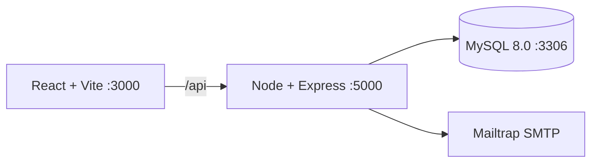

# Manual técnico: Docker y MySQL 8.0

## Arquitectura



`docker-compose.yml` levanta tres servicios: `frontend`, `backend` y `db`. El volumen `mysql_data` conserva la información y `backend/init.sql` se ejecuta al inicializar un volumen nuevo.

## Requisitos

- Docker Desktop con Compose v2.
- Git y Node.js 20+ para desarrollo fuera de contenedores.
- Puertos libres 3000 (Vite), 5000 (API) y 3306 (MySQL).
- 4 GB de RAM disponibles para Docker y conexión de red durante la instalación de imágenes.

## Despliegue local

```bash
git clone https://github.com/GabeKt/AYD1_2S_G4.git
cd AYD1_2S_G4
cp .env.example .env
docker compose up --build
```

La API responde en `http://localhost:5000/api/health` y el frontend en `http://localhost:3000`. Para detener los servicios:

```bash
docker compose down
```

**Nota Fedora/SELinux:** Crear `docker-compose.override.yml` con `:Z` en volúmenes para permisos.

No se debe usar `docker compose down -v` salvo que se quiera borrar el volumen y recrear el esquema desde cero.

## Variables de entorno

| Variable | Uso |
|---|---|
| `MYSQL_ROOT_PASSWORD` | Contraseña del usuario root del contenedor |
| `MYSQL_DATABASE` | Base de datos, normalmente `educonnect` |
| `MYSQL_USER` / `MYSQL_PASSWORD` | Credenciales de la aplicación |
| `DB_HOST`, `DB_PORT` | Conexión del backend al servicio `db` |
| `JWT_SECRET`, `JWT_EXPIRES_IN` | Firma y duración del token |
| `CORS_ORIGIN` | Origen permitido del frontend |
| `SMTP_HOST`, `SMTP_PORT`, `SMTP_USER`, `SMTP_PASS` | Sandbox Mailtrap |

Las credenciales reales nunca se deben subir al repositorio; usar `.env.example` como plantilla.

## Contratos de autenticación

### Registro e ingreso de estudiante (HU-001, HU-006)

- `POST /api/auth/register/student`: registra estudiante con validación de contraseña (8+ chars, mayúscula, minúscula, número). Crea usuario en estado `PENDING` y perfil de estudiante (nombre, apellido, carnet).
- `POST /api/auth/login/student`: devuelve JWT **solo si el estudiante está `APPROVED`**. Rechaza si está `PENDING`, `REJECTED` o `DISABLED`. JWT contiene: `{ id, studentId, role: "student", email, status }`.

### Autenticación admin con 2FA (HU-003)

**Fase 1: Login inicial**
- `POST /api/auth/login/admin`: valida email + contraseña. Si son correctas, devuelve `{ phase: 1, adminId, email }` (sin JWT).

**Fase 2: Segundo factor**
- `POST /api/auth/login/admin/2fa`: recibe archivo `auth2-ayd1.txt` (multipart). Valida:
  - Nombre exacto del archivo.
  - Contenido coincide con hash bcrypt predefinido (contraseña 2FA).
  - Si es válido, genera y devuelve JWT con `{ id, role: "admin", email, status }`.

**Seguridad del 2FA:**
- El archivo contiene un hash bcrypt (no contraseña en texto plano).
- La contraseña 2FA es **diferente** a la del primer login.
- Sin el segundo factor, el admin NO obtiene JWT y no puede acceder.

### Rutas de tutor

- `POST /api/auth/register/tutor`: multipart con fotografía obligatoria; crea usuario `PENDING`.
- `POST /api/auth/login/tutor`: devuelve JWT si está `APPROVED`. JWT contiene: `{ id, tutorId, role: "tutor", email, status }`.

### Ruta protegida de admin

- `GET /api/auth/admin/profile`: requiere JWT válido con `role: "admin"`. Responde con datos públicos del admin.

## Autenticación y autorización

### JWT (JSON Web Token)

Todos los tokens se firman con `JWT_SECRET` y expiran según `JWT_EXPIRES_IN` (default 24h para estudiantes, 8h para tutores).

**Estructura del payload:**
```json
{
  "id": 1,                    // users.id
  "studentId": 5,             // student_profiles.id (solo en login estudiante)
  "tutorId": 3,               // tutor_profiles.id (solo en login tutor)
  "role": "student|tutor|admin",
  "email": "user@example.com",
  "status": "APPROVED|PENDING|REJECTED|DISABLED"
}
```

### Control de acceso

Todas las rutas privadas requieren:

Authorization: Bearer <token>


El backend valida y extrae el payload. Middleware como `authenticateJWT` y `authorizeAdmin` garantizan:
- Token válido y no expirado.
- Rol correcto (admin solo acceso a rutas admin).
- Estado `APPROVED` (rechaza `PENDING`, `REJECTED`, `DISABLED`).

## Persistencia y migraciones

`backend/init.sql` es idempotente para un volumen nuevo mediante `CREATE TABLE IF NOT EXISTS`. Incluye seed de admin con hash 2FA.

Si el volumen ya existía antes de una modificación estructural, se debe crear una migración SQL explícita o recrear el volumen en desarrollo; nunca se deben borrar datos de producción.

## Seguridad

### Contraseñas

Las contraseñas se transforman con **bcrypt (10 rounds)** antes de insertarse o actualizarse:
- Registros: hash en `users.password_hash`.
- Logins: `comparePassword()` valida sin desencriptar.

### Validación de contraseña

Estudiantes y tutores deben cumplir:
- Mínimo 8 caracteres.
- Al menos 1 mayúscula.
- Al menos 1 minúscula.
- Al menos 1 número.

### Estados de usuario

- `PENDING`: registrado pero no aprobado por admin. Acceso denegado.
- `APPROVED`: aprobado. Acceso permitido.
- `REJECTED`: rechazado por admin. Acceso denegado.
- `DISABLED`: desactivado. Acceso denegado.

Solo usuarios `APPROVED` pueden loguearse exitosamente.
