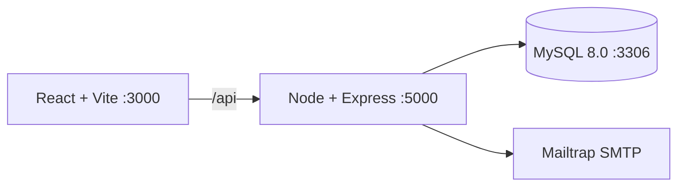

# Manual técnico: Docker y MySQL 8.0

## Arquitectura



`docker-compose.yml` levanta tres servicios: `frontend`, `backend` y `db`. El volumen `mysql_data` conserva la información y `backend/init.sql` se ejecuta al inicializar un volumen nuevo.

## Requisitos

- Docker Desktop con Compose v2.
- Git y Node.js 20+ para desarrollo fuera de contenedores.
- Puertos libres 3000 (Vite), 5000 (API) y 3306 (MySQL).
- 4 GB de RAM disponibles para Docker y conexión de red durante la instalación de imágenes.

## Despliegue local

```bash
git clone https://github.com/GabeKt/AYD1_2S_G4.git
cd AYD1_2S_G4
copy .env.example .env
docker compose up --build
```

La API responde en `http://localhost:5000/api/health` y el frontend en `http://localhost:3000`. Para detener los servicios:

```bash
docker compose down
```

No se debe usar `docker compose down -v` salvo que se quiera borrar el volumen y recrear el esquema desde cero.

## Variables de entorno

| Variable | Uso |
|---|---|
| `MYSQL_ROOT_PASSWORD` | Contraseña del usuario root del contenedor |
| `MYSQL_DATABASE` | Base de datos, normalmente `educonnect` |
| `MYSQL_USER` / `MYSQL_PASSWORD` | Credenciales de la aplicación |
| `DB_HOST`, `DB_PORT` | Conexión del backend al servicio `db` |
| `JWT_SECRET`, `JWT_EXPIRES_IN` | Firma y duración del token |
| `CORS_ORIGIN` | Origen permitido del frontend |
| `SMTP_HOST`, `SMTP_PORT`, `SMTP_USER`, `SMTP_PASS` | Sandbox Mailtrap (configuración de Xavi/PO) |

Las credenciales reales nunca se deben subir al repositorio; usar `.env.example` como plantilla.

## Contratos de tutor

- `POST /api/auth/register/tutor`: multipart con fotografía obligatoria; crea usuario `PENDING` y asocia su especialidad.
- `POST /api/auth/login/tutor`: devuelve JWT solo cuando el usuario es tutor y está `APPROVED`.
- `GET /api/tutors`: lista tutores aprobados y sus materias.
- `GET /api/tutors/:id/schedules`: consulta disponibilidad pública.
- `GET|POST|PUT /api/tutors/me/schedules`: consulta, crea o actualiza horario del tutor autenticado.
- `GET|PUT /api/tutors/me/profile`: consulta o actualiza perfil; el correo es inmutable.

Las rutas privadas requieren `Authorization: Bearer <token>` y autorización de rol `tutor`.

## Persistencia y migraciones

`backend/init.sql` es idempotente para un volumen nuevo mediante `CREATE TABLE IF NOT EXISTS`. Si el volumen ya existía antes de una modificación estructural, se debe crear una migración SQL explícita o recrear el volumen en un entorno de desarrollo; nunca se deben borrar datos de producción.

## Seguridad

Las contraseñas se transforman con bcrypt antes de insertarse o actualizarse. JWT transporta el identificador de usuario, el identificador del perfil de tutor y el rol. Las cuentas `PENDING`, `REJECTED` y `DISABLED` reciben respuestas de acceso denegado.

El segundo factor del administrador (`auth2-ayd1.txt`) y la configuración final de su flujo pertenecen al paquete de Wade; se debe integrar en este manual cuando su rama sea fusionada.
