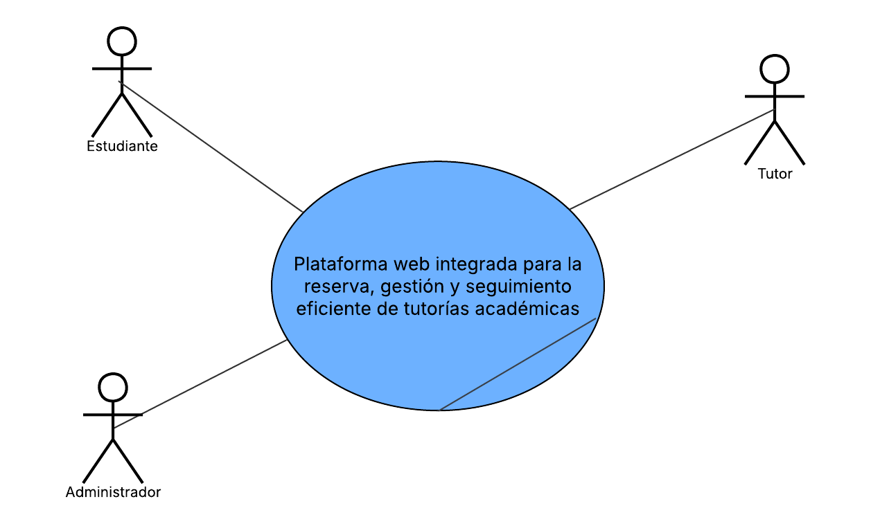

# Core del Negocio — Caso de Uso de Alto Nivel

El core resume el objetivo principal del sistema en un solo caso de uso. Es la vista de caja negra: muestra quién interactúa con el sistema y qué se espera de él, sin entrar en detalles internos.

## Diagrama de core del negocio

## Descripción del core

EduConnect es una plataforma web moderna e integrada diseñada para digitalizar y optimizar todo el proceso de gestión de tutorías académicas. Su objetivo principal es facilitar la comunicación fluida entre estudiantes y tutores, proporcionando un entorno centralizado que permite la reserva, gestión y seguimiento de sesiones de tutoría de forma eficiente. 

A través de esta solución, el sistema elimina los procesos manuales desarticulados, ofrece visibilidad en tiempo real de la disponibilidad de horarios, mantiene una trazabilidad completa del progreso académico y dota a la administración de herramientas automatizadas para la supervisión y la toma de decisiones estratégicas basadas en la demanda.