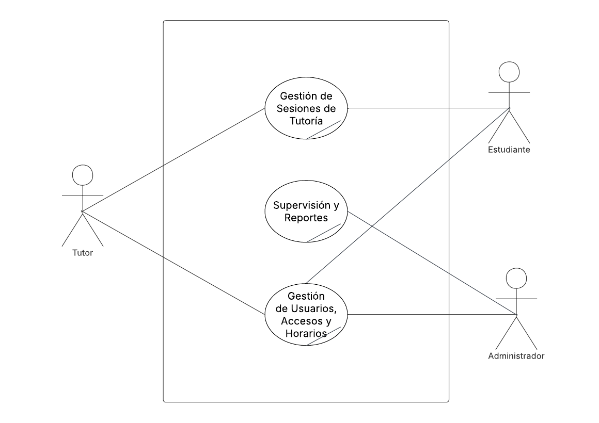

# Primera Descomposición — Procesos del Negocio

En esta fase, el Caso de Uso de Negocio (CUN) Core de EduConnect se descompone en los grandes procesos que articulan la plataforma. Estos se clasifican según su naturaleza de impacto en el sistema, siguiendo los estándares de la ingeniería de procesos de software.

## Diagrama de Primera Descomposición

## Clasificación y Justificación de Procesos

### 1. Procesos Nucleares (Operativos)
Son los procesos que representan la razón de ser de la organización y los que entregan el valor directo al estudiante y al tutor.

* **Gestión de Sesiones de Tutoría:**
  * **Actores involucrados:** Estudiante, Tutor.
  * **Justificación:** Es el motor transaccional de la plataforma. Abarca todo el ciclo de vida de una tutoría: desde la búsqueda de tutores disponibles y la programación de la sesión (evitando traslapes), hasta la atención de la misma y el registro obligatorio del resumen de tutoría por parte del tutor.

### 2. Procesos Gerenciales (Estratégicos)
Agrupan las funciones destinadas al monitoreo, control y toma de decisiones a nivel organizacional.

* **Supervisión y Reportes Analíticos:**
  * **Actores involucrados:** Administrador.
  * **Justificación:** Proporciona a la administración las herramientas necesarias para medir el rendimiento de la plataforma. Incluye el monitoreo de la demanda (materias más solicitadas) y la carga de trabajo (tutores con más estudiantes atendidos), generando información vital para las decisiones estratégicas de la institución.

### 3. Procesos de Soporte
Son aquellos procesos transversales que no entregan el valor final directamente, pero son infraestructuralmente indispensables para que los procesos nucleares y gerenciales funcionen.

* **Gestión de Usuarios, Accesos y Horarios:**
  * **Actores involucrados:** Administrador, Estudiante, Tutor.
  * **Justificación:** Garantiza la seguridad y la correcta estructuración del sistema. Incluye el registro inicial, la aprobación o baja de perfiles por parte del administrador, la autenticación (incluyendo el sistema 2FA mediante archivo para el rol administrativo) y la configuración de los bloques de horarios consistentes para los tutores.