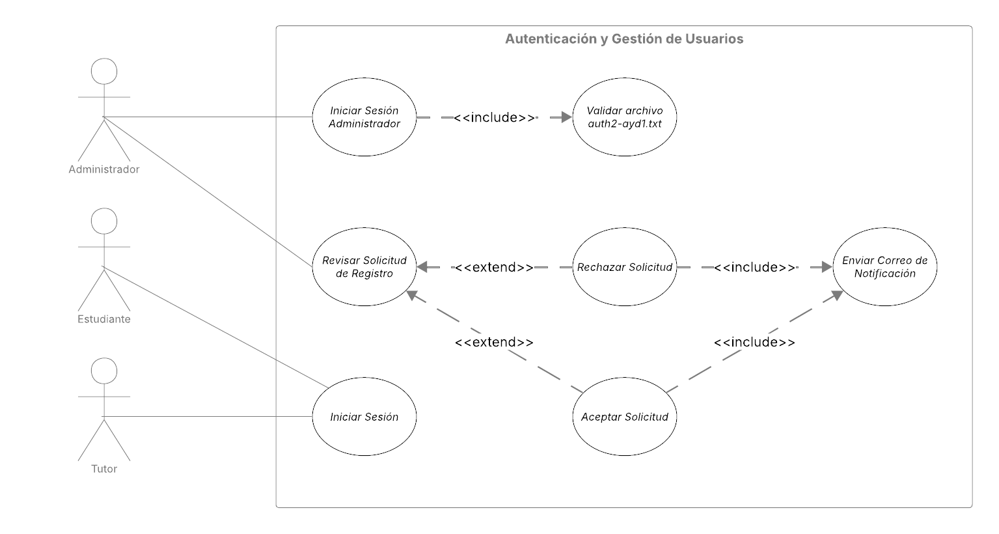
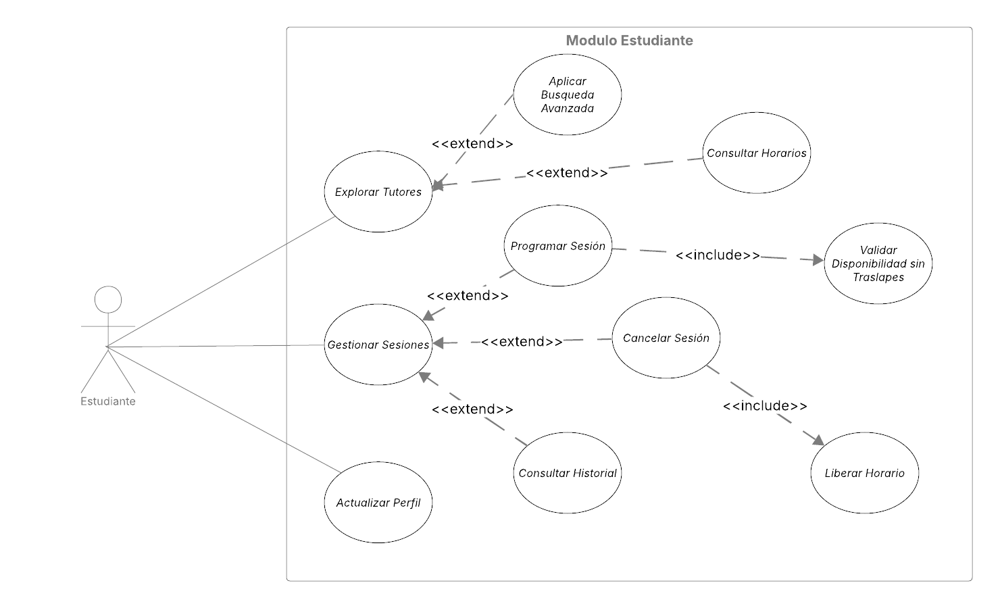
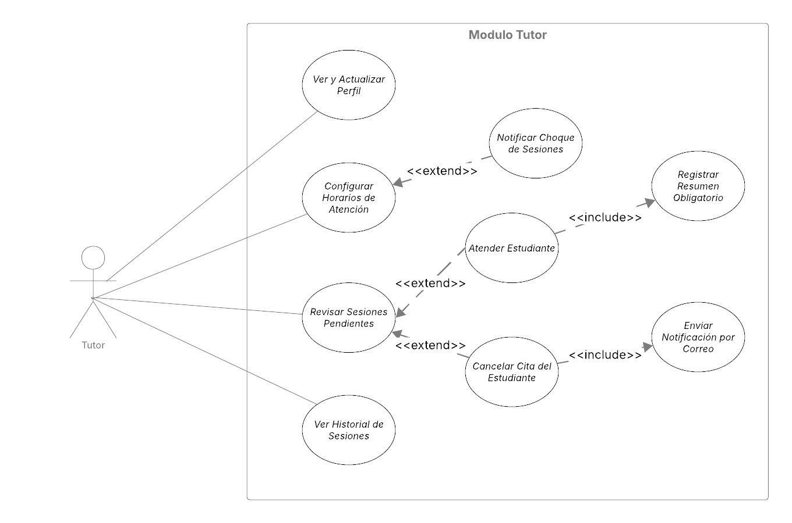

# Casos de Uso Expandidos

Este documento detalla la interacción a nivel del sistema para los procesos definidos en la primera descomposición. Se aplican relaciones de inclusión (`<<include>>`) para comportamientos obligatorios y extensión (`<<extend>>`) para comportamientos condicionales o excepciones, asegurando el cumplimiento de las reglas de negocio de EduConnect.

## 1. Módulo de Autenticación y Gestión de Usuarios

Este diagrama ilustra los flujos de seguridad y control de acceso, destacando la autenticación multifactor obligatoria para la administración y las notificaciones automáticas en el proceso de aprobación.

## 2. Módulo Estudiante

Representa la interacción del estudiante con el motor de reservas. Se hace énfasis en las validaciones internas obligatorias que el sistema ejecuta para garantizar la integridad de la agenda, evitando colisiones de horarios.

## 3. Módulo Tutor

Detalla la gestión operativa del tutor sobre su agenda y sus estudiantes. Incluye las acciones estrictas requeridas para dar por finalizada una sesión y los disparadores automáticos de comunicación hacia los estudiantes en caso de cancelaciones.

## 4. Módulo de Feedback de Sesiones

El caso de uso **Calificar tutor** se inicia desde el historial del estudiante.

- `<<include>>` **Validar sesión atendida**: comprueba que la sesión pertenece al estudiante y tiene estado `ATTENDED`.
- `<<include>>` **Validar rango de estrellas**: acepta únicamente valores enteros de 0 a 5.
- `<<include>>` **Persistir calificación**: registra una sola valoración por sesión en `reviews`.

## 5. Módulo de Integración Continua

El caso de uso técnico **Validar incremento** se ejecuta en GitHub Actions.

- `<<include>>` **Build**: construye la imagen Docker del backend y compila el frontend.
- `<<include>>` **Test**: ejecuta `npm test` después de completar Build.
- `<<extend>>` **Deploy**: se incorpora en el Sprint 2, después de cerrar las validaciones de Fase 2.
