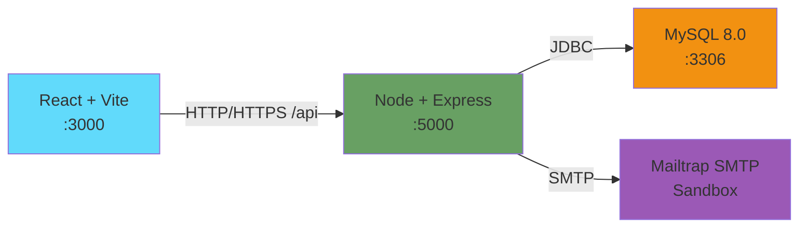

# Manual Técnico: Arquitectura, Despliegue y Especificación de API
## EduConnect — Plataforma de Gestión de Tutorías Académicas

---

## 1. Arquitectura General

### 1.1 Diagrama de Arquitectura



El sistema está compuesto por:
- **Frontend:** React 18+ con Vite, Tailwind CSS, responsivo.
- **Backend:** Node.js 20+ con Express, middleware de autenticación JWT, control transaccional.
- **Base de Datos:** MySQL 8.0 contenedorizado, persistencia en volumen Docker.
- **Correo:** Mailtrap Sandbox para notificaciones automáticas (desarrollo/testing).

Todos los componentes se orquestan mediante **Docker Compose v2**, permitiendo despliegue con un único comando.

---

## 2. Requisitos de Instalación

### 2.1 Hardware
- **RAM:** Mínimo 4 GB disponibles para Docker.
- **Almacenamiento:** 500 MB libres para imágenes y volumen de BD.
- **Procesador:** Dual-core o superior.

### 2.2 Software
- **Docker Desktop** v4.0+ con Docker Compose v2.0+.
- **Git** v2.30+.
- **Node.js** v20+ y npm (opcional, solo para desarrollo fuera de contenedores).

### 2.3 Puertos
- `3000` (React - Vite): Frontend.
- `5000` (Express): Backend API.
- `3306` (MySQL): Base de datos.

Verificar disponibilidad: `netstat -an | grep -E ':3000|:5000|:3306'`

---

## 3. Despliegue Local

### 3.1 Clonar y Configurar

```bash
# Clonar repositorio
git clone https://github.com/GabeKt/AYD1_2S_G4.git
cd AYD1_2S_G4

# Crear archivo .env desde plantilla
cp .env.example .env

# Verificar contenido (NO commitear credenciales reales)
cat .env
```

### 3.2 Construir y Levantar

```bash
# Construir imágenes y levantar servicios
docker compose up --build

# Esperado en los logs:
# ✓ db:    MySQL ready for connections
# ✓ backend: listening on port 5000
# ✓ frontend: ready in X ms
```

### 3.3 Verificar Despliegue

```bash
# En otra terminal, verificar salud del API
curl http://localhost:5000/api/health
# Respuesta esperada: { "status": "ok" }

# Verificar frontend
curl -I http://localhost:3000
# HTTP/1.1 200 OK
```

### 3.4 Detener Servicios

```bash
# Detener sin borrar datos
docker compose down

# Detener Y BORRAR volumen (solo para resetear BD desde cero)
# PÉRDIDA DE DATOS IRREVERSIBLE
docker compose down -v
```

### 3.5 Nota Especial: SELinux 

Si usa Linux y aparecen errores de permisos:

```bash
# Crear archivo docker-compose.override.yml
cat > docker-compose.override.yml << 'EOF'
version: '3.8'
services:
  db:
    volumes:
      - mysql_data:/var/lib/mysql:Z
  backend:
    volumes:
      - ./backend:/app/backend:Z
EOF

docker compose up --build
```

---

## 4. Variables de Entorno

Archivo `.env.example`:

```env
# Base de Datos
MYSQL_ROOT_PASSWORD=rootpassword123
MYSQL_DATABASE=educonnect
MYSQL_USER=educonnect_user
MYSQL_PASSWORD=user_password123
DB_HOST=db
DB_PORT=3306

# Backend
NODE_ENV=development
PORT=5000
CORS_ORIGIN=http://localhost:3000

# JWT
JWT_SECRET=tu_secreto_super_seguro_minimo_32_caracteres
JWT_EXPIRES_IN=24h

# Mailtrap SMTP
SMTP_HOST=sandbox.smtp.mailtrap.io
SMTP_PORT=2525
SMTP_USER=tu_mailtrap_usuario
SMTP_PASS=tu_mailtrap_password
SMTP_FROM=noreply@educonnect.local

# Admin 2FA
ADMIN_2FA_SECRET=hash_bcrypt_predefinido_del_admin
```

**Reglas:**
- Nunca subir `.env` a Git (ignorado en `.gitignore`).
- Usar `.env.example` como referencia.
- En desarrollo local, valores de ejemplo son aceptables.
- En producción, usar secretos seguros y variables del SO.

---

## 5. Modelo de Datos

### 5.1 Diagrama Entidad-Relación (3FN)

```mermaid
erDiagram
  USERS ||--o| STUDENT_PROFILES : "tiene"
  USERS ||--o| TUTOR_PROFILES : "tiene"
  TUTOR_PROFILES ||--o{ TUTOR_SUBJECTS : imparte
  SUBJECTS ||--o{ TUTOR_SUBJECTS : asignada
  TUTOR_PROFILES ||--o{ SCHEDULES : configura
  STUDENT_PROFILES ||--o{ SESSIONS : reserva
  TUTOR_PROFILES ||--o{ SESSIONS : atiende
  SUBJECTS ||--o{ SESSIONS : utiliza
  SESSIONS ||--o| REVIEWS : recibe
  STUDENT_PROFILES ||--o{ REVIEWS : escribe
  TUTOR_PROFILES ||--o{ REVIEWS : recibe

  USERS { 
    INT id PK
    VARCHAR email UK 
    VARCHAR password_hash 
    ENUM role 
    ENUM status 
    TIMESTAMP created_at
    TIMESTAMP updated_at
  }
  STUDENT_PROFILES { 
    INT id PK
    INT user_id FK
    VARCHAR nombre
    VARCHAR apellido
    VARCHAR carnet UK
    DATE fecha_nacimiento
    ENUM genero
    VARCHAR universidad
    VARCHAR carrera
    VARCHAR fotografia_url
  }
  TUTOR_PROFILES { 
    INT id PK
    INT user_id FK
    VARCHAR nombre
    VARCHAR apellido
    VARCHAR carnet UK
    VARCHAR identificacion UK
    DATE fecha_nacimiento
    ENUM genero
    VARCHAR fotografia_url
    VARCHAR especialidad
    VARCHAR direccion_tutoria
    YEAR anio_inicio_experiencia
    VARCHAR universidad
  }
  SUBJECTS { 
    INT id PK
    VARCHAR nombre UK
    BOOLEAN is_active
  }
  TUTOR_SUBJECTS { 
    INT tutor_id PK_FK
    INT subject_id PK_FK
  }
  SCHEDULES { 
    INT id PK
    INT tutor_id FK
    TINYINT day_of_week
    TIME start_time
    TIME end_time
    BOOLEAN is_active
  }
  SESSIONS { 
    INT id PK
    INT student_id FK
    INT tutor_id FK
    DATE session_date
    TIME start_time
    TIME end_time
    INT subject_id FK
    TEXT reason
    ENUM status
    TEXT summary
    TEXT recommendations
    TIMESTAMP created_at
    TIMESTAMP updated_at
  }
  REVIEWS { 
    INT id PK
    INT session_id UK_FK
    INT student_id FK
    INT tutor_id FK
    TINYINT rating
    TEXT comment
    TIMESTAMP created_at
  }
```

### 5.2 Diccionario de Datos

#### Tabla: `users`
| Campo | Tipo | Nulo | Restricción | Propósito |
|---|---|---|---|---|
| `id` | INT UNSIGNED | No | PK, AUTO_INCREMENT | Identificador único de usuario |
| `email` | VARCHAR(191) | No | UNIQUE | Credencial de acceso, sin duplicados |
| `password_hash` | VARCHAR(255) | No | — | Hash bcrypt (nunca texto plano) |
| `role` | ENUM('student','tutor','admin') | No | — | Rol del usuario |
| `status` | ENUM('PENDING','APPROVED','REJECTED','DISABLED') | No | DEFAULT 'PENDING' | Estado de aprobación |
| `created_at` | TIMESTAMP | No | DEFAULT CURRENT_TIMESTAMP | Auditoría |
| `updated_at` | TIMESTAMP | No | DEFAULT CURRENT_TIMESTAMP ON UPDATE | Auditoría |

**Índices:**
```sql
PRIMARY KEY (id)
UNIQUE KEY uk_email (email)
KEY idx_status (status)
KEY idx_role (role)
```

---

#### Tabla: `student_profiles`
| Campo | Tipo | Nulo | Restricción | Propósito |
|---|---|---|---|---|
| `id` | INT UNSIGNED | No | PK, AUTO_INCREMENT | Identificador del perfil |
| `user_id` | INT UNSIGNED | No | FK(users), UNIQUE | Relación 1:1 con usuario |
| `nombre` | VARCHAR(100) | No | — | Nombre del estudiante |
| `apellido` | VARCHAR(100) | No | — | Apellido del estudiante |
| `carnet` | VARCHAR(20) | No | UNIQUE | Identificación única institucional |
| `fecha_nacimiento` | DATE | Sí | — | Nacimiento |
| `genero` | ENUM('M','F','Otro') | Sí | — | Género |
| `universidad` | VARCHAR(100) | Sí | — | Institución de origen |
| `carrera` | VARCHAR(100) | Sí | — | Carrera actual |
| `fotografia_url` | VARCHAR(500) | Sí | — | URL de fotografía (opcional) |
| `created_at` | TIMESTAMP | No | DEFAULT CURRENT_TIMESTAMP | Auditoría |
| `updated_at` | TIMESTAMP | No | DEFAULT CURRENT_TIMESTAMP ON UPDATE | Auditoría |

**Índices:**
```sql
PRIMARY KEY (id)
UNIQUE KEY uk_user_id (user_id)
UNIQUE KEY uk_carnet (carnet)
KEY idx_nombre_apellido (nombre, apellido)
```

---

#### Tabla: `tutor_profiles`
| Campo | Tipo | Nulo | Restricción | Propósito |
|---|---|---|---|---|
| `id` | INT UNSIGNED | No | PK, AUTO_INCREMENT | Identificador del perfil |
| `user_id` | INT UNSIGNED | No | FK(users), UNIQUE | Relación 1:1 con usuario |
| `nombre` | VARCHAR(100) | No | — | Nombre del tutor |
| `apellido` | VARCHAR(100) | No | — | Apellido del tutor |
| `carnet` | VARCHAR(20) | No | UNIQUE | Carnet institucional |
| `identificacion` | VARCHAR(20) | No | UNIQUE | DPI o cédula |
| `fecha_nacimiento` | DATE | Sí | — | Nacimiento |
| `genero` | ENUM('M','F','Otro') | Sí | — | Género |
| `fotografia_url` | VARCHAR(500) | No | — | Foto obligatoria |
| `especialidad` | VARCHAR(100) | Sí | — | Especialidad profesional |
| `direccion_tutoria` | VARCHAR(200) | Sí | — | Lugar de tutoría |
| `anio_inicio_experiencia` | YEAR | Sí | — | Año de inicio en docencia |
| `universidad` | VARCHAR(100) | Sí | — | Universidad afiliada |
| `created_at` | TIMESTAMP | No | DEFAULT CURRENT_TIMESTAMP | Auditoría |
| `updated_at` | TIMESTAMP | No | DEFAULT CURRENT_TIMESTAMP ON UPDATE | Auditoría |

**Índices:**
```sql
PRIMARY KEY (id)
UNIQUE KEY uk_user_id (user_id)
UNIQUE KEY uk_carnet (carnet)
UNIQUE KEY uk_identificacion (identificacion)
KEY idx_nombre_apellido (nombre, apellido)
```

---

#### Tabla: `subjects`
| Campo | Tipo | Nulo | Restricción | Propósito |
|---|---|---|---|---|
| `id` | INT UNSIGNED | No | PK, AUTO_INCREMENT | Identificador de materia |
| `nombre` | VARCHAR(150) | No | UNIQUE | Nombre único de la materia |
| `is_active` | BOOLEAN | No | DEFAULT TRUE | Activa/inactiva |
| `created_at` | TIMESTAMP | No | DEFAULT CURRENT_TIMESTAMP | Auditoría |

**Índices:**
```sql
PRIMARY KEY (id)
UNIQUE KEY uk_nombre (nombre)
KEY idx_is_active (is_active)
```

---

#### Tabla: `tutor_subjects` (Relación N:M)
| Campo | Tipo | Nulo | Restricción | Propósito |
|---|---|---|---|---|
| `tutor_id` | INT UNSIGNED | No | PK, FK(tutor_profiles) | Identificador del tutor |
| `subject_id` | INT UNSIGNED | No | PK, FK(subjects) | Identificador de materia |
| `created_at` | TIMESTAMP | No | DEFAULT CURRENT_TIMESTAMP | Auditoría |

**Índices:**
```sql
PRIMARY KEY (tutor_id, subject_id)
KEY idx_subject_id (subject_id)
```

**Propósito:** Un tutor puede impartir múltiples materias; una materia puede ser impartida por múltiples tutores.

---

#### Tabla: `schedules` (Disponibilidad de Tutores)
| Campo | Tipo | Nulo | Restricción | Propósito |
|---|---|---|---|---|
| `id` | INT UNSIGNED | No | PK, AUTO_INCREMENT | Identificador del horario |
| `tutor_id` | INT UNSIGNED | No | FK(tutor_profiles) | Tutor propietario |
| `day_of_week` | TINYINT UNSIGNED | No | CHECK(1-7) | 1=Lunes … 7=Domingo |
| `start_time` | TIME | No | — | Hora inicio (HH:MM:SS) |
| `end_time` | TIME | No | CHECK(end_time > start_time) | Hora fin (HH:MM:SS) |
| `is_active` | BOOLEAN | No | DEFAULT TRUE | Horario activo |
| `created_at` | TIMESTAMP | No | DEFAULT CURRENT_TIMESTAMP | Auditoría |
| `updated_at` | TIMESTAMP | No | DEFAULT CURRENT_TIMESTAMP ON UPDATE | Auditoría |

**Índices:**
```sql
PRIMARY KEY (id)
UNIQUE KEY uk_tutor_day (tutor_id, day_of_week)
KEY idx_tutor_id (tutor_id)
KEY idx_day_of_week (day_of_week)
```

**Reglas:**
- Un tutor puede tener un rango horario distinto por cada día de la semana.
- `start_time` debe ser menor que `end_time`.
- Rango típico: 08:00 - 18:00 (8 horas máximo por día).

---

#### Tabla: `sessions` (Sesiones de Tutoría)
| Campo | Tipo | Nulo | Restricción | Propósito |
|---|---|---|---|---|
| `id` | INT UNSIGNED | No | PK, AUTO_INCREMENT | Identificador de sesión |
| `student_id` | INT UNSIGNED | No | FK(student_profiles) | Estudiante |
| `tutor_id` | INT UNSIGNED | No | FK(tutor_profiles) | Tutor asignado |
| `subject_id` | INT UNSIGNED | No | FK(subjects) | Materia a tutorar |
| `session_date` | DATE | No | — | Fecha de la sesión |
| `start_time` | TIME | No | — | Hora inicio |
| `end_time` | TIME | No | CHECK(end_time > start_time) | Hora fin |
| `reason` | TEXT | Sí | — | Motivo/tema de la tutoría |
| `status` | ENUM('PENDING','ATTENDED','CANCELLED_BY_STUDENT','CANCELLED_BY_TUTOR') | No | DEFAULT 'PENDING' | Estado actual |
| `summary` | TEXT | Sí | — | Resumen redactado por tutor (post-atención) |
| `recommendations` | TEXT | Sí | — | Recomendaciones del tutor |
| `created_at` | TIMESTAMP | No | DEFAULT CURRENT_TIMESTAMP | Auditoría |
| `updated_at` | TIMESTAMP | No | DEFAULT CURRENT_TIMESTAMP ON UPDATE | Auditoría |

**Índices:**
```sql
PRIMARY KEY (id)
UNIQUE KEY uk_session_no_conflict (student_id, session_date, start_time)
KEY idx_student_id (student_id)
KEY idx_tutor_id (tutor_id)
KEY idx_session_date (session_date)
KEY idx_status (status)
KEY idx_subject_id (subject_id)
KEY idx_tutor_date (tutor_id, session_date)
KEY idx_student_date (student_id, session_date)
```

**Reglas de Negocio:**
- No puede haber dos sesiones del mismo estudiante en el mismo intervalo de tiempo.
- No puede haber dos sesiones del mismo tutor en el mismo intervalo de tiempo.
- El intervalo debe estar dentro de los horarios disponibles del tutor para ese día.
- Solo tutores pueden cambiar estado a `ATTENDED` y llenar `summary` y `recommendations`.
- Estudiantes solo pueden cancelar sesiones con estado `PENDING`.

---

#### Tabla: `reviews` (Reseñas de Tutoría)
| Campo | Tipo | Nulo | Restricción | Propósito |
|---|---|---|---|---|
| `id` | INT UNSIGNED | No | PK, AUTO_INCREMENT | Identificador de reseña |
| `session_id` | INT UNSIGNED | No | FK(sessions), UNIQUE | Sesión asociada (una por sesión) |
| `student_id` | INT UNSIGNED | No | FK(student_profiles) | Estudiante que califica |
| `tutor_id` | INT UNSIGNED | No | FK(tutor_profiles) | Tutor calificado |
| `rating` | TINYINT UNSIGNED | No | CHECK(1-5) | Calificación numérica 1-5 |
| `comment` | TEXT | Sí | — | Comentario opcional |
| `created_at` | TIMESTAMP | No | DEFAULT CURRENT_TIMESTAMP | Auditoría |

**Índices:**
```sql
PRIMARY KEY (id)
UNIQUE KEY uk_session_id (session_id)
KEY idx_student_id (student_id)
KEY idx_tutor_id (tutor_id)
KEY idx_rating (rating)
```

---

### 5.3 Integridad Referencial

Todas las FK usan:
- **ON UPDATE CASCADE:** Si un usuario es modificado, sus datos en perfiles se actualizan.
- **ON DELETE RESTRICT:** Previene eliminar tutores/estudiantes si tienen sesiones activas.

```sql
ALTER TABLE student_profiles 
  ADD CONSTRAINT fk_student_user 
  FOREIGN KEY (user_id) REFERENCES users(id) 
  ON UPDATE CASCADE ON DELETE RESTRICT;

ALTER TABLE sessions 
  ADD CONSTRAINT fk_session_tutor 
  FOREIGN KEY (tutor_id) REFERENCES tutor_profiles(id) 
  ON UPDATE CASCADE ON DELETE RESTRICT;
```

---

## 6. Autenticación y Autorización

### 6.1 Flujo de Login

#### Estudiante y Tutor

```
POST /api/auth/login/student
{
  "email": "juan@example.com",
  "password": "MiPassword123"
}

VALIDAR:
  1. Usuario existe en BD con ese email
  2. Contraseña con bcrypt.compare()
  3. role === 'student'
  4. status === 'APPROVED'  ← ¡CRÍTICO! PENDING/REJECTED/DISABLED → 403

SI OK:
  → Generar JWT
  → Devolver { token, student: { id, studentId, email, nombre, apellido } }

SI FALLA:
  → 401 "Email o contraseña incorrectos"
  → 403 "Tu cuenta aún no ha sido aprobada"
```

#### Administrador (2FA)

**Fase 1: Primer login**
```
POST /api/auth/login/admin
{
  "email": "admin@example.com",
  "password": "AdminPassword123"
}

VALIDAR:
  1. Usuario existe
  2. Contraseña correcta con bcrypt
  3. role === 'admin'

SI OK:
  → Devolver { phase: 1, adminId: 1, email: "admin@example.com" }
  → ¡NO devolver JWT todavía!

SI FALLA:
  → 401 "Email o contraseña incorrectos"
```

**Fase 2: Segundo factor**
```
POST /api/auth/login/admin/2fa
Content-Type: multipart/form-data
{
  "file": <archivo "auth2-ayd1.txt">
}

VALIDAR:
  1. Archivo existe y nombre === "auth2-ayd1.txt"
  2. Contenido del archivo coincide con hash bcrypt almacenado
  3. bcrypt.compare(fileContent, ADMIN_2FA_SECRET) === true

SI OK:
  → Generar JWT con { id: 1, role: 'admin', email: "admin@example.com" }
  → Devolver { token, admin: { id, email } }

SI FALLA:
  → 401 "Archivo 2FA no válido"
  → 400 "Nombre de archivo incorrecto. Debe ser 'auth2-ayd1.txt'"
```

### 6.2 JWT (JSON Web Token)

**Estructura:**
```json
{
  "id": 1,
  "studentId": 5,
  "tutorId": null,
  "role": "student",
  "email": "juan@example.com",
  "status": "APPROVED",
  "iat": 1693920000,
  "exp": 1694006400
}
```

**Parámetros:**
- **`JWT_SECRET`:** Clave de firma (mínimo 32 caracteres, nunca en repositorio)
- **`JWT_EXPIRES_IN`:** Duración
  - Estudiantes/Tutores: `24h`
  - Admin: `8h`

**Middleware de Validación:**
```javascript
authenticateJWT(req, res, next) {
  const token = req.headers.authorization?.split(' ')[1];
  if (!token) return res.status(401).json({ message: 'No token' });
  
  try {
    const payload = jwt.verify(token, JWT_SECRET);
    req.user = payload;
    next();
  } catch (err) {
    return res.status(401).json({ message: 'Token inválido o expirado' });
  }
}
```

### 6.3 Control de Acceso por Rol

**Rutas Protegidas por Rol:**

```javascript
// Solo para estudiantes
app.get('/api/students/me/profile', 
  authenticateJWT, 
  authorizeRole('student'),
  getStudentProfile
);

// Solo para tutores
app.get('/api/tutors/me/profile', 
  authenticateJWT, 
  authorizeRole('tutor'),
  getTutorProfile
);

// Solo para admins
app.get('/api/admin/pending-students', 
  authenticateJWT, 
  authorizeRole('admin'),
  getPendingStudents
);
```

**Middleware de Autorización:**
```javascript
authorizeRole(allowedRoles) {
  return (req, res, next) => {
    if (!allowedRoles.includes(req.user.role)) {
      return res.status(403).json({ message: 'Acceso denegado' });
    }
    next();
  };
}
```

---

## 7. Especificación de Rutas - Autenticación

### 7.1 Registro de Estudiante (HU-001)

**Endpoint:**
```
POST /api/auth/register/student
Content-Type: application/json

{
  "email": "juan@example.com",
  "password": "MiPassword123",
  "confirmPassword": "MiPassword123",
  "nombre": "Juan",
  "apellido": "Pérez",
  "carnet": "202100001",
  "fecha_nacimiento": "2002-05-15",
  "genero": "M",
  "universidad": "USAC",
  "carrera": "Ingeniería en Sistemas"
}
```

**Validaciones (Backend):**
- Email formato válido y no duplicado
- Contraseña: 8+ caracteres, 1 mayúscula, 1 minúscula, 1 número
- `password === confirmPassword`
- Carnet: único en `student_profiles`
- Nombre y apellido: 2-100 caracteres

**Respuesta exitosa (201):**
```json
{
  "message": "Estudiante registrado correctamente. Espera la aprobación del administrador.",
  "student": {
    "id": 1,
    "email": "juan@example.com",
    "nombre": "Juan",
    "apellido": "Pérez",
    "carnet": "202100001",
    "status": "PENDING"
  }
}
```

**Errores:**
- `400`: Validación fallida → Campo específico y causa
- `409`: Email o carnet ya existe

---

### 7.2 Login de Estudiante (HU-006)

**Endpoint:**
```
POST /api/auth/login/student
Content-Type: application/json

{
  "email": "juan@example.com",
  "password": "MiPassword123"
}
```

**Validaciones:**
- Email existe en BD
- Contraseña válida (bcrypt.compare)
- `status === 'APPROVED'` ← CRÍTICO

**Respuesta exitosa (200):**
```json
{
  "token": "eyJhbGciOiJIUzI1NiIsInR5cCI6IkpXVCJ9...",
  "student": {
    "id": 1,
    "studentId": 5,
    "email": "juan@example.com",
    "nombre": "Juan",
    "apellido": "Pérez",
    "carnet": "202100001",
    "status": "APPROVED"
  },
  "expiresIn": "24h"
}
```

**Errores:**
- `401`: Email o contraseña incorrectos
- `403`: Cuenta no aprobada, rechazada o deshabilitada

---

### 7.3 Registro de Tutor (HU-002)

**Endpoint:**
```
POST /api/auth/register/tutor
Content-Type: multipart/form-data

{
  "email": "carlos@example.com",
  "password": "TutorPassword123",
  "confirmPassword": "TutorPassword123",
  "nombre": "Carlos",
  "apellido": "López",
  "carnet": "201900501",
  "identificacion": "12345678-0",
  "fecha_nacimiento": "1995-03-20",
  "genero": "M",
  "fotografia_url": <archivo JPG/PNG>,
  "especialidad": "Programación Web",
  "direccion_tutoria": "Centro Comercial, Avenida 5",
  "anio_inicio_experiencia": 2018,
  "universidad": "USAC"
}
```

**Validaciones:**
- Email único y formato válido
- Contraseña: 8+ caracteres, 1 mayúscula, 1 minúscula, 1 número
- Carnet único
- Identificación única (DPI o cédula)
- Fotografía obligatoria (JPG, PNG, < 5MB)
- Año de experiencia: 1950 ≤ año ≤ año actual

**Respuesta exitosa (201):**
```json
{
  "message": "Tutor registrado correctamente. Espera la aprobación del administrador.",
  "tutor": {
    "id": 1,
    "email": "carlos@example.com",
    "nombre": "Carlos",
    "apellido": "López",
    "carnet": "201900501",
    "status": "PENDING"
  }
}
```

---

### 7.4 Login de Tutor (HU-007)

Igual estructura que login de estudiante, pero:
- `POST /api/auth/login/tutor`
- Valida `role === 'tutor'`
- Devuelve `tutorId` en JWT

---

### 7.5 Login Admin Fase 1 (HU-003)

**Endpoint:**
```
POST /api/auth/login/admin
Content-Type: application/json

{
  "email": "admin@example.com",
  "password": "AdminPassword123"
}
```

**Respuesta exitosa (200):**
```json
{
  "phase": 1,
  "adminId": 1,
  "email": "admin@example.com",
  "message": "Completa el segundo factor con tu archivo auth2-ayd1.txt"
}
```

---

### 7.6 Login Admin Fase 2 (HU-003)

**Endpoint:**
```
POST /api/auth/login/admin/2fa
Content-Type: multipart/form-data

{
  "file": <archivo "auth2-ayd1.txt">,
  "adminId": 1
}
```

**Validaciones:**
- Archivo: nombre exacto `auth2-ayd1.txt`
- Contenido: hash bcrypt que coincida con `ADMIN_2FA_SECRET`

**Respuesta exitosa (200):**
```json
{
  "token": "eyJhbGciOiJIUzI1NiIsInR5cCI6IkpXVCJ9...",
  "admin": {
    "id": 1,
    "email": "admin@example.com",
    "role": "admin"
  },
  "expiresIn": "8h"
}
```

**Errores:**
- `400`: Nombre de archivo incorrecto
- `401`: Contenido del archivo no coincide

---

## 8. Especificación de Rutas - Horarios

### 8.1 Establecer Horario de Atención (HU-008)

**Endpoint:**
```
POST /api/tutors/schedules
Authorization: Bearer <token>
Content-Type: application/json

{
  "schedules": [
    {
      "day_of_week": 1,
      "start_time": "08:00",
      "end_time": "12:00"
    },
    {
      "day_of_week": 2,
      "start_time": "08:00",
      "end_time": "12:00"
    },
    {
      "day_of_week": 3,
      "start_time": "14:00",
      "end_time": "18:00"
    }
  ]
}
```

**Validaciones:**
- Tutor autenticado (`role === 'tutor'`)
- `day_of_week`: 1-7 (lunes-domingo)
- `start_time < end_time`
- Rango máximo: 8 horas por día
- Horario debe coincidir para todos los días seleccionados

**Respuesta exitosa (201):**
```json
{
  "message": "Horarios establecidos correctamente",
  "schedules": [
    { "id": 1, "day_of_week": 1, "start_time": "08:00", "end_time": "12:00" },
    { "id": 2, "day_of_week": 2, "start_time": "08:00", "end_time": "12:00" },
    { "id": 3, "day_of_week": 3, "start_time": "14:00", "end_time": "18:00" }
  ]
}
```

**Errores:**
- `400`: Validación fallida (día inválido, hora inconsistente, etc.)
- `401`: No autenticado

---

### 8.2 Actualizar Horario de Atención (HU-019)

**Endpoint:**
```
PUT /api/tutors/schedules
Authorization: Bearer <token>
Content-Type: application/json

{
  "schedules": [
    {
      "id": 1,
      "day_of_week": 1,
      "start_time": "09:00",
      "end_time": "13:00"
    }
  ]
}
```

**Validaciones Críticas:**
1. Tutor autenticado
2. Mismo horario para todos los días seleccionados
3. **No puede reducir rango si hay sesiones PENDING fuera del nuevo rango:**
   ```sql
   SELECT COUNT(*) FROM sessions 
   WHERE tutor_id = ? 
   AND status = 'PENDING'
   AND (
     HOUR(start_time) < ? OR HOUR(end_time) > ?
   )
   ```
   Si COUNT > 0 → `409 Conflict`: "No puedes reducir tu horario. Tienes sesiones activas fuera del nuevo rango."

**Respuesta exitosa (200):**
```json
{
  "message": "Horario actualizado correctamente",
  "schedules": [...]
}
```

**Errores:**
- `409`: Sesiones activas fuera del nuevo rango

---

### 8.3 Consultar Horarios del Tutor (HU-011)

**Endpoint:**
```
GET /api/tutors/:tutorId/schedules
Authorization: Bearer <token>
```

**Respuesta exitosa (200):**
```json
{
  "tutor": {
    "id": 3,
    "nombre": "Carlos",
    "apellido": "López",
    "especialidad": "Programación Web",
    "fotografia_url": "https://..."
  },
  "schedules": [
    {
      "id": 1,
      "day_of_week": 1,
      "day_name": "Lunes",
      "start_time": "08:00",
      "end_time": "12:00",
      "is_active": true
    },
    {
      "id": 2,
      "day_of_week": 2,
      "day_name": "Martes",
      "start_time": "08:00",
      "end_time": "12:00",
      "is_active": true
    },
    {
      "id": 3,
      "day_of_week": 3,
      "day_name": "Miércoles",
      "start_time": "14:00",
      "end_time": "18:00",
      "is_active": true
    }
  ]
}
```

---

## 9. Especificación de Rutas - Sesiones de Estudiante 

### 9.1 Programar Sesión de Tutoría (HU-012)

**Endpoint:**
```
POST /api/sessions
Authorization: Bearer <token>
Content-Type: application/json

{
  "tutor_id": 3,
  "subject_id": 5,
  "session_date": "2024-09-25",
  "start_time": "10:00",
  "end_time": "11:00",
  "reason": "Necesito ayuda con estructuras de datos"
}
```

**Validaciones Críticas (Motor Anti-Traslapes):**

1. **Tutor existe y está APPROVED**
2. **Fecha es hoy o futuro**
3. **Rango dentro de horario del tutor:**
   ```sql
   SELECT * FROM schedules 
   WHERE tutor_id = ? 
   AND day_of_week = DAYOFWEEK(?) 
   AND start_time <= ? 
   AND end_time >= ?
   ```
4. **No hay traslape con sesiones PENDING/ATTENDED del MISMO ESTUDIANTE:**
   ```sql
   SELECT COUNT(*) FROM sessions 
   WHERE student_id = ? 
   AND status IN ('PENDING', 'ATTENDED')
   AND session_date = ? 
   AND start_time < ? 
   AND end_time > ?
   ```
5. **No hay traslape con sesiones PENDING/ATTENDED del MISMO TUTOR:**
   ```sql
   SELECT COUNT(*) FROM sessions 
   WHERE tutor_id = ? 
   AND status IN ('PENDING', 'ATTENDED')
   AND session_date = ? 
   AND start_time < ? 
   AND end_time > ?
   ```

**Operación Transaccional:**
```javascript
BEGIN TRANSACTION
  INSERT INTO sessions (student_id, tutor_id, subject_id, session_date, start_time, end_time, reason, status)
  VALUES (?, ?, ?, ?, ?, ?, ?, 'PENDING')
  
  SELECT ... FOR UPDATE (lock para prevenir race condition)
COMMIT
```

**Respuesta exitosa (201):**
```json
{
  "message": "Sesión programada correctamente",
  "session": {
    "id": 42,
    "student_id": 5,
    "tutor_id": 3,
    "subject_id": 5,
    "subject_name": "Estructura de Datos",
    "tutor_name": "Carlos López",
    "session_date": "2024-09-25",
    "start_time": "10:00",
    "end_time": "11:00",
    "reason": "Necesito ayuda con estructuras de datos",
    "status": "PENDING"
  }
}
```

**Errores:**
- `400`: Validación de fechas/horas fallida
- `409`: Traslape detectado → "Ya tienes una sesión en ese horario"
- `404`: Tutor no existe

---

### 9.2 Ver Sesiones Activas del Estudiante (HU-013)

**Endpoint:**
```
GET /api/students/me/sessions/active
Authorization: Bearer <token>
```

**Respuesta exitosa (200):**
```json
{
  "sessions": [
    {
      "id": 42,
      "tutor_id": 3,
      "tutor_name": "Carlos López",
      "tutor_fotografia": "https://...",
      "subject_name": "Estructura de Datos",
      "session_date": "2024-09-25",
      "start_time": "10:00",
      "end_time": "11:00",
      "reason": "Necesito ayuda con estructuras de datos",
      "status": "PENDING",
      "days_until": 2
    }
  ],
  "count": 1
}
```

---

### 9.3 Cancelar Sesión por Estudiante (HU-016)

**Endpoint:**
```
DELETE /api/sessions/:sessionId
Authorization: Bearer <token>
Content-Type: application/json

{
  "reason": "Conflicto de horario"
}
```

**Validaciones:**
- Sesión pertenece al estudiante autenticado
- Estado es `PENDING` (no puede cancelar si ya fue atendida)
- Sesión no está en pasado

**Operación Transaccional:**
```
BEGIN TRANSACTION
  UPDATE sessions SET status = 'CANCELLED_BY_STUDENT' WHERE id = ?
  -- El horario automáticamente queda libre
COMMIT
```

**Respuesta exitosa (200):**
```json
{
  "message": "Sesión cancelada correctamente",
  "session": {
    "id": 42,
    "status": "CANCELLED_BY_STUDENT"
  }
}
```

**Errores:**
- `403`: Sesión no pertenece al estudiante
- `409`: No puedes cancelar una sesión atendida

---

### 9.4 Historial de Sesiones del Estudiante (HU-020)

**Endpoint:**
```
GET /api/students/me/sessions/history
Authorization: Bearer <token>
?page=1&limit=10&status=ATTENDED
```

**Parámetros opcionales:**
- `status`: ATTENDED, CANCELLED_BY_STUDENT, etc.
- `page`, `limit`: Paginación

**Respuesta exitosa (200):**
```json
{
  "sessions": [
    {
      "id": 40,
      "tutor_id": 3,
      "tutor_name": "Carlos López",
      "subject_name": "Estructura de Datos",
      "session_date": "2024-09-18",
      "start_time": "10:00",
      "end_time": "11:00",
      "status": "ATTENDED",
      "summary": "Se cubrieron: listas enlazadas, operaciones básicas (insert, delete). El estudiante mostró buen entendimiento. Se recomendó revisar pilas.",
      "recommendations": "Revisar pilas y colas antes de la próxima sesión.",
      "completed_at": "2024-09-18T11:15:00Z"
    }
  ],
  "pagination": {
    "page": 1,
    "limit": 10,
    "total": 15
  }
}
```

---

## 10. Especificación de Rutas - Sesiones de Tutor

### 10.1 Ver Sesiones Pendientes del Tutor (HU-014)

**Endpoint:**
```
GET /api/tutors/me/sessions/pending
Authorization: Bearer <token>
?sortBy=nearest
```

**Respuesta exitosa (200):**
```json
{
  "sessions": [
    {
      "id": 42,
      "student_id": 5,
      "student_name": "Juan Pérez",
      "subject_name": "Estructura de Datos",
      "session_date": "2024-09-25",
      "start_time": "10:00",
      "end_time": "11:00",
      "reason": "Necesito ayuda con estructuras de datos",
      "status": "PENDING",
      "minutes_until": 120
    }
  ],
  "count": 1
}
```

---

### 10.2 Marcar Sesión como Atendida (HU-015)

**Endpoint:**
```
PUT /api/sessions/:sessionId/attend
Authorization: Bearer <token>
Content-Type: application/json

{
  "summary": "Se cubrieron: listas enlazadas, operaciones básicas (insert, delete). El estudiante mostró buen entendimiento.",
  "recommendations": "Revisar pilas y colas antes de la próxima sesión."
}
```

**Validaciones:**
- Sesión pertenece al tutor autenticado
- Estado es `PENDING`
- `summary` y `recommendations` son obligatorios (mínimo 10 caracteres cada uno)

**Operación Transaccional:**
```
BEGIN TRANSACTION
  UPDATE sessions 
  SET status = 'ATTENDED', 
      summary = ?, 
      recommendations = ?, 
      updated_at = NOW()
  WHERE id = ?
COMMIT
```

**Respuesta exitosa (200):**
```json
{
  "message": "Sesión marcada como atendida",
  "session": {
    "id": 42,
    "status": "ATTENDED",
    "summary": "...",
    "recommendations": "...",
    "completed_at": "2024-09-25T11:15:00Z"
  }
}
```

---

### 10.3 Cancelar Sesión por Tutor (HU-017)

**Endpoint:**
```
DELETE /api/sessions/:sessionId/cancel-tutor
Authorization: Bearer <token>
Content-Type: application/json

{
  "reason": "Emergencia médica"
}
```

**Validaciones:**
- Sesión pertenece al tutor
- Estado es `PENDING`

**Operación Transaccional:**
```
BEGIN TRANSACTION
  UPDATE sessions SET status = 'CANCELLED_BY_TUTOR', reason = ? WHERE id = ?
  
  -- DISPARAR correo automático a estudiante (HU-018)
  INSERT INTO email_queue (type, recipient_id, data) 
  VALUES ('TUTOR_CANCELLED_SESSION', student_id, {...})
COMMIT
```

**Respuesta exitosa (200):**
```json
{
  "message": "Sesión cancelada y estudiante notificado por correo",
  "session": {
    "id": 42,
    "status": "CANCELLED_BY_TUTOR"
  }
}
```

---

### 10.4 Notificación por Correo de Cancelación (HU-018)

**Disparador:** `DELETE /api/sessions/:sessionId/cancel-tutor`

**Proceso:**
1. Tutor cancela sesión (véase 10.3)
2. Backend inserta registro en tabla `email_queue`
3. Servicio de correo (Mailtrap) procesa y envía email

**Plantilla HTML (Responsiva):**
```html
<!DOCTYPE html>
<html>
  <head>
    <style>
      body { font-family: Arial, sans-serif; background: #f5f5f5; }
      .container { max-width: 600px; margin: 0 auto; background: white; padding: 20px; }
      .header { background: #d32f2f; color: white; padding: 15px; text-align: center; }
      .content { padding: 20px; }
      .footer { background: #f5f5f5; padding: 10px; text-align: center; font-size: 12px; }
    </style>
  </head>
  <body>
    <div class="container">
      <div class="header">
        <h2>Sesión de Tutoría Cancelada</h2>
      </div>
      <div class="content">
        <p>Estimado <strong>{{ estudiante_nombre }}</strong>,</p>
        <p>Te informamos que tu sesión de tutoría ha sido cancelada por el tutor.</p>
        <table style="width: 100%; border-collapse: collapse; margin: 20px 0;">
          <tr style="background: #f5f5f5;">
            <td style="padding: 10px; border: 1px solid #ddd;"><strong>Materia:</strong></td>
            <td style="padding: 10px; border: 1px solid #ddd;">{{ materia }}</td>
          </tr>
          <tr>
            <td style="padding: 10px; border: 1px solid #ddd;"><strong>Fecha:</strong></td>
            <td style="padding: 10px; border: 1px solid #ddd;">{{ fecha }}</td>
          </tr>
          <tr style="background: #f5f5f5;">
            <td style="padding: 10px; border: 1px solid #ddd;"><strong>Hora:</strong></td>
            <td style="padding: 10px; border: 1px solid #ddd;">{{ hora_inicio }} - {{ hora_fin }}</td>
          </tr>
          <tr>
            <td style="padding: 10px; border: 1px solid #ddd;"><strong>Tutor:</strong></td>
            <td style="padding: 10px; border: 1px solid #ddd;">{{ tutor_nombre }}</td>
          </tr>
          <tr style="background: #f5f5f5;">
            <td style="padding: 10px; border: 1px solid #ddd;"><strong>Motivo:</strong></td>
            <td style="padding: 10px; border: 1px solid #ddd;">{{ motivo_cancelacion }}</td>
          </tr>
        </table>
        <p>Disculpa por cualquier inconveniente. El tutor se comunicará contigo para reprogramar la sesión si es necesario.</p>
        <p>Si tienes dudas, contacta al tutor o al administrador de la plataforma.</p>
        <p>¡Que tenga un excelente día!</p>
      </div>
      <div class="footer">
        <p>&copy; 2024 EduConnect. Plataforma de Gestión de Tutorías.</p>
      </div>
    </div>
  </body>
</html>
```

**Configuración Mailtrap:**
```env
SMTP_HOST=sandbox.smtp.mailtrap.io
SMTP_PORT=2525
SMTP_USER=tu_usuario_mailtrap
SMTP_PASS=tu_contraseña_mailtrap
SMTP_FROM=noreply@educonnect.local
```

---

### 10.5 Historial de Sesiones del Tutor (HU-021)

**Endpoint:**
```
GET /api/tutors/me/sessions/history
Authorization: Bearer <token>
?page=1&limit=10
```

**Respuesta exitosa (200):**
```json
{
  "sessions": [
    {
      "id": 40,
      "student_id": 5,
      "student_name": "Juan Pérez",
      "subject_name": "Estructura de Datos",
      "session_date": "2024-09-18",
      "start_time": "10:00",
      "end_time": "11:00",
      "status": "ATTENDED",
      "summary": "Se cubrieron listas enlazadas...",
      "recommendations": "Revisar pilas...",
      "badge": "✓ Completada"
    },
    {
      "id": 41,
      "student_id": 6,
      "student_name": "María García",
      "subject_name": "Algoritmos",
      "session_date": "2024-09-19",
      "start_time": "14:00",
      "end_time": "15:00",
      "status": "CANCELLED_BY_TUTOR",
      "badge": "✗ Cancelada por ti"
    }
  ],
  "pagination": { "page": 1, "limit": 10, "total": 25 }
}
```

---

## 11. Especificación de Rutas - Administración

### 11.1 Obtener Solicitudes Pendientes de Estudiantes (HU-004)

**Endpoint:**
```
GET /api/admin/students/pending
Authorization: Bearer <token>
?page=1&limit=20&sort=created_at
```

**Validaciones:**
- Admin autenticado con `role === 'admin'`

**Respuesta exitosa (200):**
```json
{
  "pending_students": [
    {
      "id": 1,
      "email": "juan@example.com",
      "nombre": "Juan",
      "apellido": "Pérez",
      "carnet": "202100001",
      "universidad": "USAC",
      "carrera": "Ingeniería en Sistemas",
      "created_at": "2024-09-20T10:15:00Z",
      "status": "PENDING"
    }
  ],
  "pagination": { "page": 1, "limit": 20, "total": 5 }
}
```

---

### 11.2 Aprobar o Rechazar Registro de Estudiante (HU-004)

**Endpoint:**
```
PUT /api/admin/students/:studentUserId/approve
Authorization: Bearer <token>
Content-Type: application/json

{
  "action": "APPROVED",  // o "REJECTED"
  "reason": "Datos verificados correctamente"  // Opcional para REJECTED
}
```

**Operación Transaccional:**
```
BEGIN TRANSACTION
  UPDATE users SET status = 'APPROVED' WHERE id = ? AND role = 'student'
  
  -- DISPARAR correo automático
  INSERT INTO email_queue (type, recipient_id, data)
  VALUES ('STUDENT_APPROVED', student_id, {...})
COMMIT
```

**Respuesta exitosa (200):**
```json
{
  "message": "Estudiante aprobado correctamente",
  "student": {
    "id": 1,
    "email": "juan@example.com",
    "status": "APPROVED"
  }
}
```

**Plantilla de Correo (Aprobación):**
```html
<h2>¡Tu registro ha sido aprobado!</h2>
<p>Felicidades {{ nombre }}, ya puedes acceder a la plataforma EduConnect.</p>
<p>Inicia sesión con tu email y contraseña.</p>
```

---

### 11.3 Solicitudes Pendientes de Tutores (HU-005)

Igual a HU-004 pero para tutores:
```
GET /api/admin/tutors/pending
PUT /api/admin/tutors/:tutorUserId/approve
```

---

### 11.4 Gestionar Estudiantes Aprobados (HU-024)

**Endpoint:**
```
GET /api/admin/students
Authorization: Bearer <token>
?page=1&limit=50&status=APPROVED&sort=nombre
```

**Respuesta exitosa (200):**
```json
{
  "students": [
    {
      "id": 1,
      "email": "juan@example.com",
      "nombre": "Juan",
      "apellido": "Pérez",
      "carnet": "202100001",
      "status": "APPROVED",
      "sessions_count": 5,
      "registered_at": "2024-09-20T10:15:00Z"
    }
  ]
}
```

**Dar de Baja (Deshabilitar):**
```
PUT /api/admin/students/:studentId/disable
Authorization: Bearer <token>

{
  "reason": "Solicitud del estudiante"
}
```

**Validación:** Cambiar estado de `APPROVED` a `DISABLED`. Estudiante no puede loguearse.

---

### 11.5 Gestionar Tutores Aprobados (HU-025)

Igual a HU-024 pero para tutores:
```
GET /api/admin/tutors
PUT /api/admin/tutors/:tutorId/disable
```

---

## 12. Especificación de Rutas - Búsqueda y Reportes

### 12.1 Visualizar Tutores Disponibles (HU-009)

**Endpoint:**
```
GET /api/tutors/available
Authorization: Bearer <token>
?page=1&limit=12
```

**Regla de Negocio Crítica:**
Excluir tutores con los que el estudiante autenticado YA TIENE una sesión `PENDING` o `ATTENDED`.

```sql
SELECT t.* FROM tutor_profiles t
INNER JOIN users u ON t.user_id = u.id
WHERE u.status = 'APPROVED'
AND t.id NOT IN (
  SELECT DISTINCT tutor_id FROM sessions
  WHERE student_id = ? AND status IN ('PENDING', 'ATTENDED')
)
LIMIT 12
```

**Respuesta exitosa (200):**
```json
{
  "tutors": [
    {
      "id": 3,
      "nombre": "Carlos",
      "apellido": "López",
      "especialidad": "Programación Web",
      "fotografia_url": "https://...",
      "anio_inicio_experiencia": 2018,
      "universidad": "USAC",
      "rating": 4.8,
      "sessions_completed": 25
    }
  ],
  "pagination": { "page": 1, "limit": 12, "total": 42 }
}
```

---

### 12.2 Búsqueda Avanzada de Tutores (HU-010)

**Endpoint:**
```
GET /api/tutors/search
Authorization: Bearer <token>

?subject=5
&experience_from=2015
&gender=M
&age_min=25
&age_max=50
&university=USAC
&page=1
&limit=12
```

**Parámetros:**
- `subject`: ID de materia
- `experience_from`: Año mínimo de experiencia
- `gender`: M, F, Otro
- `age_min`, `age_max`: Rango de edad
- `university`: Universidad
- Todos opcionales, se combinan con AND

**Respuesta exitosa (200):**
```json
{
  "tutors": [
    {
      "id": 3,
      "nombre": "Carlos",
      "apellido": "López",
      "especialidad": "Programación Web",
      "fotografia_url": "https://...",
      "subjects": ["Programación Web", "JavaScript", "React"],
      "rating": 4.8,
      "age": 29,
      "years_experience": 6,
      "university": "USAC"
    }
  ],
  "filters_applied": {
    "subject": "Programación Web",
    "experience_from": 2015,
    "gender": "M",
    "university": "USAC"
  }
}
```

---

### 12.3 Reporte: Tutores con Mayor Demanda (HU-026)

**Endpoint:**
```
GET /api/reports/tutors-demand
Authorization: Bearer <token>
?limit=10
```

**Query de Agregación:**
```sql
SELECT 
  t.id,
  t.nombre,
  t.apellido,
  COUNT(DISTINCT s.student_id) AS unique_students,
  COUNT(s.id) AS total_sessions,
  ROUND(COUNT(s.id) * 1.0 / 
    (SELECT COUNT(*) FROM sessions WHERE tutor_id = t.id), 2) AS completion_rate
FROM tutor_profiles t
INNER JOIN sessions s ON t.id = s.tutor_id
WHERE s.status = 'ATTENDED'
GROUP BY t.id
ORDER BY unique_students DESC
LIMIT 10
```

**Respuesta exitosa (200):**
```json
{
  "report": {
    "title": "Tutores con Mayor Demanda",
    "generated_at": "2024-09-30T15:00:00Z",
    "data": [
      {
        "rank": 1,
        "tutor_name": "Carlos López",
        "unique_students": 18,
        "total_sessions": 45,
        "completion_rate": 0.95,
        "percentage": "22.5%"
      },
      {
        "rank": 2,
        "tutor_name": "María García",
        "unique_students": 15,
        "total_sessions": 38,
        "completion_rate": 0.92,
        "percentage": "18.8%"
      }
    ],
    "total_tutors_evaluated": 8
  }
}
```

---

### 12.4 Reporte: Materias con Mayor Demanda (HU-027)

**Endpoint:**
```
GET /api/reports/subjects-demand
Authorization: Bearer <token>
```

**Query:**
```sql
SELECT 
  s.id,
  s.nombre,
  COUNT(DISTINCT sess.student_id) AS unique_students,
  COUNT(sess.id) AS total_sessions,
  ROUND(100 * COUNT(sess.id) / 
    (SELECT COUNT(*) FROM sessions), 2) AS percentage
FROM subjects s
LEFT JOIN sessions sess ON s.id = sess.subject_id
WHERE sess.status = 'ATTENDED'
GROUP BY s.id
ORDER BY total_sessions DESC
```

**Respuesta exitosa (200):**
```json
{
  "report": {
    "title": "Materias con Mayor Demanda",
    "generated_at": "2024-09-30T15:00:00Z",
    "data": [
      {
        "subject": "Algoritmos",
        "unique_students": 28,
        "total_sessions": 67,
        "percentage": 18.5
      },
      {
        "subject": "Estructura de Datos",
        "unique_students": 24,
        "total_sessions": 58,
        "percentage": 16.0
      }
    ],
    "total_subjects": 12,
    "total_sessions_analyzed": 363
  }
}
```

---

## 13. Especificación de Rutas - Perfiles

### 13.1 Ver Perfil de Estudiante (HU-022)

**Endpoint:**
```
GET /api/students/me/profile
Authorization: Bearer <token>
```

**Respuesta exitosa (200):**
```json
{
  "student": {
    "id": 1,
    "email": "juan@example.com",
    "nombre": "Juan",
    "apellido": "Pérez",
    "carnet": "202100001",
    "fecha_nacimiento": "2002-05-15",
    "genero": "M",
    "universidad": "USAC",
    "carrera": "Ingeniería en Sistemas",
    "fotografia_url": "https://..."
  }
}
```

---

### 13.2 Actualizar Perfil de Estudiante (HU-022)

**Endpoint:**
```
PUT /api/students/me/profile
Authorization: Bearer <token>
Content-Type: application/json

{
  "nombre": "Juan Pablo",
  "apellido": "Pérez García",
  "carnet": "202100001",
  "newPassword": "NuevaPassword123",
  "confirmPassword": "NuevaPassword123"
}
```

**Validaciones:**
- Nombre y apellido: 2-100 caracteres
- Carnet: único (validar que no exista otro)
- Email: **NO EDITABLE** (rechazar silenciosamente)
- Si se proporciona `newPassword`:
  - Debe ser diferente a actual
  - Cumplir criterios: 8+ chars, 1 mayúscula, 1 minúscula, 1 número
  - `confirmPassword` debe coincidir
  - Hashear con bcrypt antes de guardar

**Operación Transaccional:**
```
BEGIN TRANSACTION
  UPDATE student_profiles SET nombre = ?, apellido = ?, carnet = ? WHERE id = ?
  IF newPassword PROVIDED:
    UPDATE users SET password_hash = bcrypt(newPassword) WHERE id = ?
COMMIT
```

**Respuesta exitosa (200):**
```json
{
  "message": "Perfil actualizado correctamente",
  "student": {
    "id": 1,
    "email": "juan@example.com",
    "nombre": "Juan Pablo",
    "apellido": "Pérez García",
    "carnet": "202100001"
  }
}
```

**Errores:**
- `400`: Validación fallida
- `409`: Carnet ya existe en otro perfil

---

### 13.3 Ver Perfil de Tutor (HU-023)

**Endpoint:**
```
GET /api/tutors/me/profile
Authorization: Bearer <token>
```

**Respuesta exitosa (200):**
```json
{
  "tutor": {
    "id": 1,
    "email": "carlos@example.com",
    "nombre": "Carlos",
    "apellido": "López",
    "carnet": "201900501",
    "identificacion": "12345678-0",
    "especialidad": "Programación Web",
    "fotografia_url": "https://...",
    "direccion_tutoria": "Centro Comercial, Avenida 5",
    "anio_inicio_experiencia": 2018,
    "universidad": "USAC",
    "subjects": [
      { "id": 5, "nombre": "Programación Web" },
      { "id": 6, "nombre": "JavaScript" }
    ]
  }
}
```

---

### 13.4 Actualizar Perfil de Tutor (HU-023)

**Endpoint:**
```
PUT /api/tutors/me/profile
Authorization: Bearer <token>
Content-Type: application/json

{
  "nombre": "Carlos Alberto",
  "apellido": "López García",
  "especialidad": "Programación Web y Móvil",
  "direccion_tutoria": "Zona 10, Guatemala",
  "newPassword": "NuevaPassword123",
  "confirmPassword": "NuevaPassword123"
}
```

**Validaciones:**
- Carnet e identificación: NO editables
- Email: NO editable
- Especialidad: 5-200 caracteres
- Contraseña: mismo criterio que HU-022

**Respuesta exitosa (200):**
```json
{
  "message": "Perfil de tutor actualizado correctamente",
  "tutor": {
    "id": 1,
    "nombre": "Carlos Alberto",
    "apellido": "López García",
    "especialidad": "Programación Web y Móvil"
  }
}
```

---

## 14. Manejo de Errores Estándar

### 14.1 Códigos HTTP

| Código | Caso | Ejemplo |
|--------|------|---------|
| `200 OK` | Operación exitosa sin cambios | GET |
| `201 Created` | Recurso creado exitosamente | POST /register |
| `204 No Content` | Operación exitosa, sin body | DELETE |
| `400 Bad Request` | Validación fallida | Email inválido |
| `401 Unauthorized` | No autenticado o JWT inválido | Falta token |
| `403 Forbidden` | Autenticado pero sin permiso | Estudiante accede ruta admin |
| `404 Not Found` | Recurso no existe | Tutor ID inválido |
| `409 Conflict` | Conflicto de datos o regla de negocio | Traslape de sesiones |
| `500 Internal Server Error` | Error del servidor | Excepción no manejada |

### 14.2 Estructura de Respuesta de Error

**Formato:**
```json
{
  "error": true,
  "message": "Descripción legible del error",
  "code": "CONFLICT_SCHEDULE",
  "details": {
    "field": "start_time",
    "reason": "Ya tienes una sesión en ese horario"
  },
  "timestamp": "2024-09-25T10:30:00Z"
}
```

### 14.3 Mensajes de Error Comunes

```javascript
// Autenticación
401: { message: "Email o contraseña incorrectos" }
403: { message: "Tu cuenta aún no ha sido aprobada" }

// Validación
400: { message: "Contraseña debe tener 8+ caracteres, 1 mayúscula, 1 minúscula, 1 número" }
400: { message: "Email debe ser válido" }

// Conflictos
409: { message: "Ya tienes una sesión en ese horario" }
409: { message: "Carnet ya está registrado" }
409: { message: "No puedes reducir tu horario. Tienes sesiones activas." }

// Recursos no encontrados
404: { message: "Tutor no encontrado" }
404: { message: "Sesión no encontrada" }
```

---

## 15. Seguridad

### 15.1 Hash de Contraseñas

**Librería:** `bcryptjs` v2.4+

```javascript
const bcrypt = require('bcryptjs');

// Al registrar o cambiar contraseña
const hash = await bcrypt.hash(password, 10);  // 10 rounds
await db.query('INSERT INTO users (password_hash) VALUES (?)', [hash]);

// Al validar login
const isValid = await bcrypt.compare(password, storedHash);
```

**Parámetros:**
- **Rounds:** 10 (~ 100 ms por hash en CPU i5 de 5 años)
- **Nunca:** almacenar, loguear o transmitir en claro

### 15.2 Criterios de Validación de Contraseña

```regex
^(?=.*[A-Z])(?=.*[a-z])(?=.*\d)[A-Za-z\d@$!%*?&]{8,}$
```

- Mínimo 8 caracteres
- Al menos 1 letra mayúscula
- Al menos 1 letra minúscula
- Al menos 1 dígito
- Caracteres permitidos: A-Za-z0-9@$!%*?&

### 15.3 JWT Security

```javascript
// Firma
const token = jwt.sign(
  { id, role, email, status },
  process.env.JWT_SECRET,
  { expiresIn: '24h' }
);

// Verificación
jwt.verify(token, process.env.JWT_SECRET);
```

**Reglas:**
- `JWT_SECRET` >= 32 caracteres (generar: `openssl rand -base64 32`)
- Nunca publicar `JWT_SECRET` en repositorio
- Usar HTTPS en producción
- Tokens expiran automáticamente

### 15.4 CORS (Cross-Origin Resource Sharing)

```javascript
const cors = require('cors');

app.use(cors({
  origin: process.env.CORS_ORIGIN || 'http://localhost:3000',
  credentials: true,
  methods: ['GET', 'POST', 'PUT', 'DELETE'],
  allowedHeaders: ['Content-Type', 'Authorization']
}));
```

### 15.5 Rate Limiting (Opcional pero Recomendado)

Para prevenir fuerza bruta en login:

```javascript
const rateLimit = require('express-rate-limit');

const loginLimiter = rateLimit({
  windowMs: 15 * 60 * 1000,  // 15 minutos
  max: 5,                      // 5 intentos máximo
  message: 'Demasiados intentos de login. Intenta más tarde.'
});

app.post('/api/auth/login/student', loginLimiter, loginStudentHandler);
```

### 15.6 Validación de Entrada (Input Sanitization)

```javascript
const { body, validationResult } = require('express-validator');

app.post('/api/auth/register/student',
  body('email').isEmail().trim().toLowerCase(),
  body('nombre').trim().escape().isLength({ min: 2, max: 100 }),
  body('password').isLength({ min: 8 }).matches(/^(?=.*[A-Z])(?=.*[a-z])(?=.*\d)/),
  (req, res) => {
    const errors = validationResult(req);
    if (!errors.isEmpty()) {
      return res.status(400).json({ errors: errors.array() });
    }
    // ... continuar
  }
);
```

---

## 16. Logging y Auditoría

### 16.1 Eventos Auditables

```
[INFO] Usuario 5 registrado como STUDENT - juan@example.com
[INFO] Administrador 1 aprobó estudiante 5
[WARN] Intento de login fallido para student 5 (3/5 intentos)
[INFO] Sesión 42 programada: Student 5, Tutor 3, 2024-09-25 10:00-11:00
[ERROR] Transacción fallida en programación de sesión: Race condition detectada
```

### 16.2 Configuración de Logger

```javascript
const winston = require('winston');

const logger = winston.createLogger({
  level: process.env.LOG_LEVEL || 'info',
  format: winston.format.json(),
  transports: [
    new winston.transports.File({ filename: 'logs/error.log', level: 'error' }),
    new winston.transports.File({ filename: 'logs/combined.log' }),
    new winston.transports.Console({ format: winston.format.simple() })
  ]
});
```

---

## 17. Desempeño y Escalabilidad

### 17.1 Índices Críticos

```sql
-- Autenticación
CREATE INDEX idx_users_email ON users(email);

-- Búsqueda de tutores
CREATE INDEX idx_tutor_subjects ON tutor_subjects(tutor_id, subject_id);

-- Anti-traslapes
CREATE INDEX idx_sessions_tutor_date_time 
  ON sessions(tutor_id, session_date, start_time, end_time);
CREATE INDEX idx_sessions_student_date_time 
  ON sessions(student_id, session_date, start_time, end_time);

-- Reportes
CREATE INDEX idx_sessions_status ON sessions(status);
CREATE INDEX idx_sessions_tutor_status ON sessions(tutor_id, status);
```

### 17.2 Conexión a BD con Pool

```javascript
const mariadb = require('mariadb');

const pool = mariadb.createPool({
  host: process.env.DB_HOST,
  user: process.env.MYSQL_USER,
  password: process.env.MYSQL_PASSWORD,
  database: process.env.MYSQL_DATABASE,
  connectionLimit: 5,
  waitForConnections: true,
  connectionTimeout: 10000,
  idleTimeout: 60000
});
```

### 17.3 Caching de Horarios y Materias

Usar Redis (opcional):

```javascript
const redis = require('redis');
const client = redis.createClient();

// Cachear lista de materias activas
app.get('/api/subjects', async (req, res) => {
  const cached = await client.get('subjects:all');
  if (cached) return res.json(JSON.parse(cached));
  
  const subjects = await db.query('SELECT * FROM subjects WHERE is_active = TRUE');
  await client.setex('subjects:all', 3600, JSON.stringify(subjects));
  res.json(subjects);
});
```

---

## 18. Testing Sugerido

### 18.1 Pruebas Unitarias (Jest)

```bash
npm test -- --coverage
```

**Archivos a testear:**
- `utils/password.js` → hashPassword, comparePassword
- `utils/validation.js` → validEmail, validatePassword
- `utils/antiOverlap.js` → Lógica de anti-traslapes

### 18.2 Pruebas de Integración (Supertest)

```javascript
// test/integration/auth.test.js
const request = require('supertest');
const app = require('../../index');

describe('Authentication - Student Login', () => {
  test('Should reject PENDING student', async () => {
    const res = await request(app)
      .post('/api/auth/login/student')
      .send({ email: 'pending@example.com', password: 'password' });
    
    expect(res.statusCode).toBe(403);
    expect(res.body.message).toContain('aprobada');
  });

  test('Should accept APPROVED student', async () => {
    const res = await request(app)
      .post('/api/auth/login/student')
      .send({ email: 'approved@example.com', password: 'password' });
    
    expect(res.statusCode).toBe(200);
    expect(res.body.token).toBeDefined();
  });
});
```

### 18.3 Pruebas de Carga (Artillery)

```yaml
# load-test.yml
config:
  target: "http://localhost:5000"
  phases:
    - duration: 60
      arrivalRate: 10
      name: "Ramp up"

scenarios:
  - name: "Login concurrente"
    flow:
      - post:
          url: "/api/auth/login/student"
          json:
            email: "student@example.com"
            password: "Password123"
```

```bash
artillery run load-test.yml
```


