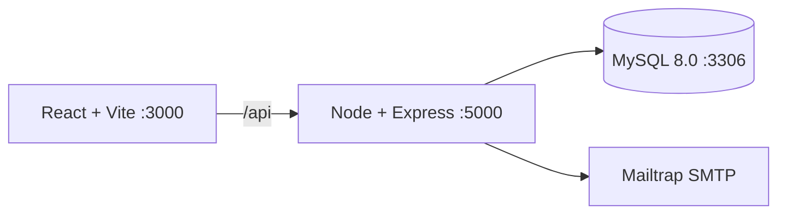

# Manual técnico: Docker y MySQL 8.0

## Arquitectura



`docker-compose.yml` levanta tres servicios: `frontend`, `backend` y `db`. El volumen `mysql_data` conserva la información y `backend/init.sql` se ejecuta al inicializar un volumen nuevo.

## Requisitos

- Docker Desktop con Compose v2.
- Git y Node.js 20+ para desarrollo fuera de contenedores.
- Puertos libres 3000 (Frontend Nginx/Vite), 5000 (API) y 3306/3307 (MySQL).
- 4 GB de RAM disponibles para Docker y conexión de red durante la instalación de imágenes.

## Despliegue local

```bash
git clone https://github.com/GabeKt/AYD1_2S_G4.git
cd AYD1_2S_G4
cp .env.example .env
docker compose up --build
```

La API responde en `http://localhost:5000/api/health` y el frontend en `http://localhost:3000`. Para detener los servicios:

```bash
docker compose down
```

**Nota Fedora/SELinux:** crear `docker-compose.override.yml` con `:Z` en los volúmenes para resolver permisos.

No se debe usar `docker compose down -v` salvo que se quiera borrar el volumen y recrear el esquema desde cero.

### Instancia temporal de MySQL sin Docker en Windows

Para validar localmente los flujos de la Fase 2 también se puede utilizar una instancia temporal de MySQL Server instalada en el equipo. En la validación del 17 de octubre de 2026 se utilizó MySQL 8.4 en `127.0.0.1:3307`, con un directorio de datos temporal fuera del repositorio. El backend se conectó usando las variables `DB_HOST`, `DB_PORT`, `DB_USER`, `DB_PASSWORD` y `DB_NAME` del archivo `.env`.

La base se inicializó con `backend/init.sql` y se cargaron datos de prueba de `backend/seeds_fase2_metrics.sql`. Esta instancia es únicamente para pruebas locales; no forma parte del despliegue ni reemplaza la base de datos del ambiente productivo. Al finalizar la validación, se puede detener el proceso `mysqld` y eliminar el directorio temporal de datos.

## Variables de entorno

| Variable | Uso |
| :--- | :--- |
| `MYSQL_ROOT_PASSWORD` | Contraseña del usuario root del contenedor |
| `MYSQL_DATABASE` | Base de datos, normalmente `educonnect` |
| `MYSQL_USER` / `MYSQL_PASSWORD` | Credenciales de la aplicación |
| `DB_HOST`, `DB_PORT` | Conexión del backend al servicio `db` |
| `JWT_SECRET`, `JWT_EXPIRES_IN` | Firma y duración del token |
| `CORS_ORIGIN` | Origen permitido del frontend |
| `VITE_API_URL` | URL base del API REST inyectada en el frontend en tiempo de build |
| `SMTP_HOST`, `SMTP_PORT`, `SMTP_USER`, `SMTP_PASS` | Sandbox Mailtrap |

Las credenciales reales nunca se deben subir al repositorio; usar `.env.example` como plantilla.

## Configuración de Mailtrap (correos de verificación y notificaciones)

EduConnect envía correos de token de verificación, aprobación/rechazo de cuentas y cancelación de sesiones. En desarrollo y pruebas se usa el sandbox SMTP de Mailtrap, que captura los correos sin entregarlos a destinatarios reales.

1. Crear una cuenta en Mailtrap y abrir (o crear) un *Inbox* dentro de *Email Testing*.
2. En la pestaña de integración del inbox, elegir SMTP y copiar el host, el puerto, el usuario y la contraseña.
3. Pegar esos valores en `.env` como `SMTP_HOST`, `SMTP_PORT`, `SMTP_USER` y `SMTP_PASS`.
4. Reiniciar el backend (`docker compose up --build`) para que tome las variables.
5. Registrar un usuario de prueba y verificar que el correo con el token llegue al inbox de Mailtrap.

Las credenciales SMTP no se versionan; solo se documentan los nombres de las variables en `.env.example`.

## Contratos de autenticación

### Registro e ingreso de estudiante (HU-001, HU-006)

- `POST /api/auth/register/student`: registra estudiante con validación de contraseña (8+ caracteres, mayúscula, minúscula, número). Crea usuario en estado `PENDING` y perfil de estudiante (nombre, apellido, carnet).
- `POST /api/auth/login/student`: devuelve JWT **solo si el estudiante está `APPROVED`**. Rechaza si está `PENDING`, `REJECTED` o `DISABLED`. El JWT contiene `{ id, studentId, role: "student", email, status }`.

### Autenticación admin con 2FA (HU-003)

**Fase 1: login inicial**

- `POST /api/auth/login/admin`: valida email y contraseña. Si son correctas, devuelve `{ phase: 1, adminId, email }` (sin JWT).

**Fase 2: segundo factor**

- `POST /api/auth/login/admin/2fa`: recibe el archivo `auth2-ayd1.txt` (multipart). Valida:
  - Nombre exacto del archivo.
  - Que el contenido coincida con el hash bcrypt predefinido (contraseña 2FA).
  - Si es válido, genera y devuelve un JWT con `{ id, role: "admin", email, status }`.

**Seguridad del 2FA:**

- El archivo contiene un hash bcrypt (no una contraseña en texto plano).
- La contraseña 2FA es **diferente** a la del primer login.
- Sin el segundo factor, el admin NO obtiene JWT y no puede acceder.

### Rutas de tutor

- `POST /api/auth/register/tutor`: multipart con fotografía y CV en PDF obligatorios; crea usuario `PENDING`.
- `POST /api/auth/login/tutor`: devuelve JWT si está `APPROVED`. El JWT contiene `{ id, tutorId, role: "tutor", email, status }`.

### Ruta protegida de admin

- `GET /api/auth/admin/profile`: requiere JWT válido con `role: "admin"`. Responde con datos públicos del admin.

## Autenticación y autorización

### JWT (JSON Web Token)

Todos los tokens se firman con `JWT_SECRET` y expiran según `JWT_EXPIRES_IN` (por defecto 24 h para estudiantes y 8 h para tutores).

**Estructura del payload:**

```jsonc
{
  "id": 1,                    // users.id
  "studentId": 5,             // student_profiles.id (solo en login estudiante)
  "tutorId": 3,               // tutor_profiles.id (solo en login tutor)
  "role": "student|tutor|admin",
  "email": "user@example.com",
  "status": "APPROVED|PENDING|REJECTED|DISABLED"
}
```

### Control de acceso

Todas las rutas privadas requieren el encabezado:

```http
Authorization: Bearer <token>
```

El backend valida y extrae el payload. Middlewares como `authenticateJWT` y `authorizeAdmin` garantizan:

- Token válido y no expirado.
- Rol correcto (un admin solo accede a rutas de admin).
- Estado `APPROVED` (rechaza `PENDING`, `REJECTED` y `DISABLED`).

## Persistencia y migraciones

`backend/init.sql` es idempotente para un volumen nuevo mediante `CREATE TABLE IF NOT EXISTS`. Incluye el seed del admin con hash 2FA.

Si el volumen ya existía antes de una modificación estructural, se debe crear una migración SQL explícita o recrear el volumen en desarrollo; nunca se deben borrar datos de producción.

## Seguridad

### Contraseñas

Las contraseñas se transforman con **bcrypt (10 rounds)** antes de insertarse o actualizarse:

- Registros: el hash se guarda en `users.password_hash`.
- Logins: `comparePassword()` valida sin desencriptar.

### Validación de contraseña

Estudiantes y tutores deben cumplir:

- Mínimo 8 caracteres.
- Al menos 1 mayúscula.
- Al menos 1 minúscula.
- Al menos 1 número.

### Estados de usuario

- `PENDING`: registrado pero no aprobado por el admin. Acceso denegado.
- `APPROVED`: aprobado. Acceso permitido.
- `REJECTED`: rechazado por el admin. Acceso denegado.
- `DISABLED`: desactivado. Acceso denegado.

Solo los usuarios `APPROVED` pueden iniciar sesión exitosamente.

---

# FASE 2

## Módulo de seguridad, tokens criptográficos y carga de archivos (Paquete A)

### 1. Generación y validación de tokens alfanuméricos

- **Entropía segura:** se utiliza el módulo nativo `crypto.randomBytes` para generar tokens de 6 caracteres basados en el alfabeto base 32 sin caracteres ambiguos (`ABCDEFGHJKLMNPQRSTUVWXYZ23456789`).
- **Ciclo de verificación dual:**
  - Al registrarse, el usuario se inserta con `email_verified = FALSE` y `verification_token = <TOKEN>`.
  - En el primer inicio de sesión, el backend compara de forma insensible a mayúsculas el token ingresado y valida que `status = 'APPROVED'`.
  - Tras la validación exitosa se ejecuta:

    ```sql
    UPDATE users SET email_verified = TRUE, verification_token = NULL WHERE id = ?;
    ```

  - En llamadas subsecuentes, al detectar `email_verified = TRUE`, no se solicita token.

### 2. Gestión de subida de archivos y nomenclatura UUID

- **Multer storage:** configurado en `studentRegistrationUpload.js` para almacenar los archivos en:
  - Fotografías: `/uploads/students/`
  - Carnets escaneados: `/uploads/documents/carnets/`
- **Nombres inmutables:** los archivos se renombran como `${Date.now()}-${crypto.randomUUID()}.pdf` para evitar colisiones y sobreescrituras accidentales.
- **Filtro MIME:** validación a nivel de cabecera que rechaza cualquier archivo que no coincida con `application/pdf` para carnets, o con `image/jpeg`, `image/png` e `image/webp` para fotos, con un límite físico de 5 MB.

---

## Módulo de CV de tutor, visores PDF incrustados y despliegue cloud (Paquete B)

### 1. Carga de CV de tutor y streaming seguro de documentos (HU-029, HU-039, HU-040)

- **Middleware de registro de tutor (`tutorRegistrationUpload.js`):** procesa de forma simultánea la fotografía (`fotografia`) en `/uploads/tutors/` y el currículum (`cv`) en `/uploads/documents/cvs/`. Asigna nombres únicos con `crypto.randomUUID()` y aplica un límite de 5 MB por archivo. Si ocurre un error de validación en el controlador, los archivos parciales se eliminan automáticamente del disco.
- **Endpoints de streaming inline (`documentController.js`):**
  - `GET /api/documents/carnets/:filename`
  - `GET /api/documents/cvs/:filename`

  Ambos limpian el parámetro con `path.basename` para evitar ataques de *path traversal* y configuran `Content-Type: application/pdf` y `Content-Disposition: inline; filename="..."`. Así, el componente `<PdfViewer />` renderiza el documento en un `<iframe>` dentro del panel administrativo sin forzar la descarga.

### 2. Contenedorización multi-stage del frontend (HU-050)

- **`frontend/Dockerfile`:**
  - Etapa 1 (`builder`): imagen `node:20-alpine` que instala dependencias, recibe `ARG VITE_API_URL` y ejecuta `npm run build`.
  - Etapa 2 (`production`): imagen `nginx:alpine` que sirve los estáticos desde `/usr/share/nginx/html` en el puerto 80 (mapeado al 3000 en `docker-compose.yml`).
- **`frontend/nginx.conf`:** incluye `try_files $uri $uri/ /index.html;` para el enrutamiento SPA de React Router y habilita `/healthz`, que trabaja junto con `GET /api/health` del backend para verificar la disponibilidad de los contenedores.

### 3. Despliegue del frontend en la nube (Render)

El frontend se publica en Render como contenedor Docker, definido de forma declarativa en `frontend/render.yaml` (plan Free).

1. Subir los cambios a GitHub y conectar el repositorio en Render (*New → Blueprint*, o *New → Web Service* con runtime Docker apuntando al directorio `frontend`).
2. Definir la variable `VITE_API_URL` con la URL pública del backend. Se usa en tiempo de build, por lo que cualquier cambio requiere un nuevo despliegue.
3. Configurar el *health check path* en `/healthz`.
4. Esperar el build; Render publica el servicio bajo una URL HTTPS pública.
5. Verificar abriendo la URL, recargando una ruta profunda (por ejemplo `/admin`) para comprobar el `try_files`, y confirmando que las peticiones llegan al backend.
6. Ajustar `CORS_ORIGIN` del backend para permitir el origen de la URL pública del frontend.

### 4. Ejecución de suites de pruebas

**Pruebas unitarias del backend:**

```bash
cd backend
npm test
```

**Pruebas end-to-end con Cypress (6 flujos E2E):**

```bash
cd frontend
npx cypress open   # modo interactivo
npx cypress run    # modo headless, para evidencias
```

Para las pruebas E2E el backend y la base de datos deben estar levantados (`docker compose up --build -d`) y el frontend accesible en `http://localhost:3000`.
