# Manual de Usuario — EduConnect

EduConnect es la plataforma que conecta a estudiantes con tutores para agendar y dar seguimiento a sesiones de tutoría. Este manual explica, con ilustraciones, cómo usar la plataforma según tu rol: estudiante, tutor o administrador.

---

## Módulo Estudiante

### Crear tu cuenta de estudiante

Al abrir EduConnect, pulsa el botón **"Registrarse como Estudiante"**. Llena el formulario con tu nombre, apellido, carnet, correo y una contraseña. Por seguridad, la contraseña debe tener al menos 8 caracteres e incluir una letra mayúscula, una minúscula y un número.

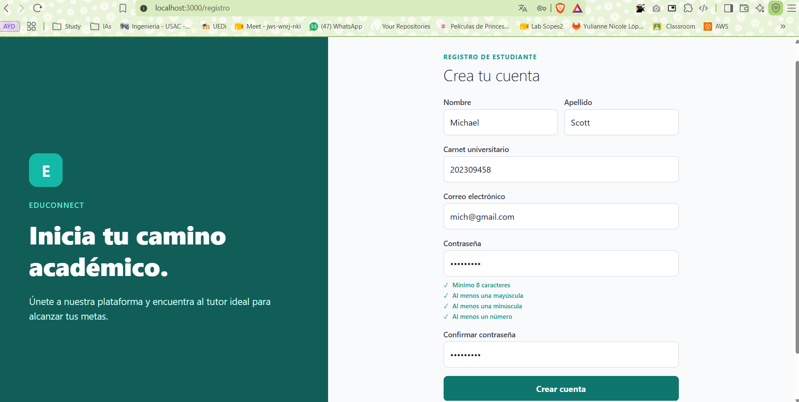

Cuando envíes el formulario, tu cuenta quedará en espera de que un administrador la apruebe. Verás un mensaje de confirmación indicando que tu registro fue recibido.

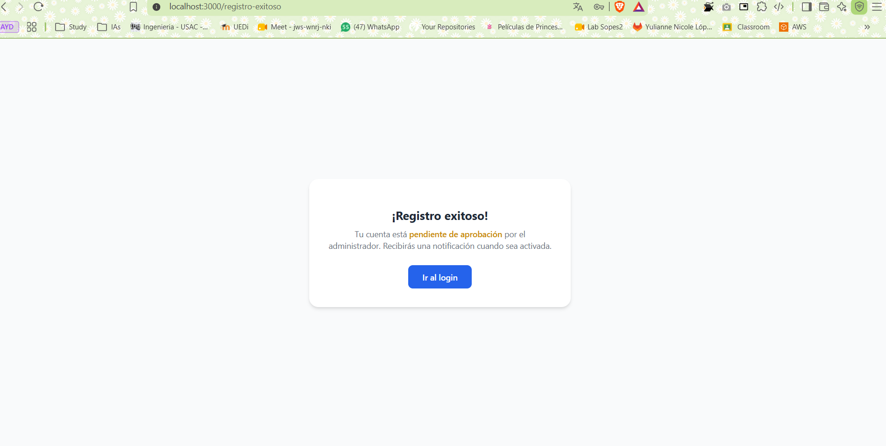

### Iniciar sesión

Pulsa **"Iniciar sesión"** e ingresa tu correo y contraseña.

Si tu cuenta todavía no ha sido aprobada por un administrador, el sistema no te dejará entrar y te mostrará un aviso indicando que tu registro sigue en revisión.

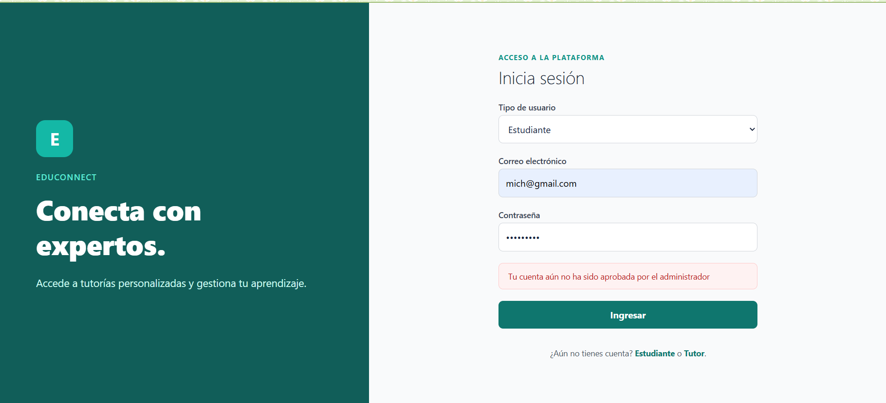

Una vez que un administrador aprueba tu cuenta, al iniciar sesión entrarás directamente a tu panel de estudiante.

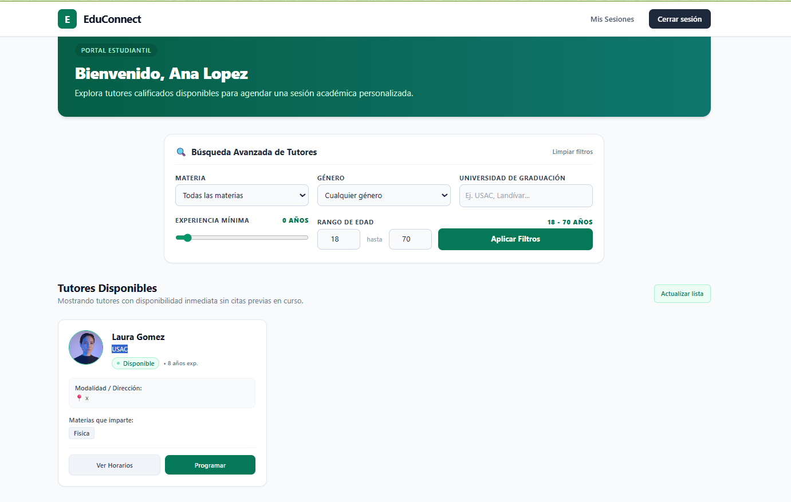

### Ver los tutores disponibles

En tu panel principal encontrarás el catálogo de tutores disponibles. Cada tarjeta muestra la información del tutor y sus materias. Los tutores con los que ya tienes una sesión agendada no aparecen en esta lista, para evitar que agendes dos veces con la misma persona.

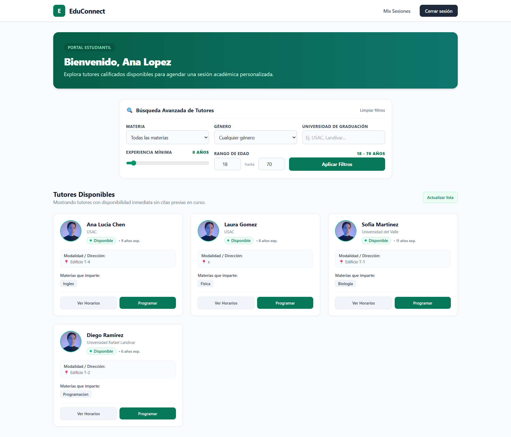

### Buscar un tutor con filtros

Si buscas algo específico, usa el panel de búsqueda avanzada. Puedes filtrar por materia, años de experiencia, sexo, edad y universidad, y combinar varios filtros a la vez para encontrar al tutor que mejor se ajuste a lo que necesitas.

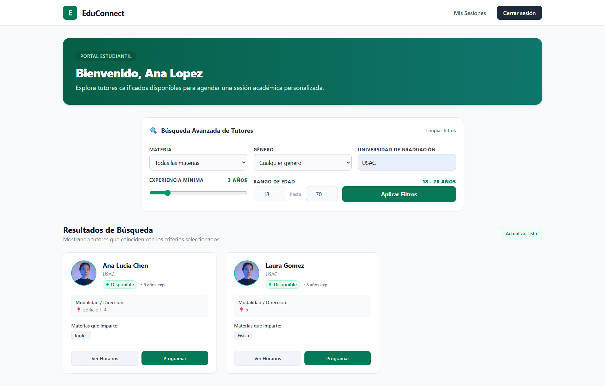

### Consultar el horario de un tutor

Pulsa **"Ver Horarios"** en la tarjeta de un tutor para conocer los días y las horas en que atiende. Los espacios se muestran diferenciando claramente los que están libres de los que ya están ocupados.

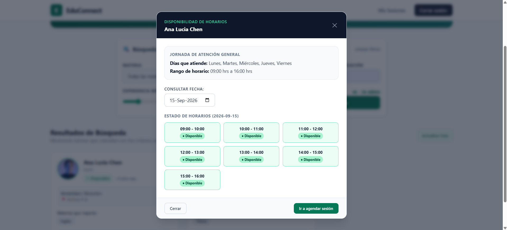

### Agendar una sesión de tutoría

Cuando encuentres al tutor y el horario que quieres, pulsa **"Programar"**. Elige la materia, la fecha y la hora, escribe un breve motivo con los temas o dudas que quieres tratar, y confirma.

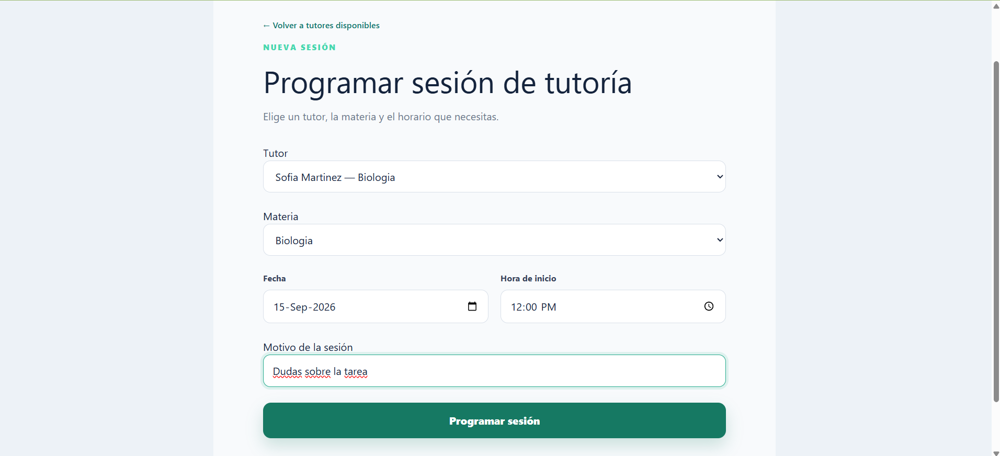

Si el horario que elegiste ya no está disponible, o si ya tienes otra sesión a esa misma hora, el sistema te avisará con un mensaje explicando el motivo en lugar de confirmar la cita. Si todo está correcto, verás la confirmación de tu sesión agendada.

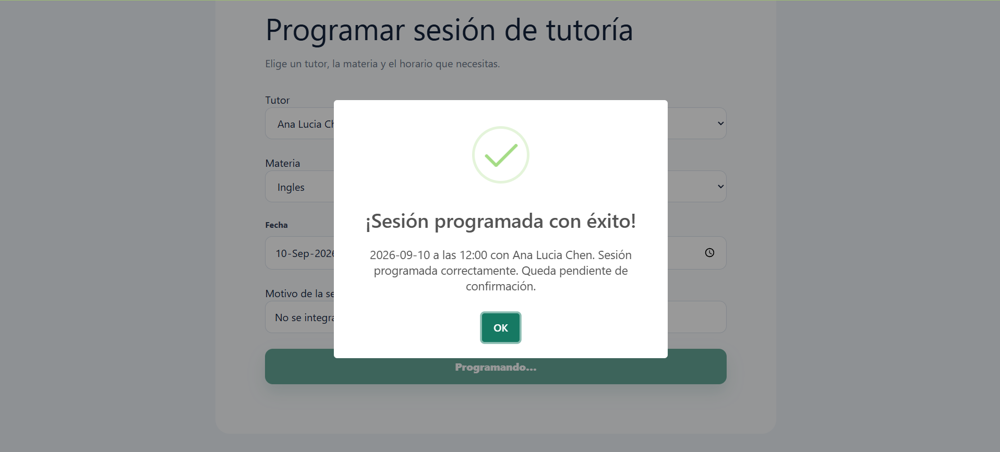

### Ver tus sesiones agendadas

En la sección **"Mis Sesiones"** encontrarás todas las sesiones que tienes agendadas y aún no atendidas, ordenadas desde la fecha más cercana a la más lejana. De cada una verás la fecha, la hora, el nombre del tutor, la materia y el motivo.

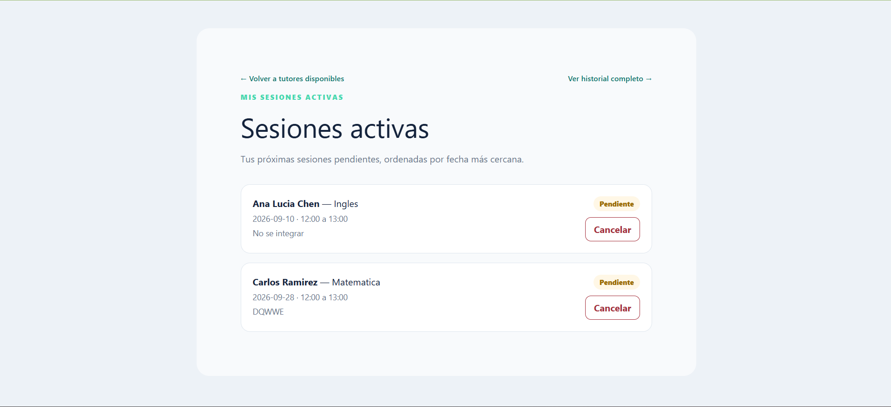

### Cancelar una sesión

Desde **"Mis Sesiones"**, pulsa **"Cancelar"** en la sesión que ya no necesitas. El sistema te pedirá confirmar antes de proceder, para evitar cancelaciones por error.

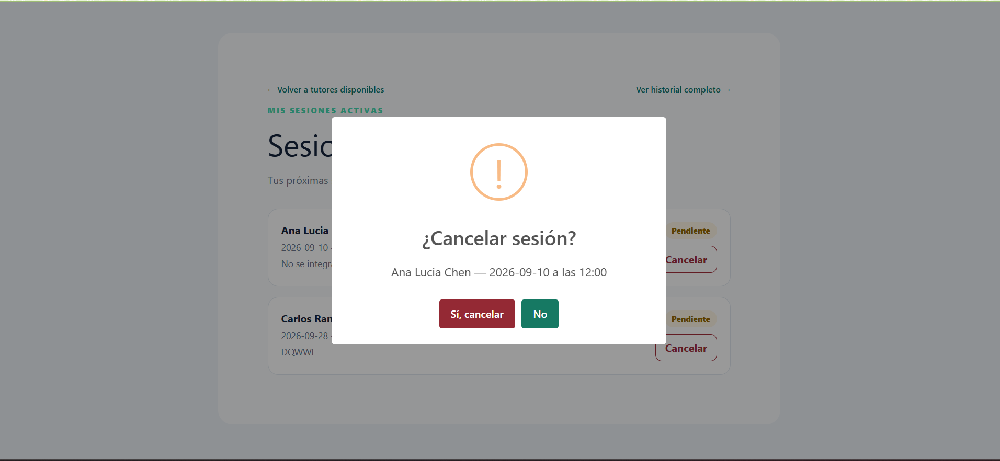

Al confirmar, la sesión desaparece de tu lista y el horario del tutor queda libre de inmediato para que otros estudiantes puedan reservarlo.

### Consultar tu historial de sesiones

En la sección **"Historial"** puedes revisar todas tus sesiones anteriores, de la más reciente a la más antigua. Aquí verás tanto las sesiones que ya fueron atendidas como las que se cancelaron, distinguiendo si la cancelación fue tuya o del tutor. En las sesiones atendidas podrás leer el resumen y las recomendaciones que dejó el tutor.

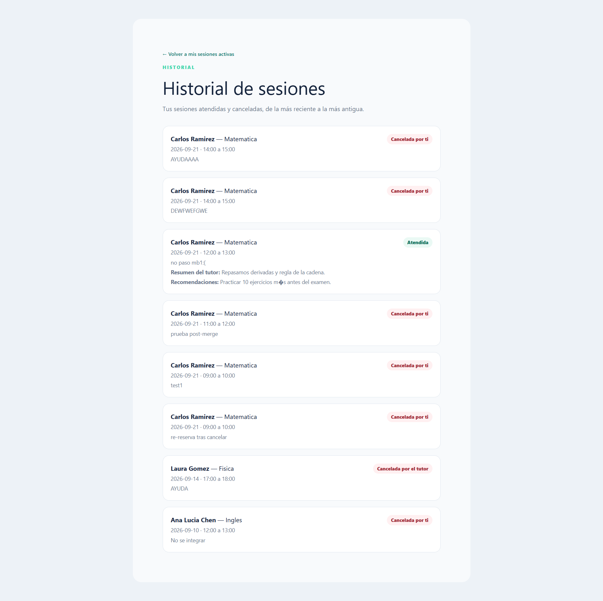

---

## Módulo Tutor

### Crear tu cuenta de tutor

Pulsa **"Registrarse como Tutor"** y completa tus datos personales y profesionales. La fotografía de perfil es obligatoria y puede ser JPG, PNG o WEBP, con un tamaño máximo de 5 MB.

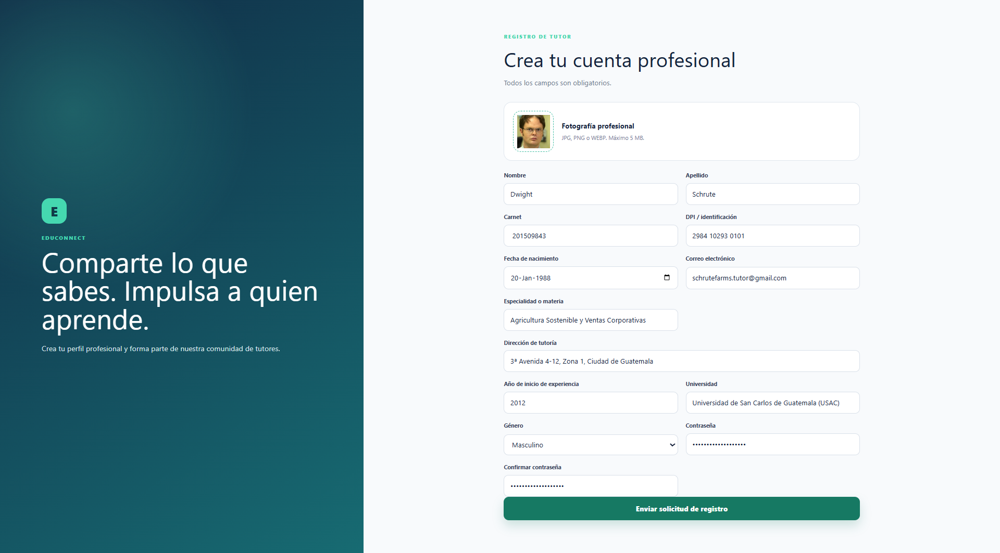

### Iniciar sesión

Ingresa con tu correo y contraseña. Al igual que con los estudiantes, solo podrás entrar cuando un administrador haya aprobado tu cuenta. Si tu cuenta está pendiente, fue rechazada o fue dada de baja, el sistema te lo indicará.

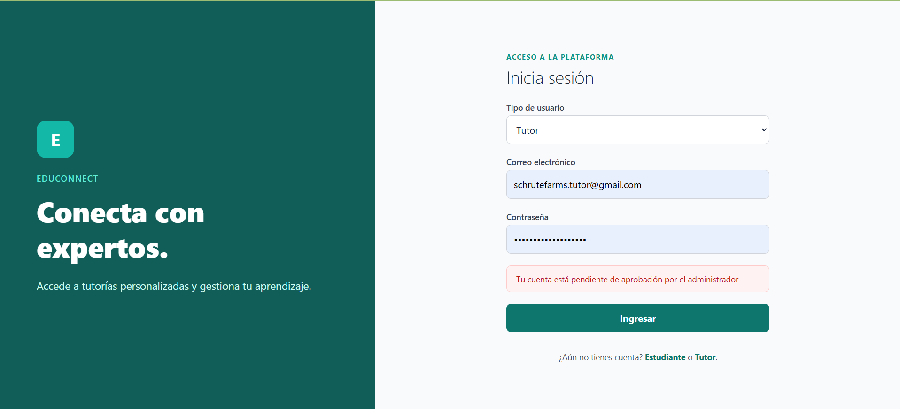

De lo contrario, entraras al panel de tutor.

### Configurar tu horario de atención

En la sección **"Mi Horario"**, marca los días en que atiendes y define una hora de inicio y una hora de fin. Ese mismo rango de horas se aplicará a todos los días que hayas seleccionado.

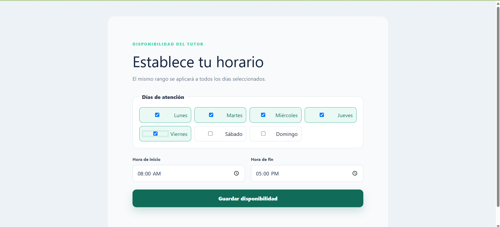

### Modificar tu horario

Puedes volver a **"Mi Horario"** para cambiar tus días u horas de atención. Si el nuevo horario dejaría fuera alguna sesión que ya tienes agendada, el sistema no permitirá el cambio y te avisará, para que primero reprogrames o canceles esas sesiones.

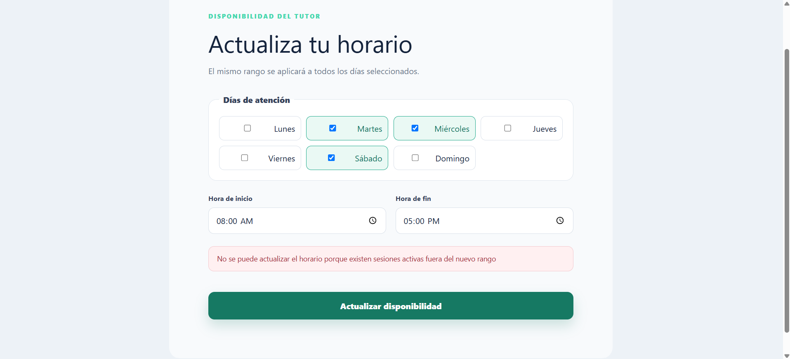

### Ver tus sesiones pendientes

En **"Mis Sesiones"** encontrarás las citas que tienes pendientes de atender, ordenadas por proximidad de fecha.

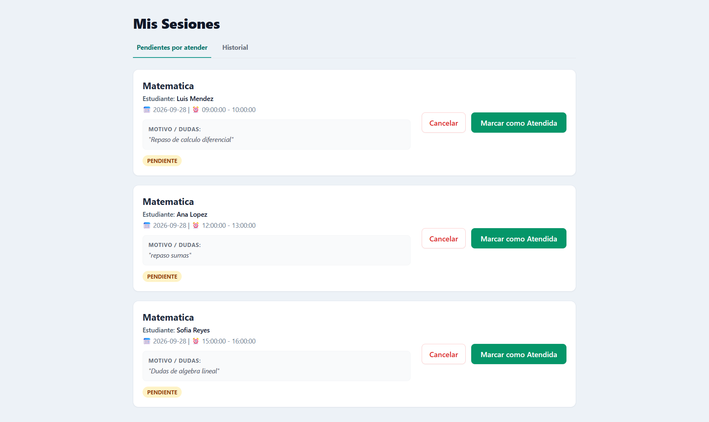

### Atender a un estudiante

Cuando termines una tutoría, pulsa **"Marcar como Atendida"** en la sesión correspondiente. Antes de guardar, el sistema te pedirá escribir un resumen de la sesión; este paso es obligatorio y ese resumen será el que el estudiante vea en su historial.

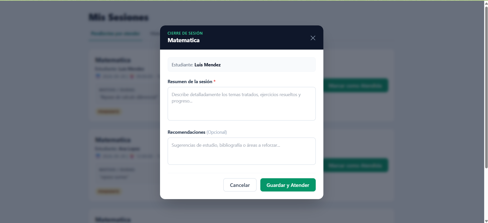

### Cancelar una sesión

Si necesitas cancelar una cita, pulsa **"Cancelar"** sobre la sesión pendiente y confirma. El estudiante recibirá automáticamente un correo con la fecha y hora de la sesión cancelada, el motivo y un mensaje de disculpa.

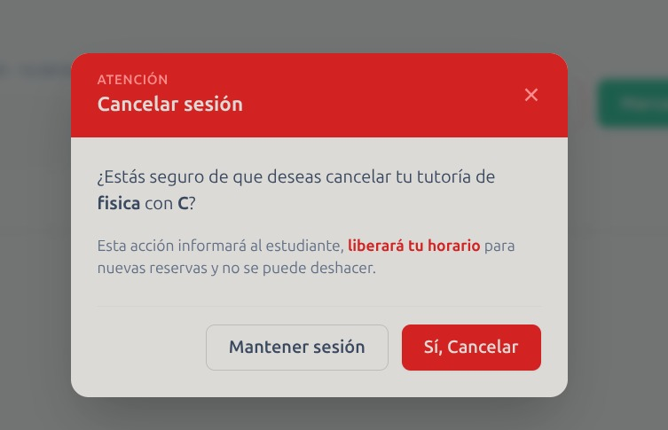
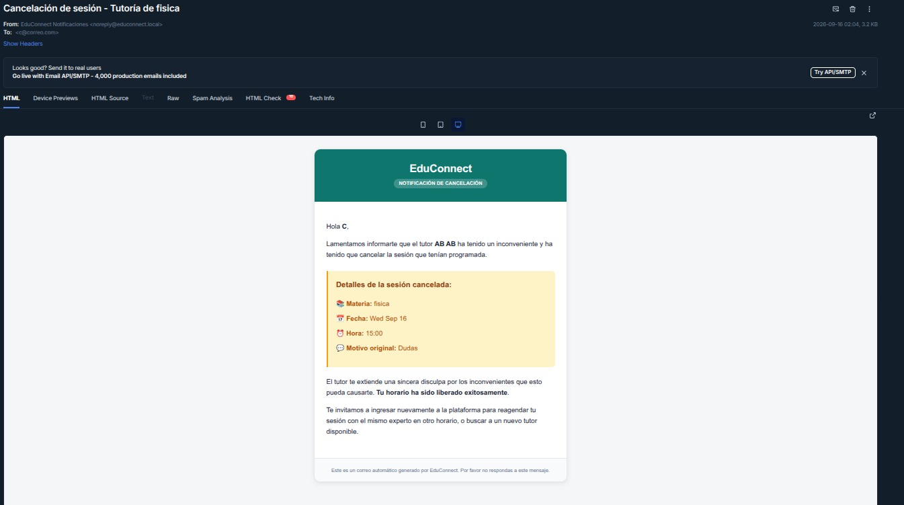

### Consultar tu historial

En tu historial puedes revisar todas las sesiones anteriores, distinguiendo con claridad si cada una fue atendida o cancelada, y en caso de cancelación, si la hizo el estudiante o tú.

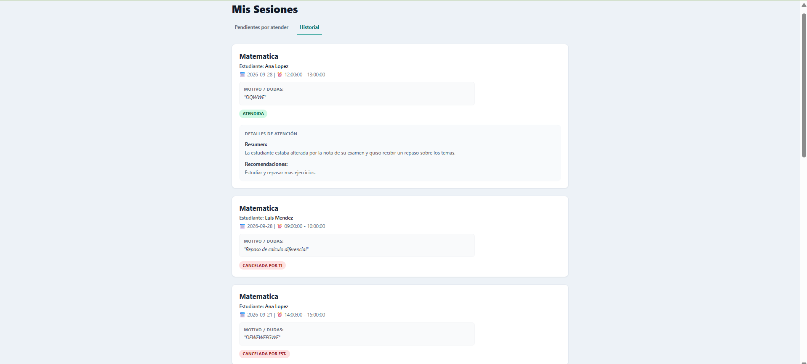

### Ver y actualizar tu perfil

En la sección **"Mi Perfil"** puedes actualizar tus datos profesionales cuando lo necesites. El correo electrónico no se puede modificar, ya que es el que identifica tu cuenta.

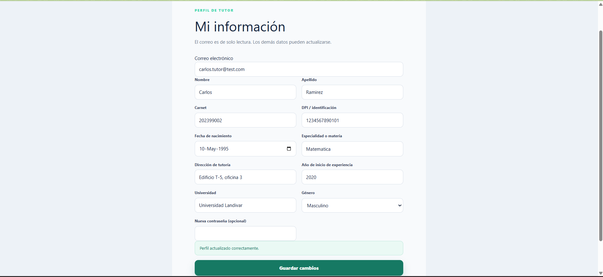

---

## Módulo Administrador

### Iniciar sesión en dos pasos

El acceso de administrador tiene dos pasos de seguridad. Primero, ingresa tu usuario y contraseña de administrador.

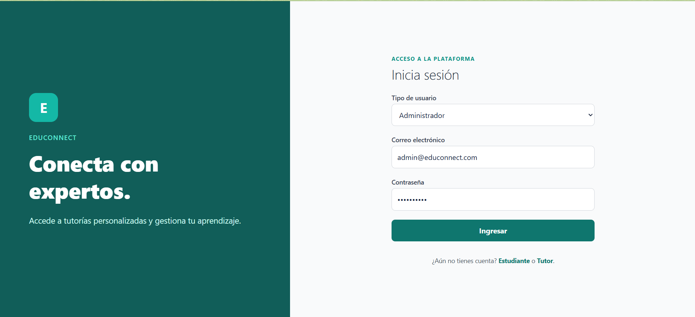

Después, el sistema te pedirá subir un archivo llamado **`auth2-ayd1.txt`** como segundo factor de verificación y contiene una clave de seguridad que el sistema comprueba. Guárdalo en un lugar seguro de tu equipo, porque lo necesitarás cada vez que inicies sesión como administrador. Selecciónalo cuando el sistema te lo pida y confirma; solo al validarse esa clave se te dará acceso al panel.

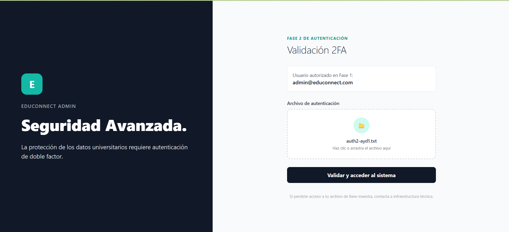

### Aprobar o rechazar solicitudes

En tu panel, entra a la sección de **"Estudiantes"** o **"Tutores"** y abre las solicitudes pendientes. De cada solicitante verás su fotografía, nombre completo, carnet, correo y demás datos, y en el caso de los tutores también su especialidad. Revisa cada solicitud y decide aprobarla o rechazarla. En ambos casos, el sistema le enviará un correo a la persona informándole el resultado.

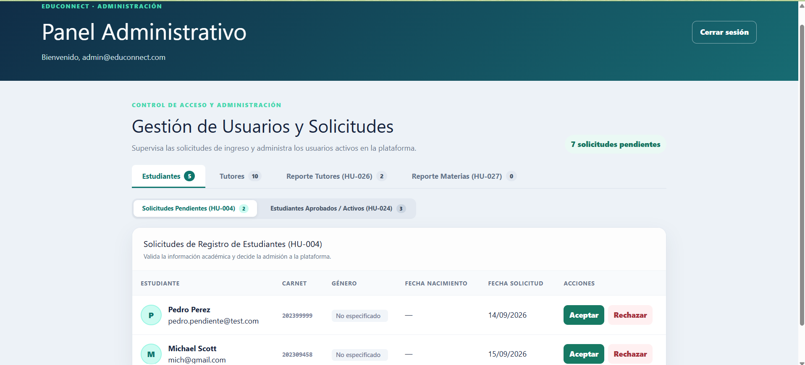
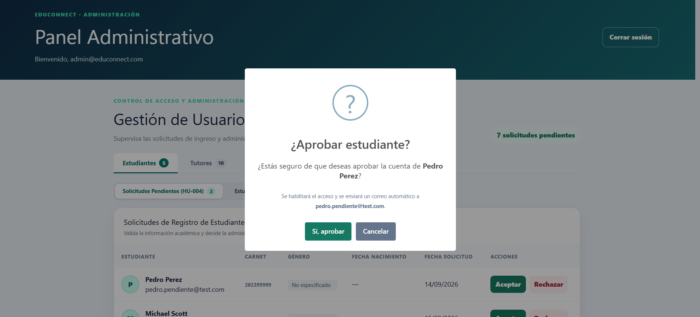

Tambien puedes ver en "detalle" de cada solicitud, la información completa del tutor, incluyendo su fotografía y los datos que proporcionó al registrarse.

### Administrar usuarios y dar de baja

En la lista de usuarios aprobados puedes ver a todos los estudiantes y tutores activos. Desde ahí puedes dar de baja a cualquiera cuando sea necesario; el sistema te pedirá confirmar, y una vez dada de baja, esa persona ya no podrá iniciar sesión en la plataforma.

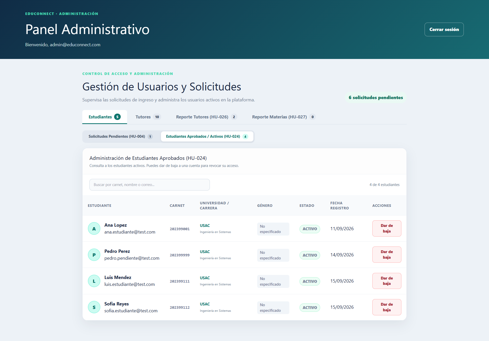

### Consultar y exportar los reportes

En la sección de reportes encontrarás el ranking de los tutores que más estudiantes han atendido, presentado con un gráfico de barras acompañado de sus cifras. Puedes usar el botón **"Exportar"** para descargar el reporte y guardarlo o compartirlo fuera de la plataforma.

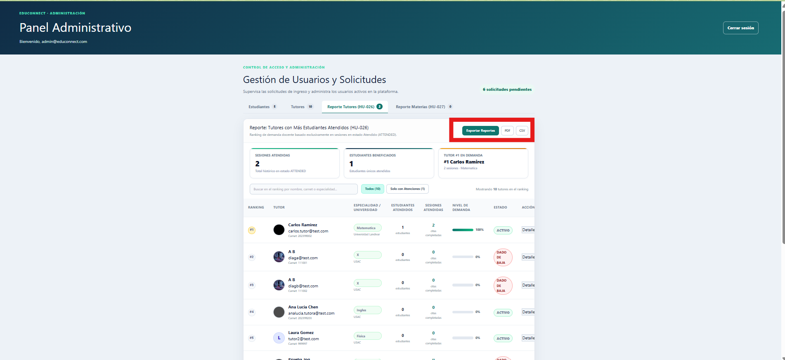

De la misma forma encontrarás el reporte de las materias con mayor demanda dentro de la plataforma, que también puedes exportar con el botón **"Exportar"**.

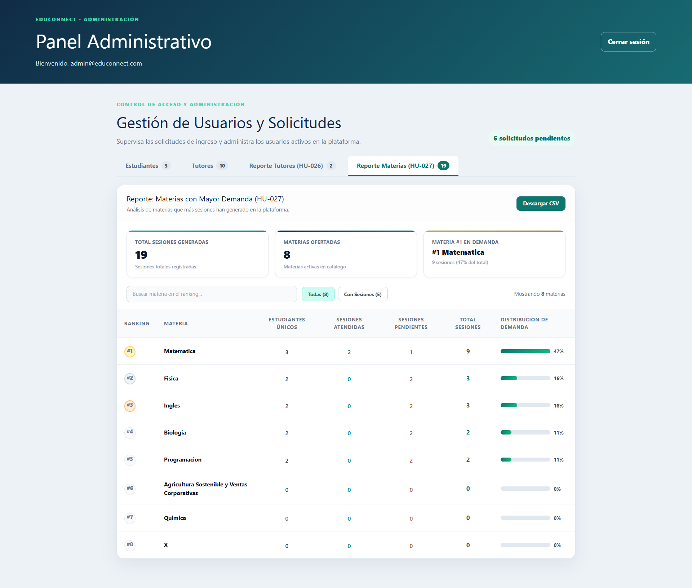

---