# Pruebas End-to-End (E2E) — EduConnect Fase 2

> **Herramienta:** Cypress 14.5.4
> **Ubicación de las pruebas:** `frontend/cypress/e2e/`
> **Resultado de la suite:** **6/6 archivos — 14/14 pruebas aprobadas** (20/10/2026)

---

## 1. Objetivo

Las pruebas E2E simulan la interacción real de cada rol (estudiante, tutor y administrador) con la interfaz de EduConnect, de principio a fin, para confirmar que los módulos nuevos de la Fase 2 funcionan integrados: frontend, API y base de datos.

Cada integrante del equipo implementa **una prueba E2E** sobre el flujo principal de su paquete.

---

## 2. Entorno y configuración

| Elemento | Valor |
|---|---|
| Framework | Cypress 14.5.4 (`devDependencies` de `frontend/package.json`) |
| Configuración | `frontend/cypress.config.js` |
| `baseUrl` | `http://localhost:3000` (servidor de Vite; `/api` se redirige al backend en `:5000`) |
| `specPattern` | `cypress/e2e/**/*.cy.{js,jsx}` |
| Navegador de ejecución | Firefox 157 (headless) |
| Sistema de referencia | Fedora Linux 44, Node.js 22.23.1 |
| Datos de prueba | `backend/seeds_e2e.sql` |

### 2.1 Datos de prueba (`backend/seeds_e2e.sql`)

Para que la suite se pueda ejecutar en cualquier máquina, el script crea, solo si no existen:

| Dato | Usado por |
|---|---|
| `admin@educonnect.com` / `Admin123!` | E2E-03, E2E-04 |
| `sofia.tutora@test.com` y `sofia.estudiante@test.com` / `Passw0rd1` (aprobadas y verificadas) | E2E-05 |
| Materia "Física", asignada a la tutora, con horario L-V 08:00-18:00 | E2E-05 |
| Una sesión PENDING tutora ↔ estudiante | E2E-05 |

El script es idempotente y resuelve los IDs por correo, no por valores fijos. Como la E2E-05 marca la sesión PENDING como atendida, **se recarga antes de cada ejecución de la suite**.

### 2.2 Cómo ejecutar la suite

```bash
# 1. Levantar el proyecto (frontend en :3000, backend en :5000, MySQL)
docker compose up --build

# 2. Cargar los datos de prueba (desde la raíz del repositorio)
docker compose exec -T db sh -c 'mysql -u"$MYSQL_USER" -p"$MYSQL_PASSWORD" "$MYSQL_DATABASE"' < backend/seeds_e2e.sql

# 3. Instalar dependencias del frontend (incluye Cypress)
cd frontend
npm ci

# 4. Ejecutar todas las pruebas E2E
npx cypress run --browser firefox

# Ejecutar una sola prueba
npx cypress run --browser firefox --spec cypress/e2e/e2e-04-metricas-reportes.cy.js

# Modo interactivo (ver cada paso en el navegador)
npm run cypress:open
```

> **Nota para Linux con Wayland:** el navegador por defecto de Cypress (Electron) se bloquea al tomar capturas (`cy.screenshot() timed out`). Ejecutar con `--browser firefox` o `--browser chrome`.

### 2.3 Estrategia de datos

El equipo combina dos técnicas según lo que necesita cada flujo:

- **Interacción real** con la interfaz y el backend en los pasos de autenticación (login, token y 2FA) y en las transacciones que la prueba debe comprobar de punta a punta (por ejemplo, el plan de estudio de la E2E-05).
- **`cy.intercept`** para simular las respuestas de la API cuyo contenido depende de los datos de cada base (reportes, listados, denuncias). Así las aserciones verifican valores conocidos.

Las capturas (`cy.screenshot`) se generan en `frontend/cypress/screenshots/` (excluida de Git) y se copian a `docs/Pruebas/imgs/`.

---

## 3. Resumen de la suite

| ID | Responsable | Paquete | Flujo | Archivo | Resultado |
|---|---|---|---|---|---|
| E2E-01 | 202300359 | A | Registro con carnet PDF → token → primer login | `student_auth_flow.cy.js` | Aprobada 1/1 |
| E2E-02 | 202300596 | B | Admin revisa CV en visor PDF → aprueba al tutor | `e2e-02-aprobacion-cv-tutor.cy.js` | Aprobada 1/1 |
| E2E-03 | 202300673 | C | Admin edita estudiante → baja por denuncia → bloqueo de login | `e2e-03-moderacion-sancion.cy.js` | Aprobada 4/4 |
| E2E-04 | 202308940 | D | Admin → métricas → filtros temporales → validación de gráficos | `e2e-04-metricas-reportes.cy.js` | Aprobada 3/3 |
| E2E-05 | 202300659 | E | Tutor asigna plan → estudiante lo consulta → constancia PDF | `e2e-05-plan-constancia.cy.js` | Aprobada 3/3 |
| E2E-06 | 202308204 | F | Calificación y denuncia bidireccional desde el historial | `e2e-06-feedback.cy.js` | Aprobada 2/2 |

---

## 4. Detalle de las pruebas

### E2E-01 — Registro con PDF, verificación por token y primer login

| Campo | Detalle |
|---|---|
| **Responsable** | 202300359 — Paquete A |
| **HU cubiertas** | HU-028, HU-030, HU-031 |
| **Archivo** | `frontend/cypress/e2e/student_auth_flow.cy.js` |
| **Estrategia** | Formulario y navegación reales; `POST /api/auth/register/student` y `POST /api/auth/login/student` simulados con `cy.intercept`. |

| # | Acción | Resultado esperado | Obtenido |
|---|---|---|---|
| 1 | Llenar el registro con datos personales, fotografía y carnet en PDF | El formulario acepta ambos archivos | Correcto |
| 2 | Enviar el registro | Redirección a `/registro-exitoso` con el mensaje "¡Revisa tu correo electrónico!" | Correcto |
| 3 | Primer login con correo y contraseña, sin token | El sistema exige el token de verificación y muestra el campo `token` | Correcto |
| 4 | Ingresar el token y enviar | Acceso al portal en `/dashboard/student` | Correcto |

**Resultado:** Aprobada, 1/1 (5.2 s).

---

### E2E-02 — Inspección del CV en visor PDF y aprobación del tutor

| Campo | Detalle |
|---|---|
| **Responsable** | 202300596 — Paquete B |
| **HU cubiertas** | HU-029, HU-040 |
| **Archivo** | `frontend/cypress/e2e/e2e-02-aprobacion-cv-tutor.cy.js` |
| **Estrategia** | Sesión de administrador inyectada en `localStorage` (`onBeforeLoad`); listado de tutores pendientes y aprobación simulados con `cy.intercept`. |

| # | Acción | Resultado esperado | Obtenido |
|---|---|---|---|
| 1 | Abrir `/admin/dashboard` y la pestaña **Tutores** | El tutor pendiente "Carlos Méndez" aparece con "PDF disponible" | Correcto |
| 2 | Presionar **Revisar** | Se abre el visor embebido `iframe[title="Visor de documento PDF"]` con `src` hacia `/api/documents/cvs/cv-demo-uuid.pdf`, sin descargar el archivo | Correcto |
| 3 | Presionar **Aceptar** | `PUT /api/admin/tutors/99/status` con cuerpo `{ status: 'APPROVED' }` | Correcto |
| 4 | Revisar el listado | El tutor aprobado desaparece de los pendientes | Correcto |

**Resultado:** Aprobada, 1/1 (1.8 s).

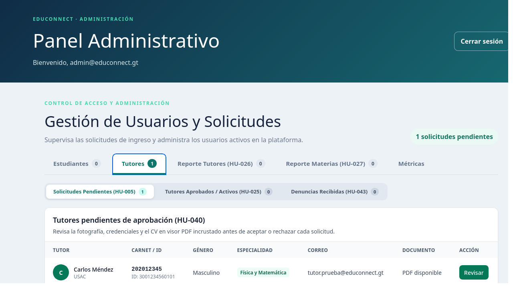

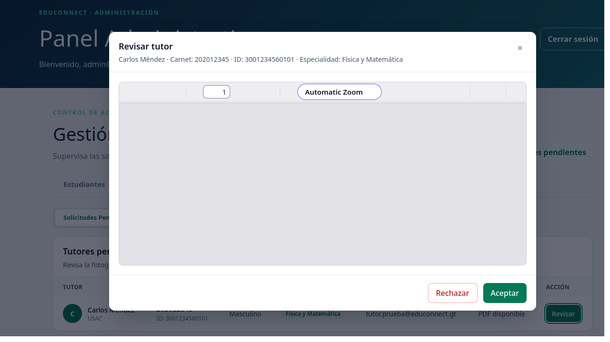

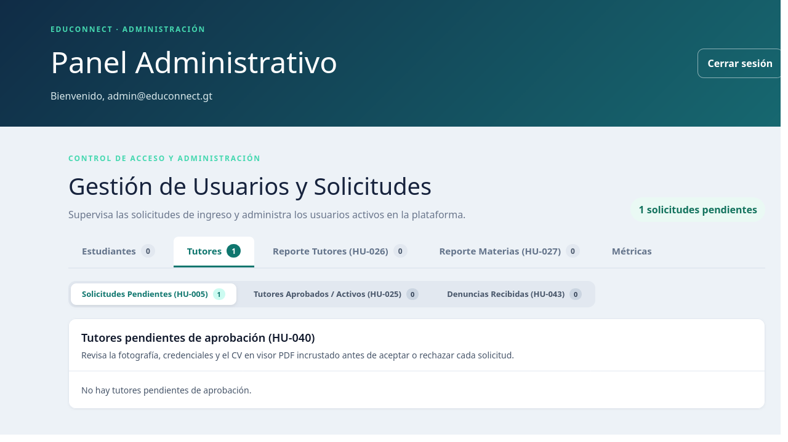

---

### E2E-03 — Moderación y sanción de cuenta

| Campo | Detalle |
|---|---|
| **Responsable** | 202300673 — Paquete C |
| **HU cubiertas** | HU-041, HU-043, HU-044 |
| **Archivo** | `frontend/cypress/e2e/e2e-03-moderacion-sancion.cy.js` |
| **Estrategia** | Login real del administrador con 2FA, reutilizado con `cy.session`; respuestas de moderación (estudiantes, denuncias y baja) simuladas con `cy.intercept`. |

| # | Acción | Resultado esperado | Obtenido |
|---|---|---|---|
| 1-2 | El administrador inicia sesión con 2FA y abre **Estudiantes Aprobados / Activos** | Se muestra el panel administrativo y el listado de estudiantes activos | Correcto |
| 3 | Abrir la edición de un estudiante | El campo de correo está deshabilitado (inmutable) | Correcto |
| 4-5 | En **Denuncias Recibidas**, aplicar "Dar de baja" sobre una denuncia pendiente y confirmar | El sistema confirma la baja del estudiante | Correcto |
| 6-7 | Cerrar sesión y entrar como el estudiante sancionado | El login es rechazado y no se accede al dashboard | Correcto |

**Resultado:** Aprobada, 4/4 (6 s).

---

### E2E-04 — Supervisión de métricas y reportes analíticos

| Campo | Detalle |
|---|---|
| **Responsable** | 202308940 — Paquete D |
| **HU cubiertas** | HU-045, HU-046, HU-047, HU-048 |
| **Archivo** | `frontend/cypress/e2e/e2e-04-metricas-reportes.cy.js` |
| **Precondición** | Administrador `admin@educonnect.com` (incluido en `seeds_e2e.sql`). |

**Estrategia:**

- **Login real** del administrador (credenciales + archivo 2FA `auth2-ayd1.txt`) contra el backend. Obtiene un JWT válido, necesario porque el panel administrativo consulta otros endpoints protegidos. La sesión se reutiliza con `cy.session`.
- Los 5 endpoints de reportes se simulan con `cy.intercept` y datos fijos que dependen del filtro recibido: `tutors-ratings`, `students-ratings`, `sessions-evolution`, `cancellations-by-subject` y `demanded-schedules`.
- Cada filtro se valida esperando la petición con el parámetro exacto (`cy.intercept` con `query`). Así la prueba no se confunde con las peticiones iniciales duplicadas por React StrictMode en desarrollo.

| # | Acción | Resultado esperado | Obtenido |
|---|---|---|---|
| 1 | Seleccionar rol Administrador, ingresar correo y contraseña | Redirección a `/login/admin/2fa` | Correcto |
| 2 | Cargar `auth2-ayd1.txt` y presionar "Validar y acceder al sistema" | Redirección a `/admin/dashboard` y JWT en `localStorage` | Correcto |
| 3 | Abrir la pestaña **Métricas** | Se muestra el panel de métricas | Correcto |
| 4 | Revisar la tabla de tutores | 3 tutores; Marta Gómez primera con **4.67 ★**; Ana Morales con "Sin calificaciones" | Correcto |
| 5 | Revisar la tabla de estudiantes | 3 estudiantes; Diego López primero con **4.00 ★**; Sofía Ramos con "Sin calificaciones" | Correcto |
| 6 | Cambiar "Agrupar por" a **Semana** | Petición con `granularity=week`; el gráfico de evolución sigue visible | Correcto |
| 7 | Filtrar el mes **2026-07** (sin sesiones) | Petición con `granularity=week&month=2026-07`; aparece "No hay sesiones atendidas en el período seleccionado." y se oculta el gráfico | Correcto |
| 8 | Presionar "Limpiar filtro" | El campo de mes queda vacío y vuelve el gráfico | Correcto |
| 9 | Revisar el reporte F2-2 sin filtro | Matemática primera con **66.7 %** de cancelación; franja más demandada **08:00 - 09:00**; ambos gráficos visibles | Correcto |
| 10 | Filtrar el reporte F2-2 por **2026-10** | Peticiones con `month=2026-10`; Física pasa a primera con **100 %** y la franja cambia a **14:00 - 15:00** | Correcto |
| 11 | Presionar "Limpiar filtro" del reporte F2-2 | Vuelven Matemática como primera y la franja **08:00 - 09:00** | Correcto |

**Resultado:** Aprobada, 3/3 (7 s).

**Promedios de calificaciones de tutores y estudiantes (pasos 3 a 5):**

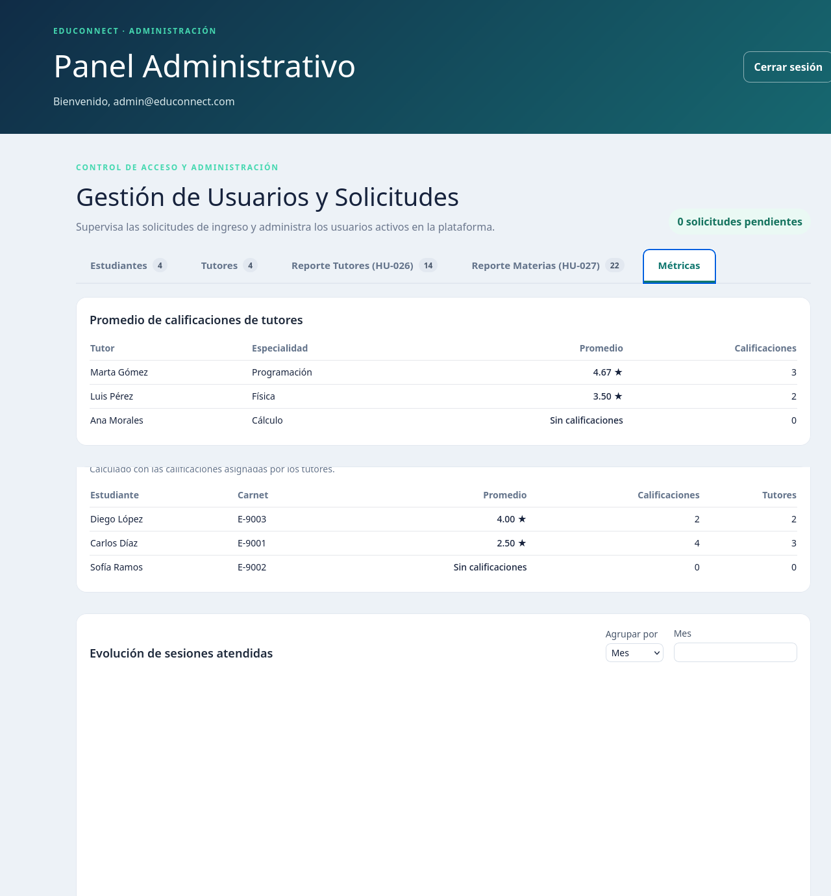

**Evolución de sesiones tras aplicar y limpiar filtros (pasos 6 a 8):**

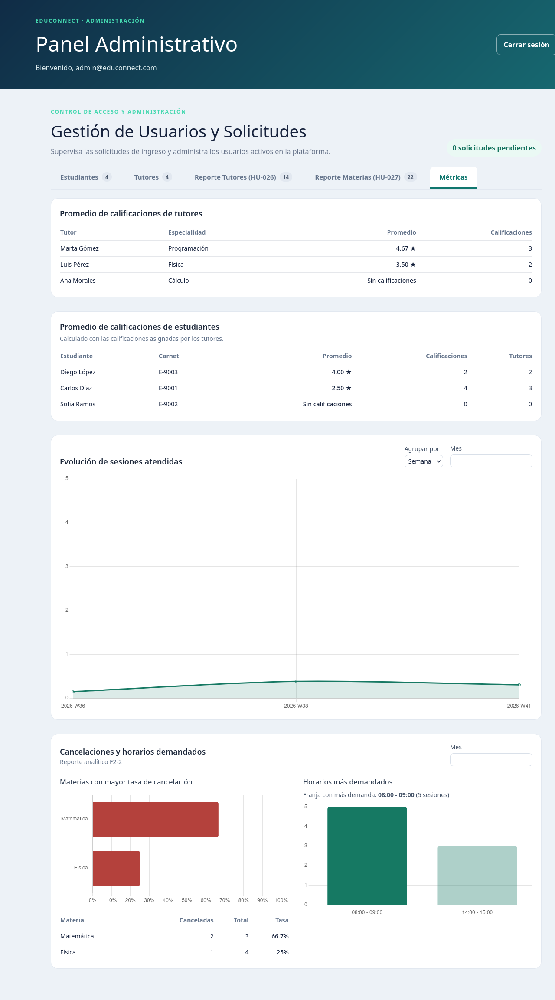

**Reporte F2-2 filtrado por octubre 2026 (pasos 9 y 10):**

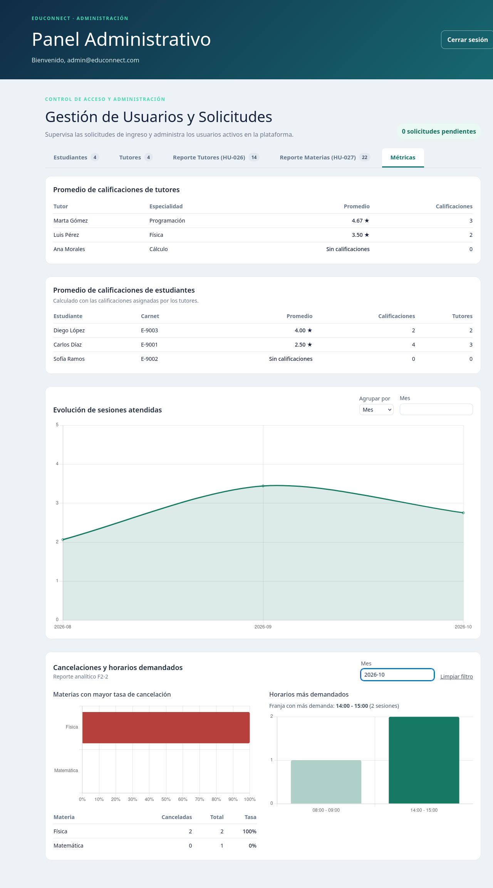

---

### E2E-05 — Creación de plan estructurado y constancia PDF

| Campo | Detalle |
|---|---|
| **Responsable** | 202300659 — Paquete E |
| **HU cubiertas** | HU-032, HU-033, HU-034 |
| **Archivo** | `frontend/cypress/e2e/e2e-05-plan-constancia.cy.js` |
| **Precondición** | Cuentas `sofia.tutora@test.com` / `sofia.estudiante@test.com` y una sesión PENDING (incluidas en `seeds_e2e.sql`). |
| **Estrategia** | Login real de tutor y estudiante contra el backend. Antes de la prueba se reutiliza la sesión PENDING de la tutora o se crea una con `cy.request`. Solo `GET /api/ratings/**` se simula, porque es ajeno al flujo. |

| # | Acción | Resultado esperado | Obtenido |
|---|---|---|---|
| 1-2 | El tutor abre sus sesiones pendientes y presiona "Marcar como Atendida" | Se abre el formulario del plan de estudio | Correcto |
| 3-4 | Registrar las dificultades identificadas y 2 recursos (Texto y Video) | El formulario acepta los recursos dinámicos | Correcto |
| 5 | Guardar el plan | La sesión pasa a ATTENDED | Correcto |
| 6-7 | El estudiante entra a "Mi Plan" | Se muestra el plan activo con las dificultades y los 2 recursos registrados | Correcto |
| 8 | Presionar "Descargar constancia PDF" | La respuesta tiene `Content-Type: application/pdf` | Correcto |

**Resultado:** Aprobada, 3/3 (15 s). Constancia generada de muestra: [`evidencias/e2e-05-constancia.pdf`](evidencias/e2e-05-constancia.pdf).

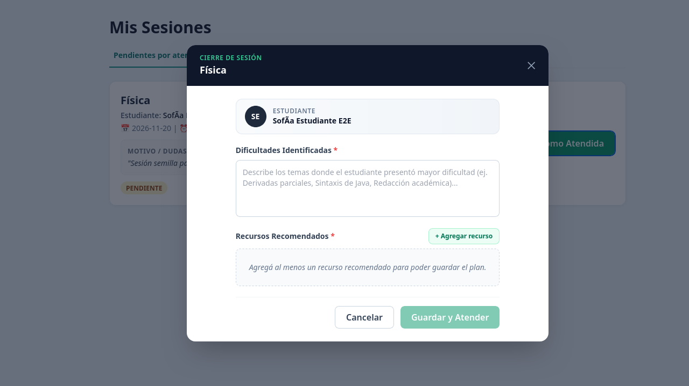

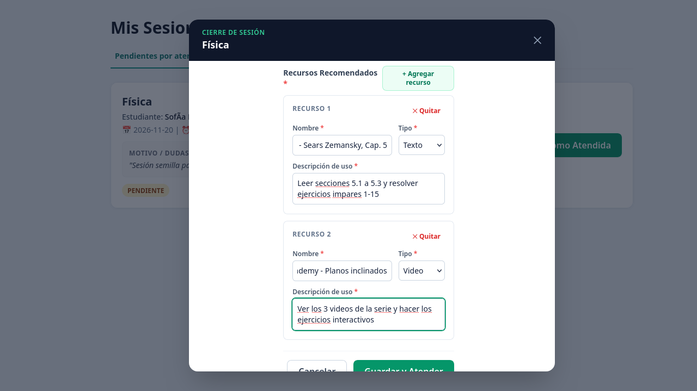

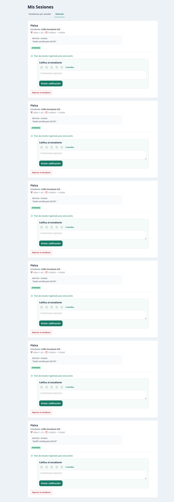


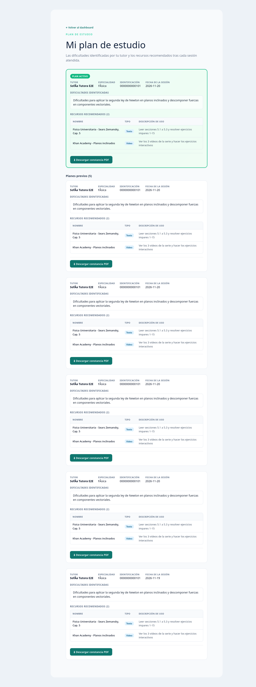

---

### E2E-06 — Retroalimentación y denuncia desde el historial

| Campo | Detalle |
|---|---|
| **Responsable** | 202308204 — Paquete F |
| **HU cubiertas** | HU-035, HU-036, HU-037, HU-038 |
| **Archivo** | `frontend/cypress/e2e/e2e-06-feedback.cy.js` |

| # | Acción | Resultado esperado | Obtenido |
|---|---|---|---|
| 1 | El estudiante abre su historial de sesiones atendidas, califica al tutor y lo reporta con una categoría del catálogo | La calificación y la denuncia se registran y el sistema confirma la recepción | Correcto |
| 2 | El tutor abre su historial, califica al estudiante y lo reporta | La calificación y la denuncia se registran y el sistema confirma la recepción | Correcto |

**Resultado:** Aprobada, 2/2 (5 s).

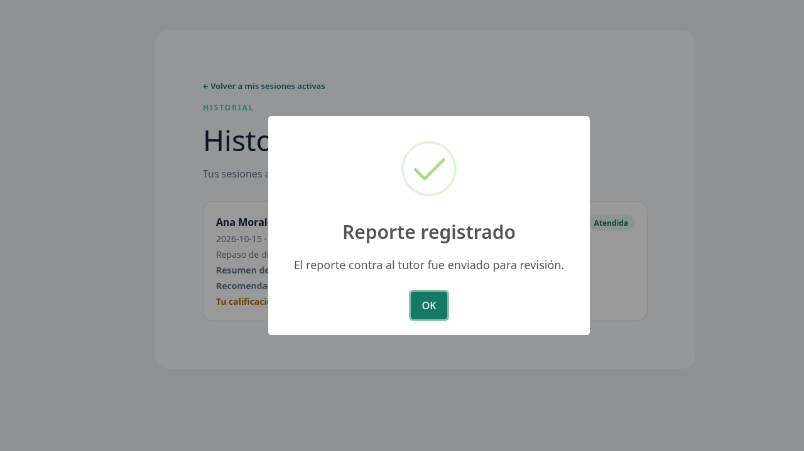

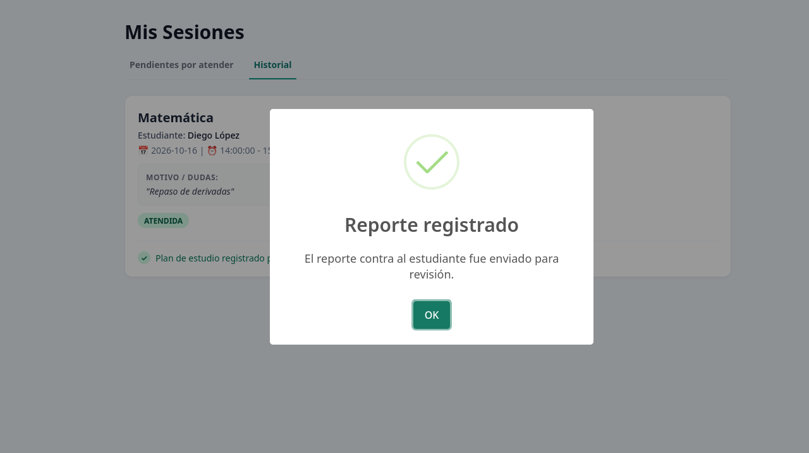

---

## 5. Ejecución de la suite completa

Ejecución del 20/10/2026 con `seeds_e2e.sql` recién cargado. La salida completa está en [`evidencias/e2e-suite-completa.txt`](evidencias/e2e-suite-completa.txt).

```
       Spec                                              Tests  Passing  Failing  Pending  Skipped
  ┌────────────────────────────────────────────────────────────────────────────────────────────────┐
  │ ✔  e2e-02-aprobacion-cv-tutor.cy.js         00:01        1        1        -        -        - │
  ├────────────────────────────────────────────────────────────────────────────────────────────────┤
  │ ✔  e2e-03-moderacion-sancion.cy.js          00:06        4        4        -        -        - │
  ├────────────────────────────────────────────────────────────────────────────────────────────────┤
  │ ✔  e2e-04-metricas-reportes.cy.js           00:07        3        3        -        -        - │
  ├────────────────────────────────────────────────────────────────────────────────────────────────┤
  │ ✔  e2e-05-plan-constancia.cy.js             00:15        3        3        -        -        - │
  ├────────────────────────────────────────────────────────────────────────────────────────────────┤
  │ ✔  e2e-06-feedback.cy.js                    00:05        2        2        -        -        - │
  ├────────────────────────────────────────────────────────────────────────────────────────────────┤
  │ ✔  student_auth_flow.cy.js                  00:05        1        1        -        -        - │
  └────────────────────────────────────────────────────────────────────────────────────────────────┘
    ✔  All specs passed!                        00:40       14       14        -        -        -
```

_Cypress 14.5.4 · Firefox 157 (headless) · Fedora Linux 44 · Node.js 22.23.1_

---

## 6. Hallazgos durante la integración

Al ejecutar la suite completa en una máquina distinta a la de cada autor se encontraron y corrigieron estos problemas:

| Hallazgo | Causa | Corrección |
|---|---|---|
| Cypress no estaba instalado ni configurado; las pruebas estaban en dos carpetas | Cada integrante creó su prueba por separado | `cypress.config.js` con `baseUrl` y `specPattern`; todas las pruebas en `cypress/e2e/` |
| `cy.screenshot()` se bloqueaba | Electron headless en Linux con Wayland | Ejecutar con `--browser firefox` |
| E2E-03 y E2E-05 fallaban fuera de la máquina de su autor | Dependían de usuarios e IDs de la base local | `backend/seeds_e2e.sql` y login real con 2FA |
| E2E-05: `cy.then()` mezclaba código síncrono y asíncrono | Se devolvía un valor después de `cy.log()` | `return cy.wrap(id)` |
| E2E-05 no encontraba "PLAN ACTIVO" | El texto en el DOM es "Plan activo"; las mayúsculas vienen de CSS | `cy.contains(/plan activo/i)` |
| Las tildes del seed se guardaban mal ("Sofía") | El cliente `mysql` lee stdin como latin1 | `SET NAMES utf8mb4` al inicio del seed |
| E2E-03 falló una vez en la suite completa | El panel tardó más de 4 s en aparecer después del 2FA | Timeout de 10 s en esa espera |
| La imagen Docker del frontend descargaba Cypress | `npm install` instala `devDependencies` | `ENV CYPRESS_INSTALL_BINARY=0` en el `Dockerfile` |