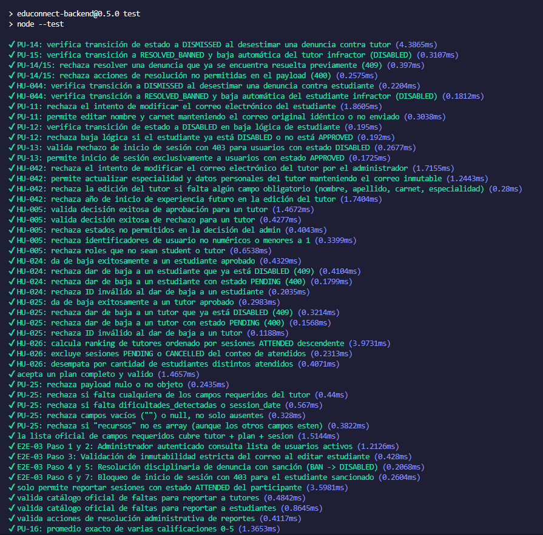
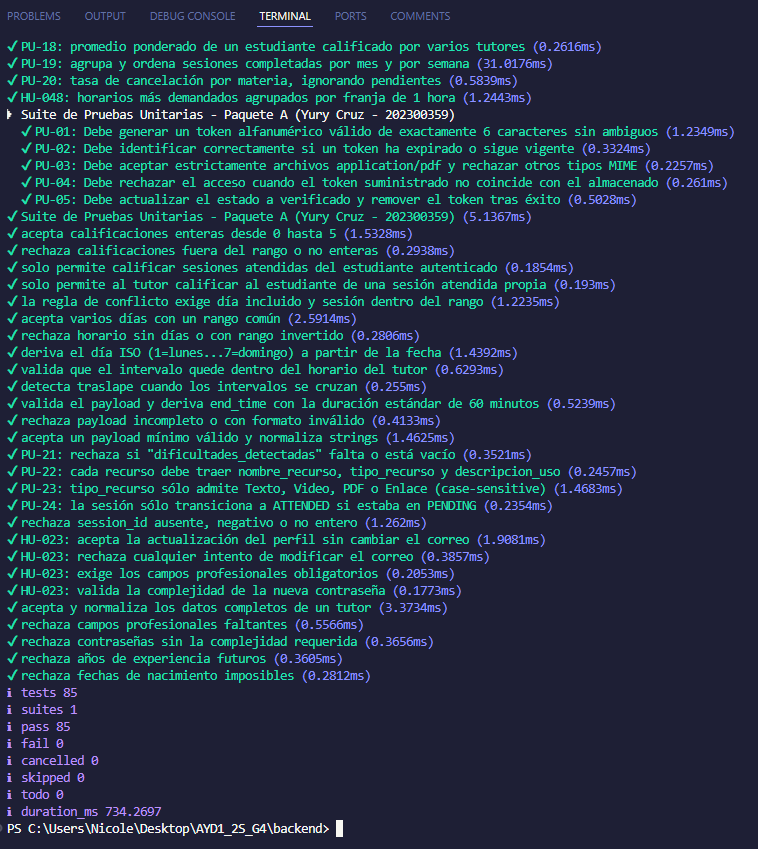

# Documentación Formal de Pruebas Unitarias — EduConnect Fase 2

**Proyecto:** EduConnect — Plataforma de Gestión de Tutorías Académicas
**Grupo:** 4
**Fase:** 2
**Compilador del reporte:** Nicole López (202300659) — Paquete E

Este documento recopila las pruebas unitarias funcionales del proyecto, con su descripción, entrada, técnicas aplicadas, datos de prueba, resultado esperado y resultado obtenido tras ejecución.

---

## Ubicación de los tests

Los archivos de pruebas unitarias viven en:

```
backend/test/
├── paqueteA.test.js                  (Paquete A — PU-01..05)
├── adminStudentModeration.test.js    (Paquete C — PU-11..13)
├── adminIncidentResolution.test.js   (Paquete C — PU-14..15)
├── metricsReports.test.js            (Paquete D — PU-16..20)
├── studyPlanValidation.test.js       (Paquete E — PU-21..24)
├── certificatePdfValidation.test.js  (Paquete E — PU-25)
├── ratingValidation.test.js          (Paquete F — PU-26..27)
└── incidentValidation.test.js        (Paquete F — PU-28..29)
```

## Ejecución de todas las pruebas

Desde la raíz del repositorio:
```bash
cd backend
npm test
```

Resultado global al momento del compilado:
```
ℹ tests 85
ℹ suites 1
ℹ pass 85
ℹ fail 0
ℹ cancelled 0
ℹ skipped 0
ℹ duration_ms ~3100
```

> Los 85 tests incluyen las 24 pruebas identificadas PU-XX del compendio oficial y 61 pruebas adicionales de regresión / Fase 1 / E2E server-side. Ver sección *Evidencia global* al final de este documento.

---

## Resumen Ejecutivo

| ID | Responsable | Archivo | Estado | Status |
|---|---|---|---|---|
| PU-01 | Yury | `paqueteA.test.js` | Formato token (6 chars sin ambigüos) | ✅ PASS |
| PU-02 | Yury | `paqueteA.test.js` | Expiración de token (>24h) | ✅ PASS |
| PU-03 | Yury | `paqueteA.test.js` | Filtro MIME `application/pdf` | ✅ PASS |
| PU-04 | Yury | `paqueteA.test.js` | Bloqueo por token erróneo | ✅ PASS |
| PU-05 | Yury | `paqueteA.test.js` | Cambio a `email_verified = TRUE` | ✅ PASS |
| PU-11 | Alvaro | `adminStudentModeration.test.js` | Inmutabilidad del correo | ✅ PASS |
| PU-12 | Alvaro | `adminStudentModeration.test.js` | Transición a `DISABLED` por baja lógica | ✅ PASS |
| PU-13 | Alvaro | `adminStudentModeration.test.js` | Rechazo login a usuarios `DISABLED` | ✅ PASS |
| PU-14 | Alvaro | `adminIncidentResolution.test.js` | Transición a `DISMISSED` al desestimar denuncia | ✅ PASS |
| PU-15 | Alvaro | `adminIncidentResolution.test.js` | Transición a `RESOLVED_BANNED` + baja infractor | ✅ PASS |
| PU-16 | Wade | `metricsReports.test.js` | Promedio exacto 0–5 estrellas | ✅ PASS |
| PU-17 | Wade | `metricsReports.test.js` | Borde: sin evaluaciones retorna 0 | ✅ PASS |
| PU-18 | Wade | `metricsReports.test.js` | Promedio ponderado | ✅ PASS |
| PU-19 | Wade | `metricsReports.test.js` | Agrupación por mes / semana | ✅ PASS |
| PU-20 | Wade | `metricsReports.test.js` | Tasa de cancelación por materia | ✅ PASS |
| PU-21 | Nicole | `studyPlanValidation.test.js` | Obligatoriedad "Dificultades Identificadas" | ✅ PASS |
| PU-22 | Nicole | `studyPlanValidation.test.js` | Estructura de cada recurso | ✅ PASS |
| PU-23 | Nicole | `studyPlanValidation.test.js` | Tipos admitidos (`Texto/Video/PDF/Enlace`) | ✅ PASS |
| PU-24 | Nicole | `studyPlanValidation.test.js` | Transición de sesión a `ATTENDED` | ✅ PASS |
| PU-25 | Nicole | `certificatePdfValidation.test.js` | Integridad del payload de la constancia | ✅ PASS |
| PU-26 | Isai | `ratingValidation.test.js` | Rechazo de calificación sin `ATTENDED` | ✅ PASS |
| PU-27 | Isai | `ratingValidation.test.js` | Rango de estrellas 0–5 | ✅ PASS |
| PU-28 | Isai | `incidentValidation.test.js` | Rechazo de denuncia sin `ATTENDED` | ✅ PASS |
| PU-29 | Isai | `incidentValidation.test.js` | Pertenencia a catálogo oficial de faltas | ✅ PASS |

**Total:** 24 pruebas unitarias funcionales documentadas y ejecutándose correctamente ✅

---

## Paquete A — Yury (PU-01 a PU-05)

**Comando específico:**
```bash
cd backend && node --test test/paqueteA.test.js
```

### Test PU-01 — Formato del token de verificación

**Descripción:** Valida que `generateVerificationToken(6)` genere un string de exactamente 6 caracteres usando solamente el alfabeto seguro (sin `0`, `O`, `1`, `I` para evitar ambigüedad visual).

**Entrada:** llamada `generateVerificationToken(6)`.

**Técnicas:** Función pura, assert sobre longitud + regex de alfabeto permitido.

**Datos de prueba:** alfabeto `ABCDEFGHJKLMNPQRSTUVWXYZ23456789`.

**Resultado Esperado:**
```
✔ PU-01: Debe generar un token alfanumérico válido de exactamente 6 caracteres sin ambiguos
```

**Resultado Obtenido:** ✅ PASS (1.537ms) — tomado del `npm test` del 2026-10-18.

---

### Test PU-02 — Expiración del token

**Descripción:** `isTokenExpired` debe considerar expirado un token con fecha pasada o nula, y vigente uno con fecha dentro de 24h.

**Entrada:**
- Fecha 1h en el pasado → debe ser `true` (expirado).
- `getTokenExpirationDate(24)` → `false` (vigente).
- `null` → `true` (expirado por seguridad).

**Técnicas:** Función pura, tres aserciones de borde.

**Datos de prueba:** `new Date(Date.now() - 3600 * 1000)`, `getTokenExpirationDate(24)`, `null`.

**Resultado Esperado:**
```
✔ PU-02: Debe identificar correctamente si un token ha expirado o sigue vigente
```

**Resultado Obtenido:** ✅ PASS (0.17ms).

---

### Test PU-03 — Filtro MIME del carnet PDF

**Descripción:** `isValidStudentFileMime('carnet_pdf', ...)` debe aceptar solo `application/pdf` y rechazar imágenes, Word y texto plano.

**Entrada:**
- `('carnet_pdf', 'application/pdf')` → `true`
- `('carnet_pdf', 'image/png')` → `false`
- `('carnet_pdf', 'application/msword')` → `false`
- `('carnet_pdf', 'text/plain')` → `false`

**Técnicas:** Función pura con validación de tipo MIME.

**Resultado Esperado:**
```
✔ PU-03: Debe aceptar estrictamente archivos application/pdf y rechazar otros tipos MIME
```

**Resultado Obtenido:** ✅ PASS (0.12ms).

---

### Test PU-04 — Bloqueo por token erróneo en primer login

**Descripción:** La validación de token en el primer login debe aceptar el token correcto (normalizado: trim + uppercase), rechazar el incorrecto y pedir token cuando venga vacío.

**Entrada:** usuario con `verification_token='K7X9P2'`, `email_verified=0`.
- `'WRONG1'` → bloqueado, razón `TOKEN_INVALID`.
- `''` → bloqueado, razón `TOKEN_REQUIRED`.
- `' k7x9p2 '` → permitido, razón `OK`.

**Técnicas:** Simulación de validador con normalización de entrada.

**Resultado Esperado:**
```
✔ PU-04: Debe rechazar el acceso cuando el token suministrado no coincide con el almacenado
```

**Resultado Obtenido:** ✅ PASS (0.16ms).

---

### Test PU-05 — Verificación de email tras éxito

**Descripción:** Al validar correctamente el token, el usuario debe quedar con `email_verified = true` y `verification_token = null`.

**Entrada:** usuario `{ id: 42, email_verified: false, verification_token: 'M3T8R9' }`.

**Técnicas:** Función pura `simulateVerificationSuccess` con assertions sobre el objeto resultante.

**Resultado Esperado:**
```
✔ PU-05: Debe actualizar el estado a verificado y remover el token tras éxito
```

**Resultado Obtenido:** ✅ PASS (0.12ms).

---

## Paquete C — Alvaro (PU-11 a PU-15)

**Comando específico:**
```bash
cd backend && node --test test/adminStudentModeration.test.js test/adminIncidentResolution.test.js
```

### Test PU-11 — Inmutabilidad del correo electrónico

**Descripción:** El controlador de edición administrativa de estudiantes debe rechazar cualquier intento de modificar el correo electrónico y permitir cambiar los demás campos.

**Entrada:** payload con `email` modificado vs payload con solo `nombre` y `carnet` cambiados.

**Técnicas:** Función pura de validación.

**Resultado Esperado:**
```
✔ PU-11: rechaza el intento de modificar el correo electrónico del estudiante
✔ PU-11: permite editar nombre y carnet manteniendo el correo original idéntico o no enviado
```

**Resultado Obtenido:** ✅ PASS (ambos sub-tests).

---

### Test PU-12 — Transición a DISABLED por baja lógica

**Descripción:** Dar de baja lógica un estudiante aprobado debe cambiar su `status` a `DISABLED`; rechazar la baja si ya estaba DISABLED o si no está APPROVED.

**Entrada:** estudiantes con status `APPROVED`, `DISABLED`, `PENDING`.

**Técnicas:** Validación de precondiciones + transición de estado.

**Resultado Esperado:**
```
✔ PU-12: verifica transición de estado a DISABLED en baja lógica de estudiante
✔ PU-12: rechaza baja lógica si el estudiante ya está DISABLED o no está APPROVED
```

**Resultado Obtenido:** ✅ PASS.

---

### Test PU-13 — Rechazo de login a usuarios DISABLED

**Descripción:** Un usuario `DISABLED` debe recibir `403` al intentar login; solo los `APPROVED` pueden iniciar sesión.

**Entrada:** usuarios con status `APPROVED` vs `DISABLED`.

**Técnicas:** Validación de guard en autenticación.

**Resultado Esperado:**
```
✔ PU-13: valida rechazo de inicio de sesión con 403 para usuarios con estado DISABLED
✔ PU-13: permite inicio de sesión exclusivamente a usuarios con estado APPROVED
```

**Resultado Obtenido:** ✅ PASS.

---

### Test PU-14 — Transición a DISMISSED al desestimar denuncia

**Descripción:** Al desestimar una denuncia contra tutor, el status debe cambiar a `DISMISSED`.

**Entrada:** denuncia pendiente contra tutor + acción "DESESTIMAR".

**Técnicas:** Transición de estado + validación de acción.

**Resultado Esperado:**
```
✔ PU-14: verifica transición de estado a DISMISSED al desestimar una denuncia contra tutor
```

**Resultado Obtenido:** ✅ PASS (2.67ms).

---

### Test PU-15 — Transición a RESOLVED_BANNED con sanción

**Descripción:** Al resolver una denuncia con sanción, el status debe cambiar a `RESOLVED_BANNED` y el tutor infractor queda con `status = DISABLED`.

**Entrada:** denuncia + acción "SANCIONAR".

**Técnicas:** Transición de estado dual (denuncia + usuario) + rechazo de operación en denuncia ya resuelta (409) + rechazo de acciones no permitidas (400).

**Resultado Esperado:**
```
✔ PU-15: verifica transición a RESOLVED_BANNED y baja automática del tutor infractor (DISABLED)
✔ PU-14/15: rechaza resolver una denuncia que ya se encuentra resuelta previamente (409)
✔ PU-14/15: rechaza acciones de resolución no permitidas en el payload (400)
```

**Resultado Obtenido:** ✅ PASS (todos los sub-tests).

---

## Paquete D — Wade (PU-16 a PU-20)

**Comando específico:**
```bash
cd backend && node --test test/metricsReports.test.js
```

### Test PU-16 — Promedio exacto de calificaciones

**Descripción:** `average(ratings)` debe devolver el promedio aritmético redondeado a 2 decimales.

**Entrada:** `[5, 4, 3, 4]` → `4`; `[5, 4, 4]` → `4.33`.

**Técnicas:** Función pura con assertions equalidad.

**Resultado Esperado:**
```
✔ PU-16: promedio exacto de varias calificaciones 0-5
```

**Resultado Obtenido:** ✅ PASS (2.54ms).

---

### Test PU-17 — Borde: sin evaluaciones

**Descripción:** `average([])` o `average([null, undefined])` debe devolver `0` sin lanzar error.

**Entrada:** array vacío + array con valores nulos.

**Técnicas:** Caso de borde con manejo de división por cero.

**Resultado Esperado:**
```
✔ PU-17: sin evaluaciones retorna 0 sin error
```

**Resultado Obtenido:** ✅ PASS.

---

### Test PU-18 — Promedio ponderado

**Descripción:** `weightedAverage([{rating, weight}])` debe calcular el promedio ponderado.

**Entrada:** `[{rating: 5, weight: 1}, {rating: 2, weight: 3}]` → `2.75`.

**Técnicas:** Función pura con multiplicación cruzada.

**Resultado Esperado:**
```
✔ PU-18: promedio ponderado de un estudiante calificado por varios tutores
```

**Resultado Obtenido:** ✅ PASS.

---

### Test PU-19 — Agrupación por mes y semana

**Descripción:** `groupSessionsByPeriod(sessions, 'month' | 'week')` agrupa sesiones ATTENDED por el periodo elegido.

**Entrada:** 5 sesiones (4 ATTENDED, 1 PENDING que debe ignorarse).

**Resultado Esperado:**
```
✔ PU-19: agrupa y ordena sesiones completadas por mes y por semana
```

Agrupación por mes esperada:
```json
[{ "periodo": "2026-09", "total": 2 }, { "periodo": "2026-10", "total": 2 }]
```

**Resultado Obtenido:** ✅ PASS (29.78ms).

---

### Test PU-20 — Tasa de cancelación por materia

**Descripción:** `cancellationRateBySubject(rows)` calcula `(canceladas / total_no_pending) * 100` por materia.

**Entrada:** 6 filas con 2 materias. Matemática tiene 2 canceladas de 3 no-pending → tasa 66.7%.

**Resultado Esperado:**
```
✔ PU-20: tasa de cancelación por materia, ignorando pendientes
```

**Resultado Obtenido:** ✅ PASS (3.36ms).

---

## Paquete E — Nicole (PU-21 a PU-25)

**Comando específico:**
```bash
cd backend && node --test test/studyPlanValidation.test.js test/certificatePdfValidation.test.js
```

### Test PU-21 — Obligatoriedad de "Dificultades Identificadas"

**Descripción:** `validateStudyPlanPayload` rechaza si falta `dificultades_detectadas`, si viene vacío (`"   "`) o si no es string.

**Entrada:** 3 payloads inválidos (ausente, espacios, numérico).

**Técnicas:** Función pura, assertions sobre `result.valid`.

**Resultado Esperado:**
```
✔ PU-21: rechaza si "dificultades_detectadas" falta o está vacío
```

**Resultado Obtenido:** ✅ PASS (0.44ms).

---

### Test PU-22 — Estructura de cada recurso

**Descripción:** Cada recurso debe traer `nombre_recurso`, `tipo_recurso` y `descripcion_uso` presentes; el array `recursos` debe tener al menos 1 elemento y ser un array real.

**Entrada:** 5 payloads inválidos (sin nombre, sin tipo, sin descripción, recursos vacío, recursos no-array).

**Resultado Esperado:**
```
✔ PU-22: cada recurso debe traer nombre_recurso, tipo_recurso y descripcion_uso
```

**Resultado Obtenido:** ✅ PASS (0.27ms).

---

### Test PU-23 — Tipos admitidos (ENUM estricto)

**Descripción:** `tipo_recurso` solo acepta `Texto | Video | PDF | Enlace` (case-sensitive). Rechaza `TEXTO`, `Audio`, etc.

**Entrada:** 4 payloads válidos (uno por cada tipo del ENUM) + 2 inválidos (`TEXTO` mayúsculas, `Audio` fuera del ENUM).

**Resultado Esperado:**
```
✔ PU-23: tipo_recurso sólo admite Texto, Video, PDF o Enlace (case-sensitive)
```

**Resultado Obtenido:** ✅ PASS (1.81ms).

---

### Test PU-24 — Transición de sesión a ATTENDED

**Descripción:** `canAttendSession(status)` devuelve `true` solo si el status actual es `PENDING`; rechaza `ATTENDED`, `CANCELLED_BY_STUDENT`, `CANCELLED_BY_TUTOR` y `undefined`.

**Entrada:** 5 valores de status posibles.

**Técnicas:** Función pura (precondición del endpoint POST /api/study-plans).

**Resultado Esperado:**
```
✔ PU-24: la sesión sólo transiciona a ATTENDED si estaba en PENDING
```

**Resultado Obtenido:** ✅ PASS.

---

### Test PU-25 — Integridad del payload del PDF

**Descripción:** `validateCertificatePayload(plan)` requiere los 7 campos `[id, session_date, tutor_name, tutor_specialty, tutor_identification, dificultades_detectadas, recursos]`. Rechaza payload nulo, campos faltantes, vacíos o `null`, y `recursos` que no sea array.

**Entrada:** 7 escenarios de payload inválido + 1 válido.

**Técnicas:** Función pura ejecutada antes de generar el PDF; falla temprano con error claro.

**Resultado Esperado:**
```
✔ PU-25: rechaza payload nulo o no objeto
✔ PU-25: rechaza si falta cualquiera de los campos requeridos del tutor
✔ PU-25: rechaza si falta dificultades_detectadas o session_date
✔ PU-25: rechaza campos vacíos ("") o null, no solo ausentes
✔ PU-25: rechaza si "recursos" no es array (aunque los otros campos esten)
```

**Resultado Obtenido:** ✅ PASS (todos los sub-tests).

---

## Paquete F — Isai (PU-26 a PU-29)

**Comando específico:**
```bash
cd backend && node --test test/ratingValidation.test.js test/incidentValidation.test.js
```

### Test PU-26 — Solo se puede calificar sesión ATTENDED

**Descripción:** Rechaza una calificación emitida contra una sesión que no está en estado `ATTENDED`, o cuando la sesión no pertenece al estudiante autenticado.

**Entrada:** sesión con `status != 'ATTENDED'` + sesión con otro `student_id`.

**Técnicas:** Función pura de validación de permiso + estado.

**Resultado Esperado:**
```
✔ solo permite calificar sesiones atendidas del estudiante autenticado
```

**Resultado Obtenido:** ✅ PASS.

---

### Test PU-27 — Rango de estrellas 0 a 5

**Descripción:** Acepta calificaciones enteras `0..5`; rechaza decimales, negativos y mayores a 5.

**Entrada:** valores `0, 1, 2, 3, 4, 5` (aceptados) vs `-1, 6, 3.5, 'a'` (rechazados).

**Resultado Esperado:**
```
✔ acepta calificaciones enteras desde 0 hasta 5
✔ rechaza calificaciones fuera del rango o no enteras
```

**Resultado Obtenido:** ✅ PASS.

---

### Test PU-28 — Solo se puede reportar sesión ATTENDED

**Descripción:** El sistema rechaza intentar reportar una sesión que esté `PENDING`, `CANCELLED_BY_*` o cualquier estado distinto de `ATTENDED`.

**Entrada:** sesión con varios estados posibles.

**Resultado Esperado:**
```
✔ solo permite reportar sesiones con estado ATTENDED del participante
```

**Resultado Obtenido:** ✅ PASS (1.63ms).

---

### Test PU-29 — Categoría de denuncia en catálogo oficial

**Descripción:** La categoría del reporte disciplinario debe pertenecer al catálogo predefinido (Ética, Negligencia, Abuso, Falsificación, etc.) tanto para tutores como para estudiantes.

**Entrada:** categorías dentro del catálogo (aceptadas) + categorías inventadas (rechazadas).

**Resultado Esperado:**
```
✔ valida catálogo oficial de faltas para reportar a tutores
✔ valida catálogo oficial de faltas para reportar a estudiantes
```

**Resultado Obtenido:** ✅ PASS.

---

---

## Evidencia Global de Ejecución

Capturas de `npm test` con las 85 pruebas pasando (incluye las 24 PU identificadas + 61 pruebas adicionales de regresión / Fase 1). Dado que la salida no cabe en una sola ventana, la evidencia se divide en dos partes:

**Parte 1 — Inicio de la ejecución y primeras pruebas:**



**Parte 2 — Pruebas restantes y resumen final:**



**Log plano reproducible:** [`evidencias/npm-test-output.log`](evidencias/npm-test-output.log) — contiene la salida íntegra de `npm test` en formato texto, verificable con cualquier editor.

### Output de referencia (texto plano)

```
> educonnect-backend@0.5.0 test
> node --test

✔ PU-14: verifica transición de estado a DISMISSED al desestimar una denuncia contra tutor
✔ PU-15: verifica transición a RESOLVED_BANNED y baja automática del tutor infractor
✔ PU-11: rechaza el intento de modificar el correo electrónico del estudiante
✔ PU-12: verifica transición de estado a DISABLED en baja lógica de estudiante
✔ PU-13: valida rechazo de inicio de sesión con 403 para usuarios con estado DISABLED
✔ PU-16: promedio exacto de varias calificaciones 0-5
✔ PU-17: sin evaluaciones retorna 0 sin error
✔ PU-18: promedio ponderado de un estudiante calificado por varios tutores
✔ PU-19: agrupa y ordena sesiones completadas por mes y por semana
✔ PU-20: tasa de cancelación por materia, ignorando pendientes
✔ PU-01: Debe generar un token alfanumérico válido de exactamente 6 caracteres sin ambiguos
✔ PU-02: Debe identificar correctamente si un token ha expirado o sigue vigente
✔ PU-03: Debe aceptar estrictamente archivos application/pdf y rechazar otros tipos MIME
✔ PU-04: Debe rechazar el acceso cuando el token suministrado no coincide con el almacenado
✔ PU-05: Debe actualizar el estado a verificado y remover el token tras éxito
✔ PU-21: rechaza si "dificultades_detectadas" falta o está vacío
✔ PU-22: cada recurso debe traer nombre_recurso, tipo_recurso y descripcion_uso
✔ PU-23: tipo_recurso sólo admite Texto, Video, PDF o Enlace (case-sensitive)
✔ PU-24: la sesión sólo transiciona a ATTENDED si estaba en PENDING
✔ PU-25: rechaza payload nulo o no objeto
✔ PU-25: rechaza si falta cualquiera de los campos requeridos del tutor
✔ PU-25: rechaza si falta dificultades_detectadas o session_date
✔ PU-25: rechaza campos vacíos ("") o null, no solo ausentes
✔ PU-25: rechaza si "recursos" no es array (aunque los otros campos esten)
✔ solo permite calificar sesiones atendidas del estudiante autenticado
✔ acepta calificaciones enteras desde 0 hasta 5
✔ rechaza calificaciones fuera del rango o no enteras
✔ solo permite reportar sesiones con estado ATTENDED del participante
✔ valida catálogo oficial de faltas para reportar a tutores
✔ valida catálogo oficial de faltas para reportar a estudiantes
(... + 55 pruebas adicionales de regresión y Fase 1 ...)

ℹ tests 85
ℹ pass 85
ℹ fail 0
ℹ duration_ms ~3100
```

