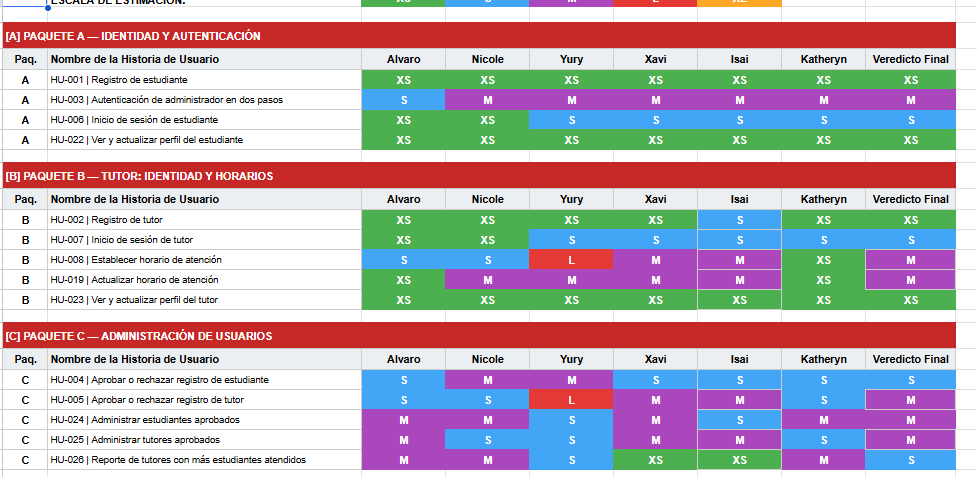
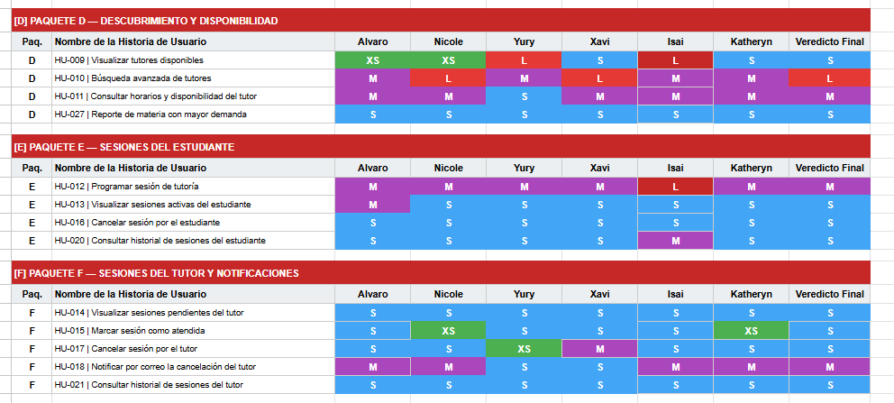
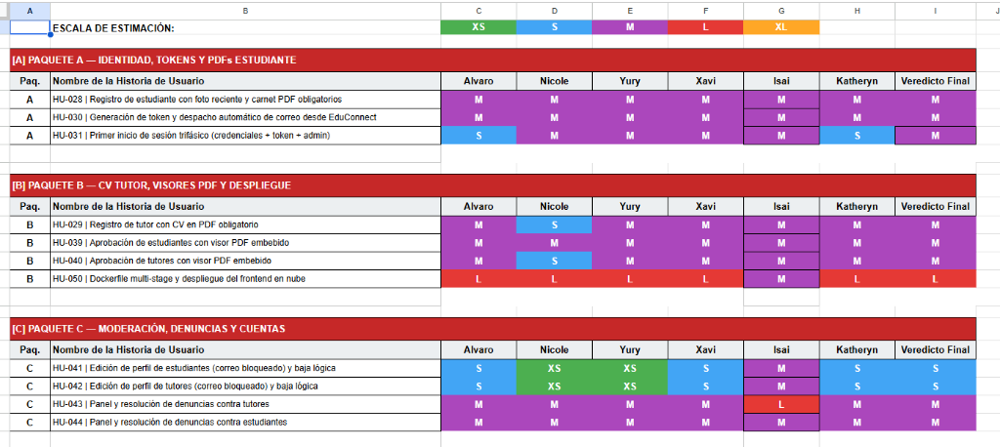
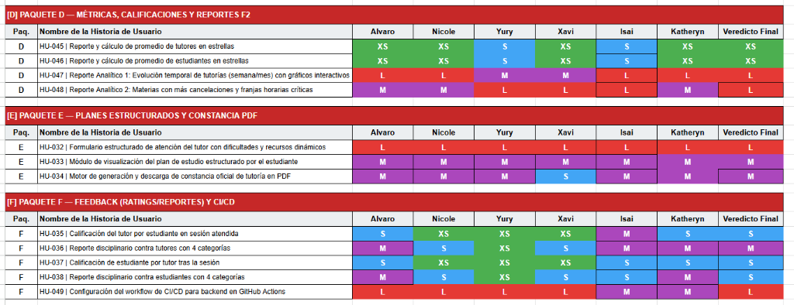

# Product Backlog: historias de usuario y trabajo asociado

> El Product Backlog es una lista ordenada y evolutiva de todo el trabajo necesario para desarrollar y mejorar un producto. Puede incluir historias de usuario, tareas técnicas, pruebas, documentación, despliegue y otros elementos necesarios para entregar valor.
>
> En este documento se presentan las historias de usuario de la plataforma **EduConnect**. Las tareas derivadas de cada historia se gestionan en el tablero Kanban, mientras que la estimación, las dependencias y los criterios de aceptación se consultan en este Product Backlog.
>
> El proyecto se estructuró formalmente en dos grandes fases metodológicas de desarrollo:
> - **Parte 1 (Fase 1 del Proyecto):** Núcleo operativo y gestión académica inicial (HU-001 a HU-027), desarrollado a lo largo de los Sprint 1 y Sprint 2 históricos.
> - **Parte 2 (Fase 2 del Proyecto):** Validación documental estricta (PDFs y tokens Mailtrap), moderación y sanciones, planes estructurados, constancias oficiales, reportes analíticos avanzados, CI/CD en GitHub Actions y despliegue cloud (HU-028 a HU-050), organizado en Sprint 1 (Prioridad Alta) y Sprint 2 (Prioridad Media/Baja).

Este documento contiene las historias de usuario para el desarrollo de la plataforma EduConnect, organizadas por fases.  
Cada historia describe una funcionalidad desde la perspectiva del usuario final y está priorizada según su importancia dentro del proyecto, dicha priorización se realizó al inicio de cada fase. Las prioridades están indicadas con cuadros de colores:  

🟥 **Alta:** Funcionalidades críticas que deben implementarse primero, ya que en base a estas se desarrollarán otras más adelante.  
🟨 **Media:** Funcionalidades importantes, pero que pueden desarrollarse después de las críticas.  
🟦 **Baja:** Funcionalidades complementarias que agregan valor analítico o secundario al sistema.  

---

## Estimación del tamaño (T-Shirt Size)

> La estimación representa el tamaño relativo de una historia de usuario, no una cantidad exacta de horas. Las tallas permiten comparar la complejidad y comunicar el nivel de esfuerzo esperado.

Para estimar el tamaño de las historias de usuario, se utilizó el método T-Shirt Size.  

- Durante las sesiones de planificación, los 6 integrantes del equipo evaluaron conjuntamente cada una de las 27 historias de usuario del backlog.
- Cada miembro del equipo emitió su voto individual según su perspectiva técnica de complejidad (frontend, backend, base de datos y pruebas), y posteriormente se debatió en conjunto hasta alcanzar un **Veredicto Final** consensuado.

> **XS:** Historia de muy baja complejidad y rápida implementación (formularios básicos o ajustes directos).  
> **S:** Historia sencilla, con pocos criterios de aceptación y cambios focalizados.  
> **M:** Historia de complejidad media, que requiere lógica de negocio e integración entre frontend y backend.  
> **L:** Historia compleja, que involucra múltiples validaciones, algoritmos de verificación de traslape, persistencia crítica o seguridad.  
> **XL:** Historia muy compleja, con alta incertidumbre técnica o alcance extenso que abarca múltiples subsistemas.  

---

### Evidencias de la Matriz de Estimación Colaborativa (Consenso del Equipo)

Como evidencia del proceso de estimación grupal, se utilizó una matriz de votación en una hoja de cálculo compartida en la que participaron **Alvaro**, **Nicole**, **Yury**, **Xavi**, **Isai** y **Katheryn**, determinando de común acuerdo la talla definitiva de cada historia:

#### Paquetes A, B y C — Identidad, Tutor y Administración

#### Paquetes D, E y F — Descubrimiento, Sesiones y Notificaciones

---

# 1. Fase 1 — Núcleo Operativo y Gestión Inicial (HU-001 a HU-027)

## 1.1 Sprint 1 (Fase 1) — Núcleo Operativo (HU-001 a HU-017)

## 🟥 [HU-001] Registro de estudiante

**Responsable:** Katheryn / Wade (Paquete A)

**Como** estudiante nuevo  
**Quiero** registrarme en la plataforma EduConnect con mis datos personales y académicos  
**Para** solicitar acceso al sistema y poder programar sesiones de tutoría

### Criterios de Aceptación

- El formulario debe solicitar obligatoriamente: nombre, apellido, carnet universitario, correo electrónico institucional y contraseña.
- La fotografía de perfil debe ser un campo opcional para el estudiante.
- La contraseña debe contener al menos 8 caracteres, incluyendo al menos una letra minúscula, una letra mayúscula y un número.
- El sistema debe verificar que no exista previamente un usuario registrado con el mismo correo electrónico o carnet.
- Las contraseñas deben persistirse encriptadas de forma unidireccional utilizando un algoritmo seguro (bcrypt).
- Al completar el registro, la cuenta del estudiante debe crearse en estado pendiente (`PENDING`), impidiendo el inicio de sesión hasta que un administrador apruebe la solicitud.
- El sistema debe mostrar un mensaje claro informando que la cuenta está en espera de revisión administrativa.

### Tamaño: XS

### Dependencias

- Base de datos inicial y esquema de tablas de usuarios

---

## 🟥 [HU-002] Registro de tutor

**Responsable:** Isai (Paquete B)

**Como** docente o tutor aspirante  
**Quiero** registrarme en EduConnect proporcionando mis datos personales, credenciales y fotografía  
**Para** solicitar la habilitación de mi perfil docente y ofrecer tutorías académicas

### Criterios de Aceptación

- El formulario debe solicitar: nombre, apellido, carnet, DPI/identificación, fecha de nacimiento, género, especialidad académica, universidad de origen, modalidad/dirección, año de inicio de experiencia, correo electrónico y contraseña.
- La carga de una fotografía de perfil es de carácter obligatorio para el tutor.
- El sistema debe validar que la fotografía cargada sea en formato de imagen admitido (JPG, PNG) y almacenarse en almacenamiento estático persistente.
- La contraseña debe cumplir con las políticas de complejidad (mínimo 8 caracteres, mayúscula, minúscula y número) y almacenarse con hash seguro.
- La cuenta debe crearse en estado pendiente (`PENDING`), impidiendo el acceso a la plataforma hasta su aprobación.

### Tamaño: XS

### Dependencias

- Base de datos inicial y sistema de almacenamiento de archivos

---

## 🟥 [HU-003] Autenticación de administrador en dos pasos

**Responsable:** Katheryn / Wade (Paquete A)

**Como** administrador del sistema  
**Quiero** autenticarme mediante un mecanismo de inicio de sesión en dos factores (2FA)  
**Para** garantizar el acceso altamente seguro al panel de control y proteger la información institucional

### Criterios de Aceptación

- **Fase 1:** El administrador debe ingresar su correo electrónico y contraseña maestra en un formulario inicial.
- Si las credenciales primarias son correctas, el sistema no emite el token JWT definitivo, sino una respuesta que solicita el segundo factor de autenticación.
- **Fase 2:** El sistema debe exigir la carga física del archivo criptográfico `auth2-ayd1.txt`.
- El backend debe validar el contenido del archivo contra el hash esperado y verificar que el nombre de archivo sea exactamente `auth2-ayd1.txt`.
- Las contraseñas de ambos pasos deben validarse rigurosamente; solo tras la aprobación de ambos factores se emite el token JWT con rol `admin`.
- Si el archivo es inválido, modificado o ausente, el acceso debe denegarse con código HTTP 401.

### Tamaño: M

### Dependencias

- [HU-001] Base de autenticación JWT y configuración de variables de entorno

---

## 🟥 [HU-004] Aprobar o rechazar registro de estudiante

**Responsable:** Alvaro (Paquete C)

**Como** administrador autenticado  
**Quiero** revisar las solicitudes de ingreso de los estudiantes pendientes  
**Para** autorizar el acceso a la plataforma o rechazar solicitudes no válidas

### Criterios de Aceptación

- El panel administrativo debe mostrar un listado claro de todos los estudiantes en estado pendiente (`PENDING`), desplegando carnet, nombre completo, correo y fecha de solicitud.
- El administrador debe disponer de botones diferenciados para "Aprobar" y "Rechazar" cada solicitud.
- Al aprobar, el estado del usuario cambia a `APPROVED`, habilitando inmediatamente su capacidad de iniciar sesión.
- Al rechazar, el estado cambia a `REJECTED`, bloqueando el acceso a la plataforma.
- El sistema debe enviar automáticamente una notificación por correo electrónico al estudiante informándole la resolución de su solicitud.

### Tamaño: S

### Dependencias

- [HU-001] Registro de estudiante
- [HU-003] Autenticación de administrador en dos pasos

---

## 🟥 [HU-005] Aprobar o rechazar registro de tutor

**Responsable:** Alvaro (Paquete C)

**Como** administrador autenticado  
**Quiero** examinar el expediente completo y la fotografía de los tutores postulantes  
**Para** verificar sus credenciales académicas y decidir su aprobación o rechazo en la plataforma

### Criterios de Aceptación

- El panel administrativo debe mostrar el listado de tutores pendientes con acceso a su dossier completo: fotografía, especialidad, universidad, experiencia, DPI y datos de contacto.
- La aprobación cambia el estado del tutor a `APPROVED`, permitiéndole iniciar sesión y configurar horarios de atención.
- El rechazo cambia el estado a `REJECTED`, impidiendo el inicio de sesión.
- Debe dispararse un correo electrónico institucional automático notificando al tutor la decisión del administrador.
- Las decisiones administrativas deben reflejarse de inmediato en el sistema sin requerir recargas manuales.

### Tamaño: M

### Dependencias

- [HU-002] Registro de tutor
- [HU-003] Autenticación de administrador en dos pasos

---

## 🟥 [HU-006] Inicio de sesión de estudiante

**Responsable:** Katheryn / Wade (Paquete A)

**Como** estudiante registrado  
**Quiero** iniciar sesión con mi correo y contraseña  
**Para** ingresar al portal y acceder a la programación de mis tutorías

### Criterios de Aceptación

- El formulario debe requerir correo electrónico y contraseña.
- Si las credenciales son incorrectas, debe mostrarse el mensaje: "Credenciales inválidas".
- Si el usuario existe pero su estado es `PENDING`, el sistema debe denegar el acceso con HTTP 403 y mostrar el mensaje: "Tu cuenta está pendiente de aprobación por el administrador".
- Si la cuenta está en estado `REJECTED` o `DISABLED`, el acceso debe ser bloqueado con un mensaje explícito.
- Al ingresar exitosamente, se debe retornar un token JWT válido con rol `student` y redirigir al estudiante a su panel principal.

### Tamaño: S

### Dependencias

- [HU-001] Registro de estudiante
- [HU-004] Aprobar o rechazar registro de estudiante

---

## 🟥 [HU-007] Inicio de sesión de tutor

**Responsable:** Isai (Paquete B)

**Como** tutor aprobado  
**Quiero** autenticarme en EduConnect con mis credenciales  
**Para** acceder al panel docente y gestionar mi agenda de atención

### Criterios de Aceptación

- El sistema debe verificar correo y contraseña contra la base de datos de tutores.
- Debe comprobar estrictamente que el tutor tenga estado `APPROVED`.
- Si el tutor está en estado `PENDING`, `REJECTED` o `DISABLED`, se debe rechazar la autenticación informando el motivo del estado.
- Tras la validación exitosa, se genera una sesión autenticada con JWT conteniendo el rol `tutor` y su identificador de perfil.

### Tamaño: S

### Dependencias

- [HU-002] Registro de tutor
- [HU-005] Aprobar o rechazar registro de tutor

---

## 🟥 [HU-008] Establecer horario de atención

**Responsable:** Isai (Paquete B)

**Como** tutor autenticado  
**Quiero** definir mis días disponibles de la semana y un rango de horario diario  
**Para** habilitar espacios de tiempo en los que los estudiantes puedan reservarme citas

### Criterios de Aceptación

- El tutor debe poder seleccionar uno o varios días de la semana (Lunes a Domingo).
- Debe establecer una hora de inicio y una hora de finalización (formato HH:mm).
- El sistema debe validar que la hora de inicio sea estrictamente anterior a la hora de finalización.
- La disponibilidad debe guardarse en la tabla de horarios asociada al perfil del tutor autenticado.
- El tutor no puede definir intervalos invertidos ni vacíos.

### Tamaño: M

### Dependencias

- [HU-007] Inicio de sesión de tutor

---

## 🟥 [HU-009] Visualizar tutores disponibles

**Responsable:** Yury (Paquete D)

**Como** estudiante autenticado  
**Quiero** consultar la lista de tutores aprobados y activos en la plataforma  
**Para** conocer a los profesionales disponibles y seleccionar al más apto para mi consulta

### Criterios de Aceptación

- La interfaz debe presentar una cuadrícula o lista de tutores aprobados (`APPROVED`), mostrando nombre completo, fotografía, especialidad académica, universidad y modalidad de tutoría.
- No deben aparecer tutores en estado pendiente (`PENDING`) ni deshabilitados (`DISABLED`).
- Si el estudiante ya tiene una sesión activa programada con un tutor específico, dicho tutor debe ser excluido del catálogo de reserva activa para prevenir duplicidad.
- Cada tarjeta de tutor debe incluir un botón directo para consultar sus horarios y disponibilidad.

### Tamaño: S

### Dependencias

- [HU-005] Aprobar o rechazar registro de tutor
- [HU-006] Inicio de sesión de estudiante

---

## 🟥 [HU-011] Consultar horarios y disponibilidad del tutor

**Responsable:** Yury (Paquete D)

**Como** estudiante  
**Quiero** seleccionar un tutor y visualizar sus días y horas de atención  
**Para** elegir una fecha y hora disponible antes de solicitar la tutoría

### Criterios de Aceptación

- Al elegir un tutor, el estudiante debe visualizar los días de la semana en los que dicho tutor ofrece atención.
- El sistema debe permitir elegir una fecha específica en el calendario y validar que corresponda a un día habilitado por el tutor.
- Deben desplegarse los bloques de horarios disponibles calculados para esa fecha, distinguiendo claramente los espacios libres de los ocupados.
- Si una fecha u hora ya cuenta con una cita programada, dicho bloque debe mostrarse como no disponible.

### Tamaño: M

### Dependencias

- [HU-008] Establecer horario de atención
- [HU-009] Visualizar tutores disponibles

---

## 🟥 [HU-012] Programar sesión de tutoría

**Responsable:** Nicole (Paquete E)

**Como** estudiante autenticado  
**Quiero** reservar una cita de tutoría indicando fecha, hora, materia y motivo  
**Para** asegurar un espacio de asesoría académica personalizada con el tutor seleccionado

### Criterios de Aceptación

- El formulario debe solicitar: tutor seleccionado, fecha, hora de inicio, materia y descripción del motivo de la consulta.
- El sistema debe validar que la fecha y hora solicitadas estén dentro del rango de horario configurado por el tutor.
- **Regla anti-traslapes:** El sistema debe verificar en la base de datos que el tutor no tenga ya una sesión reservada (`PENDING` o `ATTENDED`) que se cruce en el intervalo de tiempo seleccionado.
- **Regla de unicidad de sesión:** Un estudiante no puede tener más de una sesión activa simultánea con el mismo tutor.
- Al confirmar la reserva, la sesión se registra con estado `PENDING` y duración estándar de 60 minutos.

### Tamaño: M

### Dependencias

- [HU-011] Consultar horarios y disponibilidad del tutor

---

## 🟥 [HU-016] Cancelar sesión por el estudiante

**Responsable:** Nicole (Paquete E)

**Como** estudiante  
**Quiero** cancelar una sesión de tutoría que tenga programada  
**Para** liberar el horario del tutor en caso de que no pueda asistir a la cita

### Criterios de Aceptación

- El estudiante debe visualizar sus citas programadas y contar con un botón de "Cancelar Cita".
- El sistema debe solicitar confirmación explícita antes de ejecutar la acción.
- Al confirmar, el estado de la sesión cambia inmediatamente a `CANCELLED_BY_STUDENT`.
- El horario ocupado por la sesión debe quedar automáticamente liberado en el calendario del tutor para que otros estudiantes puedan reservarlo.
- La sesión cancelada debe desaparecer de las citas activas y trasladarse al historial.

### Tamaño: S

### Dependencias

- [HU-012] Programar sesión de tutoría

---

## 🟥 [HU-017] Cancelar sesión por el tutor

**Responsable:** Xavi (Paquete F)

**Como** tutor  
**Quiero** cancelar una sesión pendiente de mi agenda  
**Para** notificar que por un imprevisto no podré impartir la asesoría académica

### Criterios de Aceptación

- El tutor debe poder ver sus citas pendientes y presionar la opción de "Cancelar Cita".
- Se debe solicitar un motivo de cancelación mediante un cuadro de texto obligatorio o modal de confirmación.
- El estado de la sesión debe actualizarse en base de datos a `CANCELLED_BY_TUTOR`.
- El espacio en la agenda del tutor se libera inmediatamente.
- La cita cancelada se conserva en la base de datos con su motivo para efectos de historial y auditoría.

### Tamaño: S

### Dependencias

- [HU-012] Programar sesión de tutoría
- [HU-014] Visualizar sesiones pendientes del tutor

---

## 1.2 Sprint 2 (Fase 1) — Completitud, Gestión y Reportes (HU-018 a HU-027)

## 🟨 [HU-010] Búsqueda avanzada de tutores

**Responsable:** Yury (Paquete D)

**Como** estudiante  
**Quiero** aplicar filtros avanzados en el catálogo de tutores  
**Para** encontrar tutores específicos por materia, años de experiencia, sexo, edad o universidad

### Criterios de Aceptación

- El catálogo de tutores debe incluir controles de filtrado interactivos:
  1. Filtro por materia o especialidad.
  2. Filtro por rango de años de experiencia docente.
  3. Filtro por género/sexo del tutor.
  4. Filtro por edad o rango de nacimiento.
  5. Filtro por universidad de procedencia.
- Los filtros deben ser combinables entre sí (búsqueda multicriterio).
- El sistema debe proveer un botón para limpiar filtros y restaurar el listado completo.
- Si no existen tutores que coincidan con la combinación de filtros, debe mostrarse un mensaje informativo amigable.

### Tamaño: L

### Dependencias

- [HU-009] Visualizar tutores disponibles

---

## 🟨 [HU-013] Visualizar sesiones activas del estudiante

**Responsable:** Nicole (Paquete E)

**Como** estudiante autenticado  
**Quiero** consultar una vista dedicada de mis sesiones de tutoría activas  
**Para** dar seguimiento a mis citas pendientes y conocer las fechas y tutores asignados

### Criterios de Aceptación

- Debe existir una vista accesible ("Mis Sesiones" o "Sesiones Activas") que liste únicamente las citas en estado `PENDING`.
- No deben listarse sesiones finalizadas (`ATTENDED`) ni canceladas.
- Cada tarjeta o fila debe mostrar: nombre del tutor, especialidad, fecha, hora, materia y modalidad.
- Las sesiones deben presentarse ordenadas cronológicamente de la más próxima a la más lejana.
- Si el estudiante no cuenta con citas activas, se debe mostrar un mensaje que invite a programar una tutoría.

### Tamaño: S

### Dependencias

- [HU-012] Programar sesión de tutoría

---

## 🟨 [HU-014] Visualizar sesiones pendientes del tutor

**Responsable:** Xavi (Paquete F)

**Como** tutor autenticado  
**Quiero** consultar la lista de sesiones que los estudiantes han reservado conmigo  
**Para** organizar mi tiempo de preparación y saber qué citas tengo pendientes de impartir

### Criterios de Aceptación

- La interfaz debe listar todas las sesiones del tutor en estado `PENDING`.
- Debe mostrar el nombre completo del estudiante, carnet, materia a consultar, motivo de la sesión, fecha y hora programada.
- Las sesiones deben mostrarse ordenadas cronológicamente por proximidad temporal.
- Desde esta vista el tutor debe tener accesos directos para atender la sesión o cancelarla si fuera necesario.

### Tamaño: S

### Dependencias

- [HU-007] Inicio de sesión de tutor
- [HU-012] Programar sesión de tutoría

---

## 🟨 [HU-015] Marcar sesión como atendida

**Responsable:** Xavi (Paquete F)

**Como** tutor  
**Quiero** marcar una sesión completada como "Atendida" e ingresar un resumen académico  
**Para** registrar formalmente que la asesoría fue impartida y dejar retroalimentación al estudiante

### Criterios de Aceptación

- El tutor debe disponer de la opción "Marcar como Atendida" en sus sesiones pendientes.
- Al presionar la opción, debe desplegarse un formulario que requiera obligatoriamente:
  - Resumen de los temas abordados en la tutoría.
  - Recomendaciones u observaciones para el estudiante.
- Al confirmar el guardado, el estado de la sesión cambia a `ATTENDED` y se persisten los textos en la base de datos.
- La sesión se remueve de las citas pendientes del tutor y pasa a formar parte de las estadísticas e historiales.

### Tamaño: S

### Dependencias

- [HU-014] Visualizar sesiones pendientes del tutor

---

## 🟨 [HU-020] Consultar historial de sesiones del estudiante

**Responsable:** Nicole (Paquete E)

**Como** estudiante  
**Quiero** consultar el historial completo de todas las tutorías que he solicitado  
**Para** revisar mi registro de aprendizaje, citas pasadas y las recomendaciones dejadas por los tutores

### Criterios de Aceptación

- La vista de historial debe incluir tanto sesiones finalizadas (`ATTENDED`) como canceladas (`CANCELLED_BY_STUDENT`, `CANCELLED_BY_TUTOR`).
- Debe incluir distintivos visuales de estado con colores claros (verde para atendida, rojo para cancelada).
- En las sesiones atendidas, el estudiante debe poder hacer clic para abrir y leer el resumen y recomendaciones redactadas por el tutor.
- Las sesiones deben estar ordenadas de la más reciente a la más antigua.

### Tamaño: S

### Dependencias

- [HU-015] Marcar sesión como atendida
- [HU-016] Cancelar sesión por el estudiante

---

## 🟨 [HU-021] Consultar historial de sesiones del tutor

**Responsable:** Xavi (Paquete F)

**Como** tutor  
**Quiero** acceder a mi historial histórico de sesiones atendidas y canceladas  
**Para** llevar control docente de las horas impartidas y consultar expedientes de estudiantes atendidos

### Criterios de Aceptación

- El historial del tutor debe mostrar todas las sesiones con estado `ATTENDED` y cancelaciones pasadas.
- Debe desplegar claramente el nombre del estudiante, carnet, fecha de realización, materia y el resumen registrado.
- Debe permitir distinguir si una cita cancelada fue revocada por el tutor o por el estudiante.
- El listado debe paginarse u ordenarse cronológicamente descendente.

### Tamaño: S

### Dependencias

- [HU-015] Marcar sesión como atendida
- [HU-017] Cancelar sesión por el tutor

---

## 🟨 [HU-022] Ver y actualizar perfil del estudiante

**Responsable:** Katheryn / Wade (Paquete A)

**Como** estudiante autenticado  
**Quiero** consultar y modificar los datos de mi perfil  
**Para** mantener actualizada mi información de contacto en la plataforma

### Criterios de Aceptación

- El estudiante debe visualizar sus datos actuales en un formulario de edición.
- Debe permitir actualizar nombre, apellido y contraseña (con validación de complejidad mínima).
- El correo electrónico institucional y el carnet deben permanecer bloqueados para edición por motivos de seguridad e identidad.
- El sistema debe confirmar la actualización con un mensaje de éxito reactivo.

### Tamaño: XS

### Dependencias

- [HU-006] Inicio de sesión de estudiante

---

## 🟨 [HU-023] Ver y actualizar perfil del tutor

**Responsable:** Isai (Paquete B)

**Como** tutor autenticado  
**Quiero** actualizar la información de mi perfil profesional y contraseña  
**Para** reflejar cambios en mi experiencia académica o actualizar mis credenciales de acceso

### Criterios de Aceptación

- El formulario debe presentar los datos actuales del tutor y permitir modificar especialidad, universidad, dirección/modalidad y contraseña.
- El correo electrónico institucional debe estar bloqueado para edición.
- Las actualizaciones de contraseña deben verificar la presencia de mayúsculas, minúsculas y números antes de encriptarse.
- Los cambios deben guardarse de forma inmediata en la tabla `tutor_profiles`.

### Tamaño: XS

### Dependencias

- [HU-007] Inicio de sesión de tutor

---

## 🟨 [HU-024] Administrar estudiantes aprobados

**Responsable:** Alvaro (Paquete C)

**Como** administrador autenticado  
**Quiero** consultar el directorio de estudiantes aprobados y tener la opción de darles de baja  
**Para** revocar el acceso a estudiantes inactivos o que hayan infringido las normativas de la plataforma

### Criterios de Aceptación

- El panel administrativo debe contar con una pestaña para listar todos los estudiantes con estado `APPROVED`.
- Debe incluir una barra de búsqueda reactiva por carnet, nombre completo o correo electrónico.
- Cada estudiante debe contar con un botón "Dar de baja" que requiera confirmación explícita antes de proceder.
- Al confirmar la baja, el estado del usuario cambia a `DISABLED` mediante una baja lógica (sin eliminar el registro físico en base de datos).
- El estudiante dado de baja debe ver revocado su acceso a la plataforma de inmediato, impidiéndole nuevos inicios de sesión.

### Tamaño: M

### Dependencias

- [HU-003] Autenticación de administrador en dos pasos
- [HU-004] Aprobar o rechazar registro de estudiante

---

## 🟨 [HU-025] Administrar tutores aprobados

**Responsable:** Alvaro (Paquete C)

**Como** administrador autenticado  
**Quiero** consultar los tutores aprobados y poder darles de baja lógica notificándoles por correo  
**Para** gestionar el cuerpo docente activo y desincorporar a tutores que ya no presten servicio

### Criterios de Aceptación

- El panel de administración debe mostrar la lista de tutores activos (`APPROVED`) con su fotografía, especialidad, carnet y universidad.
- Debe permitir buscar tutores en tiempo real por nombre, especialidad, correo o carnet.
- El botón "Dar de baja" debe desplegar un modal que permita ingresar un motivo de desvinculación (opcional o descriptivo).
- Al confirmar, el estado en la base de datos cambia a `DISABLED`.
- El sistema debe enviar un correo electrónico automático al tutor notificando su baja y el motivo registrado por el administrador.
- El tutor dado de baja queda inhabilitado para iniciar sesión y es excluido automáticamente de los catálogos de búsqueda de los estudiantes.

### Tamaño: M

### Dependencias

- [HU-003] Autenticación de administrador en dos pasos
- [HU-005] Aprobar o rechazar registro de tutor

---

## 🟦 [HU-018] Notificar por correo la cancelación del tutor

**Responsable:** Xavi (Paquete F)

**Como** estudiante  
**Quiero** recibir una notificación por correo electrónico cuando mi tutor cancele una sesión  
**Para** enterarme a tiempo de la cancelación, conocer el motivo y reprogramar mi consulta

### Criterios de Aceptación

- El sistema debe integrarse al servicio de correo SMTP (Nodemailer / Mailtrap).
- Al momento en que el tutor ejecute la cancelación de la cita ([HU-017]), se debe disparar automáticamente un correo al estudiante titular de la sesión.
- El cuerpo del correo debe incluir: nombre del estudiante, nombre del tutor, materia, fecha y hora original de la cita, y el motivo detallado de la cancelación.
- Si el servicio de correo presenta fallas de red, la transacción de cancelación de la base de datos debe conservarse y registrar el error en bitácora.

### Tamaño: M

### Dependencias

- [HU-017] Cancelar sesión por el tutor

---

## 🟦 [HU-019] Actualizar horario de atención

**Responsable:** Isai (Paquete B)

**Como** tutor  
**Quiero** modificar los días y horas de mi horario de atención regular  
**Para** ajustar mi disponibilidad docente a nuevos compromisos académicos

### Criterios de Aceptación

- El tutor debe poder cargar sus rangos de horario actuales y definir nuevos días o intervalos horarios.
- **Regla de integridad:** El sistema debe comprobar que el nuevo horario no deje citas previamente programadas en estado pendiente (`PENDING`) fuera del nuevo rango de atención.
- Si existen sesiones pendientes que entrarían en conflicto con el nuevo horario, la actualización debe ser rechazada informando al tutor de las citas existentes.
- Si no hay conflictos, los nuevos rangos deben actualizarse en la tabla de horarios del tutor.

### Tamaño: M

### Dependencias

- [HU-008] Establecer horario de atención
- [HU-012] Programar sesión de tutoría

---

## 🟦 [HU-026] Reporte de tutores con más estudiantes atendidos

**Responsable:** Alvaro (Paquete C)

**Como** administrador autenticado  
**Quiero** consultar un reporte analítico con el ranking de tutores según la cantidad de estudiantes y citas atendidas  
**Para** identificar a los tutores con mayor impacto y demanda en la plataforma EduConnect

### Criterios de Aceptación

- El reporte debe contabilizar exclusivamente las sesiones de tutoría con estado `ATTENDED` (atendidas exitosamente), excluyendo citas pendientes (`PENDING`) y canceladas.
- Los tutores deben ordenarse en un ranking descendente según la cantidad de sesiones atendidas.
- En caso de empate en sesiones atendidas, el criterio de desempate debe ser la cantidad de estudiantes únicos distintos atendidos (`COUNT(DISTINCT student_id)`).
- La interfaz administrativa debe mostrar:
  - Tarjetas de resumen KPI (Total de sesiones atendidas, Estudiantes beneficiados, Tutor líder #1).
  - Tabla detallada con distintivos de podio (#1, #2, #3), especialidad, carnet, universidad, barras de porcentaje de demanda y estado.
  - Filtro reactivo para buscar por nombre/especialidad y alternar entre todos los tutores o solo aquellos con atenciones.
- El sistema debe incluir la opción de **Exportar Reportes**, descargando simultáneamente:
  1. Planilla en formato CSV con codificación UTF-8 con BOM.
  2. Documento ejecutivo oficial en formato PDF con membrete y estructura formal.
- La interfaz del reporte y sus exportaciones deben presentarse sin caracteres emojis informales.

### Tamaño: S

### Dependencias

- [HU-003] Autenticación de administrador en dos pasos
- [HU-015] Marcar sesión como atendida

---

## 🟦 [HU-027] Reporte de materia con mayor demanda

**Responsable:** Yury (Paquete D)

**Como** administrador autenticado  
**Quiero** visualizar un reporte que totalice las sesiones reservadas agrupadas por materia  
**Para** conocer qué asignaturas académicas presentan la mayor necesidad de apoyo estudiantil

### Criterios de Aceptación

- El endpoint debe consultar y agregar el número total de sesiones registradas agrupadas por el campo `materia`.
- El reporte debe ordenar las materias de mayor a menor número de solicitudes recibidas.
- La interfaz debe presentar una tabla ordenada con el nombre de la materia, total de citas solicitadas y porcentaje relativo sobre el total general.
- Debe calcularse en tiempo real a partir de las sesiones existentes en base de datos.

### Tamaño: S

### Dependencias

- [HU-003] Autenticación de administrador en dos pasos
- [HU-012] Programar sesión de tutoría

---

# 2. Fase 2 — Validación Documental, Planes, Moderación, CI/CD y Cloud (HU-028 a HU-050)

> Esta sección contiene el Product Backlog ampliado y oficial para la **Fase 2 del Proyecto EduConnect**.
> Incorpora 23 nuevas historias de usuario (**HU-028 a HU-050**), abarcando flujos de validación documental estricta (carnet y CV en PDF), verificación de identidad por token temporal vía correo institucional (Mailtrap), aprobación administrativa con visores embebidos, moderación de conducta y régimen sancionatorio de bajas lógicas, planes de estudio estructurados con recursos dinámicos, generación y descarga de constancias oficiales vectoriales en PDF, reportes analíticos multidimensionales con gráficos interactivos, pipeline automatizado de CI/CD en GitHub Actions y despliegue del frontend en la nube mediante contenedores multi-stage.

---

## Metodología y Priorización de Fase 2

La priorización del backlog de Fase 2 se definió al inicio de la fase en estrecha coordinación entre el **Scrum Master (Alvaro)**, el **Product Owner (Isai)** y el **Equipo de Desarrollo (Nicole, Yury, Xavi, Wade)**, respetando la arquitectura técnica y la secuencia crítica de dependencias:

* 🟥 **Prioridad ALTA (Sprint 1 de Fase 2 — Días 3 al 14):**
  Constituye el núcleo operativo y habilitador del sistema. Incluye el registro con respaldos documentales en PDF, la generación y despacho automático de tokens por correo electrónico, el panel de aprobación con visor embebido de carnets, la edición de perfiles protegida y sanciones iniciales de tutores, el registro obligatorio de planes de estudio estructurados, las calificaciones base de tutores y el pipeline automatizado de CI/CD (Build y Test) en GitHub Actions. Sin estas historias concluidas, no es factible desbloquear los flujos del siguiente sprint.
* 🟨 **Prioridad MEDIA (Sprint 2 de Fase 2 — Días 15 al 28):**
  Agrupa funcionalidades que completan la experiencia integral y cierran los ciclos operativos: primer login trifásico con validación dual, visor embebido para currículums de tutores, constancia oficial de tutoría en PDF descargable, régimen sancionatorio contra estudiantes infractores, reportes disciplinarios tipificados bidireccionales y la infraestructura de despliegue en la nube con Docker multi-stage.
* 🟦 **Prioridad BAJA (Sprint 2 de Fase 2 — Días 15 al 28):**
  Funcionalidades analíticas complementarias de valor estratégico avanzado, específicamente el Reporte Analítico 2 (**HU-048**) que correlaciona tasas de cancelación y distribución horaria crítica mediante visualizaciones combinadas.

---

## Estimación del Tamaño (T-Shirt Size) — Consenso Fase 2

Para la estimación del esfuerzo y complejidad de las 23 historias de usuario de Fase 2, el equipo completo aplicó la técnica **T-Shirt Size** en sesiones plenarias de planificación.

Cada integrante emitió su voto individual analizando el impacto en frontend, lógica de negocio en backend, persistencia en base de datos y diseño de pruebas automatizadas:
* **XS:** Complejidad mínima. Cambios focalizados o formularios simples sin dependencias complejas.
* **S:** Complejidad baja. Pocos criterios de aceptación, endpoints directos o CRUDs estándar.
* **M:** Complejidad media. Integración completa frontend-backend, reglas de negocio o transacciones en base de datos.
* **L:** Complejidad alta. Múltiples validaciones, algoritmos de visualización, flujos asíncronos (correo/tokens), visores embebidos, generación de archivos binarios o configuración de runners CI/CD y despliegue en nube.
* **XL:** Complejidad muy alta con incertidumbre arquitectónica (no requerida en este alcance tras la modularización en paquetes).

### Matriz de Consenso y Votación Individual (Fase 2)

A continuación se detalla la matriz de votación unánime documentada en la hoja de cálculo colaborativa del equipo:

---

### Evidencias de la Matriz de Estimación Colaborativa (Fase 2)

Como evidencia fidedigna de las sesiones sincrónicas de planificación y consenso técnico, se presentan las capturas extraídas de la hoja de cálculo oficial del equipo:

#### Paquetes A, B y C — Identidad, Visores Embebidos y Moderación

#### Paquetes D, E y F — Métricas, Planes Estructurados y CI/CD

---

## Tabla Resumen de Distribución por Sprint y Prioridad (Fase 2)

| Sprint | Código | Historia de Usuario | Paquete | Responsable | Prioridad | Talla |
| :---: | :---: | :--- | :---: | :--- | :---: | :---: |
| **Sprint 1** | **HU-028** | Registro de estudiante con foto reciente y carnet PDF obligatorios | A | Yury | 🟥 Alta | M |
| **Sprint 1** | **HU-030** | Generación de token y despacho automático de correo desde EduConnect | A | Yury | 🟥 Alta | M |
| **Sprint 1** | **HU-029** | Registro de tutor con CV en PDF obligatorio | B | Xavi | 🟥 Alta | M |
| **Sprint 1** | **HU-039** | Aprobación de estudiantes con visor PDF embebido | B | Xavi | 🟥 Alta | M |
| **Sprint 1** | **HU-041** | Edición de perfil de estudiantes (correo bloqueado) y baja lógica | C | Alvaro | 🟥 Alta | S |
| **Sprint 1** | **HU-043** | Panel y resolución de denuncias contra tutores | C | Alvaro | 🟥 Alta | M |
| **Sprint 1** | **HU-045** | Reporte y cálculo de promedio de tutores en estrellas | D | Wade | 🟥 Alta | XS |
| **Sprint 1** | **HU-047** | Reporte Analítico 1: Evolución temporal de tutorías (semana/mes) con gráficos interactivos | D | Wade | 🟥 Alta | L |
| **Sprint 1** | **HU-032** | Formulario estructurado de atención con dificultades y recursos dinámicos | E | Nicole | 🟥 Alta | L |
| **Sprint 1** | **HU-033** | Visualización del plan de estudio estructurado por el estudiante | E | Nicole | 🟥 Alta | M |
| **Sprint 1** | **HU-035** | Calificación del tutor por estudiante en sesión atendida | F | Isai | 🟥 Alta | S |
| **Sprint 1** | **HU-049** | Configuración del workflow de CI/CD para backend en GitHub Actions | F | Isai | 🟥 Alta | L |
| **Sprint 2** | **HU-031** | Primer inicio de sesión trifásico (credenciales + token + admin) | A | Yury | 🟨 Media | M |
| **Sprint 2** | **HU-040** | Aprobación de tutores con visor PDF embebido | B | Xavi | 🟨 Media | M |
| **Sprint 2** | **HU-050** | Dockerfile multi-stage y despliegue del frontend en nube | B | Xavi | 🟨 Media | L |
| **Sprint 2** | **HU-042** | Edición de perfil de tutores (correo bloqueado) y baja lógica | C | Alvaro | 🟨 Media | S |
| **Sprint 2** | **HU-044** | Panel y resolución de denuncias contra estudiantes | C | Alvaro | 🟨 Media | M |
| **Sprint 2** | **HU-046** | Reporte y cálculo de promedio de estudiantes en estrellas | D | Wade | 🟨 Media | XS |
| **Sprint 2** | **HU-048** | Reporte Analítico 2: Materias con cancelaciones y franjas horarias críticas | D | Wade | 🟦 Baja | L |
| **Sprint 2** | **HU-034** | Motor de generación y descarga de constancia oficial de tutoría en PDF | E | Nicole | 🟨 Media | M |
| **Sprint 2** | **HU-036** | Reporte disciplinario contra tutores con 4 categorías | F | Isai | 🟨 Media | M |
| **Sprint 2** | **HU-037** | Calificación de estudiante por tutor tras la sesión | F | Isai | 🟨 Media | S |
| **Sprint 2** | **HU-038** | Reporte disciplinario contra estudiantes con 4 categorías | F | Isai | 🟨 Media | S |

---

## 2.1 Sprint 1 (Fase 2) — Núcleo de Validación, Planes y CI/CD (Prioridad ALTA 🟥)

## 🟥 [HU-028] Registro de estudiante con foto reciente y carnet PDF obligatorios

**Responsable:** Yury (Paquete A — Identidad, Tokens y PDFs Estudiante)  
**Prioridad:** 🟥 Alta (Sprint 1)  
**Tamaño:** M  

**Como** estudiante postulante  
**Quiero** adjuntar obligatoriamente mi fotografía reciente y mi carnet universitario escaneado en formato PDF al momento de registrarme  
**Para que** el administrador cuente con los respaldos documentales necesarios para validar mi identidad académica previo a concederme acceso

### Criterios de Aceptación

- El formulario solicita obligatoriamente: nombres, apellidos, carnet universitario único, correo institucional único y contraseña segura ($\ge 8$ caracteres, al menos 1 mayúscula, 1 minúscula y 1 número).
- La carga de fotografía reciente y archivo `.pdf` del carnet son estrictamente obligatorios; la interfaz y el backend bloquean el envío si falta cualquiera de los dos documentos.
- Validación estricta de MIME-Type (`application/pdf`) y límite de tamaño máximo del archivo (5 MB).
- Almacenamiento seguro del PDF en el servidor con nombres UUID v4 no colisionables (`/uploads/documents/carnets/`).
- La cuenta se persiste en base de datos en estado pendiente (`PENDING`), impidiendo el inicio de sesión hasta que un administrador apruebe la solicitud.
- Preserva todas las validaciones de unicidad de carnet y correo electrónico institucional.

### Tareas técnicas

- **T-028.1:** Formulario frontend de registro con validaciones de campos y subida de imagen y carnet en PDF.
- **T-028.2:** Middleware backend con `Multer` para validar formato MIME (`application/pdf`), tamaño máximo y almacenamiento con UUID.
- **T-028.3:** Endpoint `POST /api/auth/register/student` con persistencia de campos, hash bcrypt y registro en estado `PENDING`.

### Dependencias

- Base de datos relacional y migración con columna `carnet_pdf_url` en tabla `users`.

---

## 🟥 [HU-030] Generación de token y despacho automático de correo desde EduConnect

**Responsable:** Yury (Paquete A — Identidad, Tokens y PDFs Estudiante)  
**Prioridad:** 🟥 Alta (Sprint 1)  
**Tamaño:** M  

**Como** sistema EduConnect  
**Quiero** generar un token criptográfico único y despachar un correo institucional tras el registro de cualquier estudiante o tutor  
**Para que** el usuario verifique la legitimidad de su dirección de correo antes de su primer acceso a la plataforma

### Criterios de Aceptación

- Generación de un token pseudoaleatorio alfanumérico seguro de 6 caracteres persistido en la tabla `users` (`verification_token`) con expiración de 24 horas y marca inicial `email_verified = FALSE`.
- Envío automático e inmediato mediante transporte SMTP (Mailtrap) con remitente oficial "EduConnect".
- Plantilla HTML de correo con diseño institucional: logotipo oficial, mensaje de bienvenida contra filtros anti-spam, el token en texto resaltado e instrucciones claras de verificación.
- Si el despacho de correo falla, el backend maneja el error sin comprometer la persistencia del usuario registrado.

### Tareas técnicas

- **T-030.1:** Módulo utilitario de generación de tokens alfanuméricos criptográficos y control de expiración.
- **T-030.2:** Configuración del servicio de correo con `nodemailer` y transporte SMTP (Mailtrap Sandbox).
- **T-030.3:** Diseño de plantilla HTML institucional de correo con token destacado y mensaje anti-spam.

### Dependencias

- [HU-028] Registro de estudiante / [HU-029] Registro de tutor.

---

## 🟥 [HU-029] Registro de tutor con CV en PDF obligatorio

**Responsable:** Xavi (Paquete B — CV Tutor, Visores PDF y Despliegue)  
**Prioridad:** 🟥 Alta (Sprint 1)  
**Tamaño:** M  

**Como** docente o tutor postulante  
**Quiero** adjuntar obligatoriamente mi currículum vítae en formato PDF durante mi registro profesional  
**Para que** la administración certifique mi experiencia académica y materias de especialidad previo a autorizarme impartir tutorías

### Criterios de Aceptación

- El formulario solicita obligatoriamente: nombres, apellidos, carnet, DPI/identificación, fecha de nacimiento, género, especialidades académicas, universidad de origen, modalidad/dirección, año de inicio de experiencia, correo institucional y contraseña segura.
- Carga obligatoria de fotografía de perfil y currículum vítae en formato estrictamente PDF (`application/pdf`).
- Validación de tamaño máximo del archivo PDF (hasta 5 MB) y almacenamiento en disco persistente (`/uploads/documents/cvs/`) con nombres basados en UUID v4.
- Se almacena la ruta relativa en base de datos (`cv_pdf_url`) asociada al registro del tutor.
- El registro se crea en estado inicial `PENDING` y `email_verified = FALSE`, bloqueando cualquier acceso hasta la aprobación.

### Tareas técnicas

- **T-029.1:** Formulario web de registro de tutor con carga de foto de perfil y CV en PDF.
- **T-029.2:** Middleware de carga con validación de tipo MIME y límite de tamaño para CVs.
- **T-029.3:** Endpoint `POST /api/auth/register/tutor` con persistencia de especialidades, ruta de CV y estado inicial `PENDING`.

### Dependencias

- Esquema de base de datos con campo `cv_pdf_url` en tabla `users` y `tutors`.

---

## 🟥 [HU-039] Aprobación de estudiantes con visor PDF embebido

**Responsable:** Xavi (Paquete B — CV Tutor, Visores PDF y Despliegue)  
**Prioridad:** 🟥 Alta (Sprint 1)  
**Tamaño:** M  

**Como** administrador del sistema  
**Quiero** examinar el carnet del estudiante directamente en la interfaz mediante un visor incrustado sin necesidad de descargarlo localmente  
**Para que** pueda cotejar los datos registrados con el documento oficial de forma rápida y segura antes de aprobar o rechazar la solicitud

### Criterios de Aceptación

- Panel de revisión de solicitudes de estudiantes en estado `PENDING`.
- Visor PDF embebido mediante etiqueta `<iframe src="{pdfUrl}">` o visor PDF.js con zoom, paginación y navegación nítida sin forzar la descarga en disco local.
- Endpoint seguro de lectura con cabeceras `Content-Type: application/pdf` y `Content-Disposition: inline`.
- Visualización simultánea de foto de perfil, carnet, nombre completo, correo y datos académicos.
- Botones de acción "Aprobar" (actualiza estado a `APPROVED`) y "Rechazar" (actualiza estado a `REJECTED`), disparando notificación de resolución.

### Tareas técnicas

- **T-039.1:** Endpoint de streaming seguro de documentos PDF (`GET /api/documents/carnet/:id`).
- **T-039.2:** Componente frontend de visor PDF interactivo embebido en modal o vista de aprobación.
- **T-039.3:** Acciones administrativas de aprobación/rechazo con actualización de estado y retroalimentación visual.

### Dependencias

- [HU-028] Registro de estudiante con carnet PDF.

---

## 🟥 [HU-041] Edición de perfil de estudiantes (correo bloqueado) y baja lógica

**Responsable:** Alvaro (Paquete C — Moderación, Denuncias y Cuentas / Scrum Master)  
**Prioridad:** 🟥 Alta (Sprint 1)  
**Tamaño:** S  

**Como** administrador del sistema  
**Quiero** visualizar el padrón de estudiantes aprobados, editar su información académica o dar de baja su cuenta  
**Para que** el directorio estudiantil se mantenga depurado y se puedan deshabilitar accesos indebidos de forma justificada

### Criterios de Aceptación

- Tabla interactiva con búsqueda por nombre o carnet y paginación de estudiantes en estado `APPROVED`.
- Formulario modal de edición que permite modificar nombre, apellido y carnet, manteniendo el correo electrónico estrictamente bloqueado para edición (`disabled`/`readonly`).
- Validación en backend: cualquier intento de alterar el correo electrónico en la petición PUT/PATCH debe ser rechazado con error 400 Bad Request.
- Botón de "Dar de baja" con modal de confirmación obligatorio; actualiza el estado del estudiante a `DISABLED`.
- Un estudiante con estado `DISABLED` tiene denegado el inicio de sesión de forma inmediata (código 403 Forbidden).

### Tareas técnicas

- **T-041.1:** Vista administrativa de gestión de estudiantes aprobados con tabla, filtros y acciones.
- **T-041.2:** Modal de edición de perfil con campo de correo bloqueado y validaciones de datos.
- **T-041.3:** Endpoints `PUT /api/admin/students/:id` y `PATCH /api/admin/students/:id/status` con baja lógica y protección de correo.

### Dependencias

- [HU-003] Autenticación administrativa / [HU-039] Aprobación de estudiantes.

---

## 🟥 [HU-043] Panel y resolución de denuncias contra tutores

**Responsable:** Alvaro (Paquete C — Moderación, Denuncias y Cuentas / Scrum Master)  
**Prioridad:** 🟥 Alta (Sprint 1)  
**Tamaño:** M  

**Como** administrador del sistema  
**Quiero** revisar las quejas formales interpuestas por estudiantes contra tutores y ejecutar sanciones disciplinarias  
**Para que** se mantengan altos estándares de ética, respeto y profesionalismo en las sesiones de tutoría académica

### Criterios de Aceptación

- Panel administrativo que lista denuncias en estado `PENDING` contra tutores con datos: categoría de falta, motivo circunstanciado, sesión relacionada, nombre del tutor denunciado, nombre del estudiante denunciante y marca de tiempo.
- Acción "Dar de baja al tutor" (sanción aplicada): actualiza la denuncia a `RESOLVED_BANNED` y cambia automáticamente el estado del tutor a `DISABLED`.
- Acción "Desestimar denuncia": actualiza el estado de la denuncia a `DISMISSED` sin afectar el estado del tutor.
- Ambas acciones requieren confirmación mediante modal para prevenir ejecuciones accidentales y quedan auditadas en el historial.

### Tareas técnicas

- **T-043.1:** Panel frontend con tabla de denuncias contra tutores, filtros por categoría y modal de detalle.
- **T-043.2:** Modal de resolución con acciones de sanción (baja del tutor) o desestimación.
- **T-043.3:** Endpoint `PATCH /api/admin/reports/tutors/:id/resolve` con transaccionalidad para actualizar denuncia y usuario.

### Dependencias

- Base de datos con tabla `incident_reports` y registros de tutores.

---

## 🟥 [HU-045] Reporte y cálculo de promedio de tutores en estrellas

**Responsable:** Wade (Paquete D — Métricas, Calificaciones y Reportes F2)  
**Prioridad:** 🟥 Alta (Sprint 1)  
**Tamaño:** XS  

**Como** administrador del sistema  
**Quiero** consultar el listado consolidado de tutores activos junto con su promedio de calificación en estrellas  
**Para que** pueda evaluar el rendimiento docente y detectar quiénes destacan positivamente o requieren retroalimentación institucional

### Criterios de Aceptación

- Muestra una tabla con nombre completo del tutor, correo institucional, materias que imparte y el promedio numérico y visual de 0 a 5 estrellas.
- El cálculo se deriva matemáticamente mediante `AVG(rating)` de todas las evaluaciones emitidas por estudiantes en sesiones con estado `ATTENDED`.
- Los tutores que aún no cuentan con evaluaciones registradas deben mostrar un distintivo claro (ej. "Sin calificaciones" o 0.0 estrellas).
- Permite ordenar la tabla por promedio de mayor a menor y viceversa para facilitar la supervisión.

### Tareas técnicas

- **T-045.1:** Consulta SQL de agregación para calcular promedio de estrellas y total de reseñas por tutor.
- **T-045.2:** Endpoint `GET /api/reports/tutors-ratings` con soporte de ordenamiento.
- **T-045.3:** Componente visual de tabla de calificaciones con estrellas interactivas y formato amigable.

### Dependencias

- Base de datos con tabla de calificaciones (`session_ratings` / `reviews`).

---

## 🟥 [HU-047] Reporte Analítico 1: Evolución temporal de tutorías (semana/mes) con gráficos interactivos

**Responsable:** Wade (Paquete D — Métricas, Calificaciones y Reportes F2)  
**Prioridad:** 🟥 Alta (Sprint 1)  
**Tamaño:** L  

**Como** administrador institucional  
**Quiero** visualizar un reporte gráfico interactivo que exhiba el volumen y evolución de tutorías agrupadas por semana y mes  
**Para que** la institución planifique la asignación de recursos y refuerzos académicos en épocas de exámenes

### Criterios de Aceptación

- Gráfico interactivo (Chart.js / Recharts) de líneas o barras temporales con selector de granularidad (semanal y mensual) y rango de fechas.
- Diferenciación visual clara entre sesiones programadas, sesiones atendidas y sesiones canceladas.
- Tabla resumen complementaria que detalle totales absolutos y porcentajes de variación temporal.
- El reporte debe ser completamente nuevo y desacoplado de los reportes estáticos entregados en Fase 1.

### Tareas técnicas

- **T-047.1:** Consulta SQL de agregación temporal (`DATE_FORMAT`, `COUNT`, `GROUP BY`) por intervalos de tiempo.
- **T-047.2:** Endpoint `GET /api/analytics/sessions-timeline` con parámetros de rango temporal.
- **T-047.3:** Interfaz visual con gráficos responsivos, tooltips informativos y filtros de fecha dinámicos.

### Dependencias

- Registro de sesiones de tutoría en base de datos.

---

## 🟥 [HU-032] Formulario estructurado de atención del tutor con dificultades y recursos dinámicos

**Responsable:** Nicole (Paquete E — Planes Estructurados y Constancia PDF)  
**Prioridad:** 🟥 Alta (Sprint 1)  
**Tamaño:** L  

**Como** tutor que ha finalizado una sesión presencial u online  
**Quiero** registrar un plan de estudio estructurado con las dificultades detectadas y un listado dinámico de recursos al concluir la cita  
**Para que** el estudiante cuente con una guía precisa y metodológica para superar sus vacíos académicos

### Criterios de Aceptación

- Al presionar el botón "Atender Estudiante", se despliega un formulario estructurado obligatorio antes de finalizar la sesión.
- Campo de texto obligatorio: "Dificultades Identificadas" (el sistema no permite guardar si está vacío).
- Componente dinámico de recursos que permite agregar, editar y eliminar $N$ recursos pedagógicos en tiempo real.
- Cada recurso exige obligatoriamente tres campos: Nombre del recurso, Tipo de recurso (Texto, Video, PDF o Enlace externo) e Instrucción o descripción de uso.
- Al confirmar, la sesión transiciona exitosamente a estado `ATTENDED` / `COMPLETED` y los datos del plan y recursos se persisten relacionalmente (`study_plans` y `study_resources`).

### Tareas técnicas

- **T-032.1:** Esquema de base de datos y modelos para `study_plans` y `study_resources` vinculados a la sesión.
- **T-032.2:** Formulario dinámico en frontend con validaciones de campos obligatorios y gestión reactiva de arrays de recursos.
- **T-032.3:** Endpoint transaccional `POST /api/sessions/:id/study-plan` que valida datos, guarda el plan y actualiza la sesión a `ATTENDED`.

### Dependencias

- Sesiones agendadas en estado pendiente (`PENDING`).

---

## 🟥 [HU-033] Módulo de visualización del plan de estudio estructurado por el estudiante

**Responsable:** Nicole (Paquete E — Planes Estructurados y Constancia PDF)  
**Prioridad:** 🟥 Alta (Sprint 1)  
**Tamaño:** M  

**Como** estudiante atendido  
**Quiero** acceder a un módulo dedicado para consultar el plan de estudio formulado por mi tutor  
**Para que** pueda repasar las dificultades diagnosticadas y acceder a los recursos recomendados

### Criterios de Aceptación

- Apartado dedicado en el panel del estudiante accesible desde su historial de citas atendidas.
- Despliegue de metadatos de la sesión: fecha de realización, materia, nombre del tutor, carnet y especialidad.
- Sección destacada con el texto íntegro de las "Dificultades Identificadas" por el tutor.
- Tabla formateada de recursos recomendados con nombre, badge de tipo (Texto, Video, PDF, Enlace) e instrucción detallada. Los enlaces web deben ser clicables abriendo en pestaña nueva (`target="_blank"`).

### Tareas técnicas

- **T-033.1:** Endpoint `GET /api/sessions/:id/study-plan` para consultar los detalles del plan y recursos asignados.
- **T-033.2:** Vista de interfaz responsiva en el frontend con tarjetas informativas y badges de tipo de recurso.
- **T-033.3:** Control de acceso para garantizar que únicamente el estudiante dueño de la cita o el tutor puedan visualizar el plan.

### Dependencias

- [HU-032] Formulario estructurado de atención del tutor.

---

## 🟥 [HU-035] Calificación del tutor por estudiante en sesión atendida

**Responsable:** Isai (Paquete F — Feedback y CI/CD / Product Owner)  
**Prioridad:** 🟥 Alta (Sprint 1)  
**Tamaño:** S  

**Como** estudiante que completó una sesión de tutoría  
**Quiero** calificar al tutor asignando de 0 a 5 estrellas e ingresar un comentario voluntario desde mi historial  
**Para que** mi opinión contribuya a la reputación y auditoría de la plataforma

### Criterios de Aceptación

- El formulario de calificación se activa **única y exclusivamente** si la sesión se encuentra en estado `ATTENDED`.
- Bloqueo estricto para sesiones pendientes, activas o canceladas.
- Registro de calificación numérica entera de 0 a 5 estrellas y campo de texto opcional para comentarios.
- Restricción de unicidad: cada sesión puede recibir un único registro de calificación por parte del estudiante; una vez calificada, se desactiva el botón y se muestra la valoración guardada.
- Persistencia en la tabla `session_ratings` / `reviews`.

### Tareas técnicas

- **T-035.1:** Formulario modal de calificación con selector interactivo de estrellas (0 a 5) y textarea de comentarios.
- **T-035.2:** Endpoint `POST /api/sessions/:id/rate-tutor` con validación de estado `ATTENDED` y control de calificación única.
- **T-035.3:** Integración en la vista de historial de citas para reflejar inmediatamente el estado calificado.

### Dependencias

- [HU-032] Sesiones en estado `ATTENDED`.

---

## 🟥 [HU-049] Configuración del workflow de CI/CD para backend en GitHub Actions

**Responsable:** Isai (Paquete F — Feedback y CI/CD / Product Owner)  
**Prioridad:** 🟥 Alta (Sprint 1)  
**Tamaño:** L  

**Como** equipo de ingeniería y DevOps  
**Quiero** un pipeline automatizado que compile, pruebe y verifique el backend en cada integración a `main`  
**Para que** se garantice la integridad del código, detectando regresiones antes de integrar cambios

### Criterios de Aceptación

- Workflow `.github/workflows/backend-ci-cd.yml` activado automáticamente ante eventos `push` hacia la rama `main`.
- **Job Build:** Instalación limpia de dependencias y construcción de la imagen Docker del backend a partir de `./backend/Dockerfile`.
- **Job Test:** Ejecución automatizada de la suite de pruebas unitarias (`npm test` / `node --test`). Si una sola prueba falla, el runner aborta el pipeline de inmediato.
- Las variables sensibles (puertos, secretos, tokens) se administran de forma segura mediante `GitHub Secrets`.
- Costo de infraestructura de $0.00 utilizando el runner oficial de GitHub (`ubuntu-latest`).

### Tareas técnicas

- **T-049.1:** Creación y configuración del archivo de flujo `.github/workflows/backend-ci-cd.yml`.
- **T-049.2:** Configuración del job de Build con Docker y dependencias de Node.js.
- **T-049.3:** Configuración del job de Test con base de datos de servicio (MySQL) y reporte de resultados en el runner.

### Dependencias

- Suite de pruebas unitarias y Dockerfile del backend.

---

## 2.2 Sprint 2 (Fase 2) — Despliegue Cloud, Constancias, Moderación y Cierre (Prioridad MEDIA 🟨 / BAJA 🟦)

## 🟨 [HU-031] Primer inicio de sesión trifásico (credenciales + token + admin)

**Responsable:** Yury (Paquete A — Identidad, Tokens y PDFs Estudiante)  
**Prioridad:** 🟨 Media (Sprint 2)  
**Tamaño:** M  

**Como** estudiante o tutor registrado  
**Quiero** ingresar mi correo, contraseña y el token recibido en mi primer intento de autenticación  
**Para que** el sistema active mi cuenta y me conceda acceso a la plataforma

### Criterios de Aceptación

- En el primer inicio de sesión se exige obligatoriamente el campo "Token de Verificación".
- Si el token ingresado es erróneo, está vencido (> 24 hrs) o no coincide, el acceso es rechazado con mensaje descriptivo específico.
- Si el usuario no ha sido aprobado aún por el administrador (`status != 'APPROVED'`), el sistema bloquea el acceso informando "Cuenta pendiente de aprobación administrativa".
- Tras validar exitosamente ambas condiciones (token válido y aprobación administrativa), la cuenta se marca permanentemente como `email_verified = TRUE`.
- En los inicios de sesión subsecuentes, el sistema solicita únicamente correo y contraseña habituales.

### Tareas técnicas

- **T-031.1:** Adaptación de la vista de Login en frontend para soportar el campo condicional de token.
- **T-031.2:** Endpoint de autenticación adaptado para verificar token temporal y estado de aprobación administrativa.
- **T-031.3:** Lógica de transición para marcar `email_verified = TRUE` y permitir accesos futuros simplificados.

### Dependencias

- [HU-028] / [HU-029] Registros y [HU-030] Envío de token vía correo.

---

## 🟨 [HU-040] Aprobación de tutores con visor PDF embebido

**Responsable:** Xavi (Paquete B — CV Tutor, Visores PDF y Despliegue)  
**Prioridad:** 🟨 Media (Sprint 2)  
**Tamaño:** M  

**Como** administrador del sistema  
**Quiero** leer el CV del tutor en un visor integrado en pantalla sin necesidad de descargas externas  
**Para que** pueda validar su perfil profesional previo a emitir una decisión de ingreso

### Criterios de Aceptación

- Panel de administración para tutores pendientes con visor embebido de CV en PDF (usando iframe o PDF.js) con controles de zoom y desplazamiento responsivo.
- Visualización simultánea de foto de perfil, materias a impartir, identificación, credenciales y años de experiencia.
- Botones "Aprobar Tutor" y "Rechazar Tutor" completamente funcionales que actualizan el estado a `APPROVED` o `REJECTED`.
- Notificación de estado al tutor mediante correo tras la decisión administrativa.

### Tareas técnicas

- **T-040.1:** Integración del componente de visor PDF embebido en la vista de auditoría de tutores.
- **T-040.2:** Endpoint de lectura de CVs (`GET /api/documents/cv/:id`) con cabeceras para renderizado en navegador.
- **T-040.3:** Controladores de aprobación y rechazo administrativo con confirmación y auditoría de estado.

### Dependencias

- [HU-029] Registro de tutor con CV en PDF.

---

## 🟨 [HU-050] Dockerfile multi-stage y despliegue del frontend en nube

**Responsable:** Xavi (Paquete B — CV Tutor, Visores PDF y Despliegue)  
**Prioridad:** 🟨 Media (Sprint 2)  
**Tamaño:** L  

**Como** evaluador técnico y usuario final  
**Quiero** acceder a la plataforma web de EduConnect mediante una URL pública desplegada en la nube  
**Para que** el sistema sea accesible y operativo fuera de un entorno local cerrado

### Criterios de Aceptación

- Frontend dockerizado con Dockerfile optimizado para producción mediante compilación multi-stage (Stage 1: Build de React con Vite; Stage 2: Servidor web ligero `nginx:alpine`).
- Configuración de Nginx para resolver rutas SPA (`try_files $uri /index.html;`).
- Despliegue funcional en proveedor cloud (Vercel, Render o Cloud Run) accesible mediante una URL pública con certificado SSL/HTTPS.
- El frontend en la nube se comunica de forma transparente y segura vía API REST con los servicios del backend mediante la variable `VITE_API_URL`.

### Tareas técnicas

- **T-050.1:** Redacción y optimización del `frontend/Dockerfile` multi-stage y archivo de configuración `nginx.conf`.
- **T-050.2:** Aprovisionamiento y despliegue del servicio frontend en la nube con certificado SSL/HTTPS.
- **T-050.3:** Configuración de variables de entorno de producción y verificación de conectividad con la API REST.

### Dependencias

- Frontend compilable y endpoints de backend accesibles.

---

## 🟨 [HU-042] Edición de perfil de tutores (correo bloqueado) y baja lógica

**Responsable:** Alvaro (Paquete C — Moderación, Denuncias y Cuentas / Scrum Master)  
**Prioridad:** 🟨 Media (Sprint 2)  
**Tamaño:** S  

**Como** administrador del sistema  
**Quiero** auditar a los tutores aprobados, actualizar sus credenciales profesionales y suspender cuentas infractoras  
**Para que** se garantice la idoneidad del personal académico activo

### Criterios de Aceptación

- Listado interactivo de tutores activos con opción de editar datos personales y especialidades docentes.
- Formulario de edición con el correo electrónico estrictamente bloqueado para modificación (`readonly`). El backend rechaza peticiones de alteración con error 400.
- Opción de "Dar de baja" bajo confirmación previa obligatoria, actualizando el estado del tutor a inactivo (`DISABLED`).
- Restricción inmediata de inicio de sesión para el tutor dado de baja y ocultamiento automático de su disponibilidad horaria.

### Tareas técnicas

- **T-042.1:** Panel administrativo de gestión de tutores con tabla interactiva, filtros y estado actual.
- **T-042.2:** Modal de actualización de especialidades y datos del tutor con campo de correo protegido.
- **T-042.3:** Endpoint `PUT /api/admin/tutors/:id` y `PATCH /api/admin/tutors/:id/status` con lógica de suspensión.

### Dependencias

- [HU-003] Autenticación administrativa / [HU-040] Aprobación de tutores.

---

## 🟨 [HU-044] Panel y resolución de denuncias contra estudiantes

**Responsable:** Alvaro (Paquete C — Moderación, Denuncias y Cuentas / Scrum Master)  
**Prioridad:** 🟨 Media (Sprint 2)  
**Tamaño:** M  

**Como** administrador del sistema  
**Quiero** gestionar los reportes presentados por tutores respecto a conductas irregulares de estudiantes  
**Para que** se proteja la integridad física, psicológica y académica de los tutores

### Criterios de Aceptación

- Panel con listado completo de incidencias pendientes contra estudiantes: categoría de falta, explicación detallada, estudiante infractor, tutor denunciante y fecha.
- Acción "Dar de baja al estudiante": actualiza la denuncia a `RESOLVED_BANNED` y suspende inmediatamente la cuenta del estudiante infractor (`DISABLED`).
- Acción "Desestimar reporte": transiciona el estado de la queja a `DISMISSED` sin alterar el estado del estudiante.
- Modales de confirmación en ambas acciones y persistencia en base de datos para trazabilidad y auditoría.

### Tareas técnicas

- **T-044.1:** Interfaz administrativa con tabla de denuncias contra estudiantes y vista detallada de la queja.
- **T-044.2:** Acciones interactivas de sanción inmediata o desestimación con confirmación modal.
- **T-044.3:** Endpoint `PATCH /api/admin/reports/students/:id/resolve` con actualización de estado y baja lógica transaccional.

### Dependencias

- [HU-038] Reportes de tutores contra estudiantes en base de datos.

---

## 🟨 [HU-046] Reporte y cálculo de promedio de estudiantes en estrellas

**Responsable:** Wade (Paquete D — Métricas, Calificaciones y Reportes F2)  
**Prioridad:** 🟨 Media (Sprint 2)  
**Tamaño:** XS  

**Como** administrador institucional  
**Quiero** monitorear la reputación académica de los estudiantes mediante su promedio de estrellas otorgadas por tutores  
**Para que** pueda identificar alumnos ejemplares o aquellos que presenten dificultades sistemáticas

### Criterios de Aceptación

- Muestra una tabla con nombre completo, carnet, correo y promedio de calificación en estrellas (rango 0 a 5).
- Cálculo exacto ponderado a partir de las calificaciones registradas por los tutores en sesiones con estado `ATTENDED`.
- Indicador visual claro para estudiantes sin evaluaciones previas.
- Permite ordenar de mayor a menor y viceversa para facilitar la supervisión docente.

### Tareas técnicas

- **T-046.1:** Consulta SQL de agregación para calcular promedio de estrellas y total de sesiones evaluadas por estudiante.
- **T-046.2:** Endpoint `GET /api/reports/students-ratings` con soporte de paginación y ordenamiento.
- **T-046.3:** Componente frontend de tabla de promedios con visualización de estrellas y filtros de búsqueda.

### Dependencias

- [HU-037] Calificaciones emitidas por tutores hacia estudiantes.

---

## 🟦 [HU-048] Reporte Analítico 2: Materias con más cancelaciones y franjas horarias críticas

**Responsable:** Wade (Paquete D — Métricas, Calificaciones y Reportes F2)  
**Prioridad:** 🟦 Baja (Sprint 2)  
**Tamaño:** L  

**Como** administrador del sistema  
**Quiero** un reporte analítico que correlacione las materias con mayor tasa de cancelación y los horarios más demandados  
**Para que** se tomen medidas correctivas en las materias críticas y se optimice la oferta horaria

### Criterios de Aceptación

- Gráfico visual interactivo (gráfico combinado de pastel o barras apiladas) mostrando la proporción y tasa de cancelaciones por cátedra/materia.
- Mapa de calor o histograma de distribución horaria identificando las franjas con mayor afluencia de reservas y deserciones.
- Tabla complementaria con métricas detalladas: total de reservas, total de cancelaciones y porcentaje relativo de deserción.
- Totalmente desacoplado e independiente de los reportes entregados en Fase 1.

### Tareas técnicas

- **T-048.1:** Consulta analítica agregada para correlacionar tasas de cancelación y distribución horaria por materia.
- **T-048.2:** Endpoint `GET /api/analytics/cancellations-and-schedules` con agregaciones multidimensionales.
- **T-048.3:** Integración de gráficos combinados en el frontend con tooltips explicativos y diseño responsivo.

### Dependencias

- Registros de sesiones de tutoría con estados atendidos y cancelados.

---

## 🟨 [HU-034] Motor de generación y descarga de constancia oficial de tutoría en PDF

**Responsable:** Nicole (Paquete E — Planes Estructurados y Constancia PDF)  
**Prioridad:** 🟨 Media (Sprint 2)  
**Tamaño:** M  

**Como** estudiante  
**Quiero** generar y descargar una constancia formal en PDF de mi plan de estudio  
**Para que** me sirva como comprobante de asistencia académica ante coordinaciones o cátedras universitarias

### Criterios de Aceptación

- Botón "Descargar Constancia en PDF" disponible en el módulo del plan de estudio de la sesión atendida.
- Descarga directa con renderizado vectorial limpio y maquetación profesional:
  - **Encabezado institucional obligatorio:** Logotipo oficial, nombre "EduConnect - Constancia Oficial de Tutoría", fecha de emisión y teléfonos de contacto.
  - **Datos generales de la asesoría:** Nombre del estudiante, carnet, nombre del tutor, especialidad académica y fecha de la sesión.
  - **Cuerpo del documento:** Resumen de dificultades identificadas y tabla formateada con los recursos recomendados (Nombre, Tipo e Instrucción de uso).
  - **Pie de página obligatorio (firma institucional/sello):** Nombre completo del tutor, especialidad docente y número de identificación para garantizar autenticidad.

### Tareas técnicas

- **T-034.1:** Integración de librería de generación de PDF (`jsPDF` / `pdfkit`) con plantilla tipográfica institucional.
- **T-034.2:** Función de mapeo de datos de la sesión y recursos dinámicos hacia la estructura visual del documento.
- **T-034.3:** Implementación del botón de descarga directa en el navegador con nombre estandarizado (`Constancia_Tutoria_[ID].pdf`).

### Dependencias

- [HU-032] y [HU-033] Plan de estudio asignado a la sesión.

---

## 🟨 [HU-036] Reporte disciplinario contra tutores con 4 categorías

**Responsable:** Isai (Paquete F — Feedback y CI/CD / Product Owner)  
**Prioridad:** 🟨 Media (Sprint 2)  
**Tamaño:** M  

**Como** estudiante víctima de irregularidades  
**Quiero** reportar a un tutor desde mi historial mediante un catálogo tipificado de faltas  
**Para que** la coordinación administrativa investigue y sancione malas conductas

### Criterios de Aceptación

- Formulario de denuncia habilitado **única y exclusivamente** sobre sesiones en estado `ATTENDED`.
- Selector obligatorio con al menos 4 categorías oficiales predefinidas: (1) Ética y profesionalismo, (2) Negligencia académica, (3) Abuso o conducta inapropiada, (4) Falsificación de información.
- Campo obligatorio de descripción circunstanciada de los hechos con una longitud mínima de 10 caracteres.
- El reporte se persiste en estado `PENDING` en la tabla `incident_reports` y se canaliza al panel de administración.
- Regla anti-duplicados: un estudiante solo puede interponer un reporte por sesión atendida.

### Tareas técnicas

- **T-036.1:** Formulario modal en frontend para interponer denuncias con selector de categoría y validación de texto.
- **T-036.2:** Endpoint `POST /api/sessions/:id/report-tutor` con validación de sesión atendida y prevención de duplicados.
- **T-036.3:** Notificación de confirmación al estudiante y persistencia en estado `PENDING`.

### Dependencias

- Sesiones en estado `ATTENDED`.

---

## 🟨 [HU-037] Calificación de estudiante por tutor tras la sesión

**Responsable:** Isai (Paquete F — Feedback y CI/CD / Product Owner)  
**Prioridad:** 🟨 Media (Sprint 2)  
**Tamaño:** S  

**Como** tutor  
**Quiero** evaluar el compromiso del estudiante (0 a 5 estrellas y comentario) tras concluir la sesión  
**Para que** quede un precedente del desempeño del alumno en el sistema

### Criterios de Aceptación

- Opción disponible únicamente para sesiones en estado `ATTENDED` impartidas por el tutor autenticado. Bloqueada para canceladas o pendientes.
- Calificación numérica entera entre 0 y 5 estrellas, con textarea opcional para observaciones del tutor sobre la preparación previa del estudiante.
- La calificación y el comentario se persisten sin impedir que el estudiante registre su propia calificación al tutor.
- Cada tutor puede calificar una sola vez a cada estudiante por sesión atendida.

### Tareas técnicas

- **T-037.1:** Componente de calificación del estudiante en la vista de historial de tutorías del tutor.
- **T-037.2:** Endpoint `POST /api/sessions/:id/rate-student` con validaciones de rol y sesión atendida.
- **T-037.3:** Persistencia relacional y bloqueo de re-calificación.

### Dependencias

- Sesiones en estado `ATTENDED`.

---

## 🟨 [HU-038] Reporte disciplinario contra estudiantes con 4 categorías

**Responsable:** Isai (Paquete F — Feedback y CI/CD / Product Owner)  
**Prioridad:** 🟨 Media (Sprint 2)  
**Tamaño:** S  

**Como** tutor afectado  
**Quiero** levantar un reporte disciplinario contra un estudiante problemático  
**Para que** el administrador aplique las sanciones de baja que correspondan

### Criterios de Aceptación

- Válido únicamente sobre sesiones atendidas impartidas por el tutor.
- Selector obligatorio con al menos 4 categorías oficiales predefinidas: (1) Conducta inapropiada, (2) Falsificación de documentos, (3) Agresión verbal o física, (4) Daño a instalaciones / inasistencia lesiva.
- Campo obligatorio de exposición circunstanciada de motivos con un mínimo de 10 caracteres.
- El ticket se persiste en estado `PENDING` en `incident_reports` y se transfiere al panel de administración.
- No se permite más de un reporte del tutor por sesión.

### Tareas técnicas

- **T-038.1:** Formulario modal de denuncia contra estudiantes en el historial de tutorías atendidas del tutor.
- **T-038.2:** Endpoint `POST /api/sessions/:id/report-student` con verificación de autoría y validación de categorías.
- **T-038.3:** Registro y confirmación de la denuncia en la base de datos.

### Dependencias

- Sesiones en estado `ATTENDED`.

