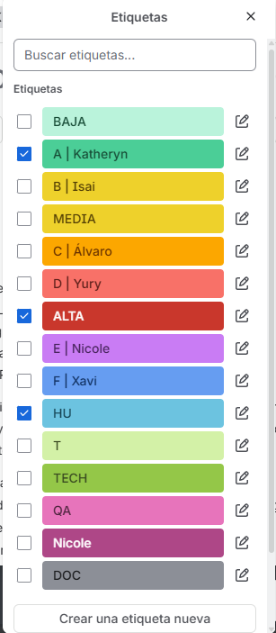
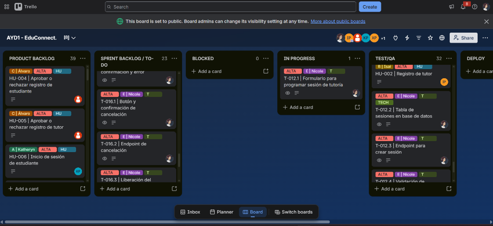
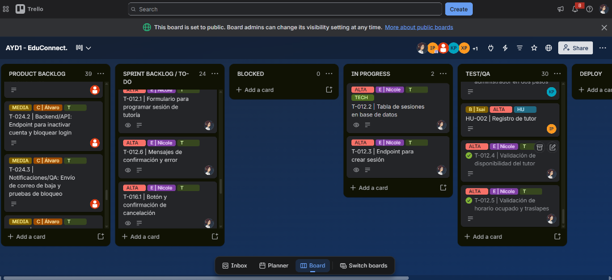

# Tablero Kanban — Flujo Visual de Trabajo (EduConnect)

> Kanban es un método visual para gestionar el flujo continuo de trabajo. Cada tarjeta representa una actividad técnica o historia de usuario y se desplaza entre columnas conforme evoluciona su estado.

El tablero Kanban fue utilizado para llevar el control y seguimiento diario de todas las tareas desarrolladas durante el proyecto **EduConnect**. Este tablero permitió a los 6 miembros del equipo visualizar en tiempo real el progreso de las actividades, coordinar entregas cruzadas y detectar cuellos de botella en cada sprint.

Se utilizó la herramienta **Trello** para implementar el tablero (`AYD1 - EduConnect.`), organizando el flujo de trabajo según el modelo Kanban con las siguientes columnas estándar:

- **TO-DO (Sprint Backlog):** Contiene las tareas planificadas para el sprint que están listas para iniciar su desarrollo.
- **BLOCKED:** Contiene tareas detenidas por alguna razón interna o externa (impedimentos técnicos, dependencias entre módulos no resueltas o bloqueos de entorno).
- **IN PROGRESS:** Reúne las tareas que están siendo desarrolladas activamente por el miembro del equipo responsable.
- **TEST/QA:** Contiene las tareas terminadas a nivel de código que se encuentran bajo pruebas unitarias, validación de integración o revisión cruzada por pares.
- **DEPLOY / DONE:** Contiene las tareas probadas, aprobadas y fusionadas exitosamente en la rama de integración (`develop`) o listas para el despliegue final.

**Backlog General:** En el tablero también se gestionó la columna de **Product Backlog** con el detalle de las 27 historias de usuario. Las tareas derivadas fueron trasladadas a **TO-DO** a medida que se planificaban los sprints. A partir de ahí, se desplazaron por las distintas columnas conforme avanzaban en su ciclo de vida.

---

## 1. Datos del Tablero

| Información | Detalle |
| :--- | :--- |
| **Herramienta usada** | Trello |
| **Nombre del Tablero** | AYD1 - EduConnect. |
| **Enlace al Tablero** | [Acceder al Tablero Trello (AYD1 - EduConnect)](https://trello.com/invite/b/6a8e3c36dcf32de42c7d8d45/ATTIc16aa6c7be21da464d3dabfea5738f984D9AE89F/ayd1-educonnect) |
| **Visibilidad** | Pública / Compartida (acceso para evaluación y seguimiento del equipo) |

---

### Miembros del Equipo y Roles en el Tablero

| Integrante | Inicial / Avatar | Rol Scrum | Paquete de Trabajo Asignado |
| :--- | :---: | :--- | :--- |
| **Alvaro Ceballos** | Avatar rojo | Scrum Master / Dev | **Paquete C:** Administración y Reportes |
| **Katheryn / Wade** | `KP` | Developer | **Paquete A:** Identidad y Autenticación |
| **Isai Patzán** | `IP` | Developer | **Paquete B:** Tutor: Identidad y Horarios |
| **Yury** | `+1` | Developer | **Paquete D:** Descubrimiento y Disponibilidad |
| **Nicole López** | Avatar Nicole | Developer | **Paquete E:** Sesiones del Estudiante |
| **Xavi De León** | `XP` | Developer | **Paquete F:** Sesiones del Tutor y Notificaciones |

---

### Etiquetas y Convenciones Utilizadas en Trello

Para clasificar rápidamente el tipo de trabajo, la prioridad y la pertenencia a cada paquete técnico, se configuraron las siguientes etiquetas en Trello:

#### Clasificación de Etiquetas
1. **Prioridad de la Historia / Tarea:**
   - `ALTA` (Rojo carmesí): Funcionalidades críticas y estructurales del sistema.
   - `MEDIA` (Amarillo mostaza): Funcionalidades operativas importantes complementarias.
   - `BAJA` (Verde menta): Reportes analíticos, notificaciones secundarias y ajustes.

2. **Responsable / Paquete Técnico:**
   - `A | Katheryn`: Paquete A — Registro, Login y 2FA de Estudiante / Admin.
   - `B | Isai`: Paquete B — Registro, Perfil y Configuración Horaria de Tutor.
   - `C | Álvaro`: Paquete C — Aprobaciones, Bajas Lógicas y Reportes Administrativos.
   - `D | Yury`: Paquete D — Catálogo, Búsqueda Avanzada y Reporte de Materias.
   - `E | Nicole`: Paquete E — Reservas, Cancelaciones y Sesiones del Estudiante.
   - `F | Xavi`: Paquete F — Cancelación, Resúmenes, Correos y Sesiones del Tutor.

3. **Naturaleza del Elemento:**
   - `HU` (Azul cian): Historia de Usuario completa con criterios de aceptación.
   - `T` (Verde lima claro): Tarea técnica de desarrollo frontend o backend.
   - `TECH` (Verde oliva): Tarea de infraestructura, scripts de base de datos o Docker.
   - `QA` (Rosa fucsia): Tareas de aseguramiento de calidad, pruebas y verificación.
   - `DOC` (Gris): Tareas de documentación técnica, manuales y heurísticas.

---

## 2. Prioridad en Historias de Usuario

Las 27 historias de usuario del backlog de EduConnect se categorizaron según su criticidad de negocio y dependencias técnicas:

- 🟥 **Rojo (Prioridad Alta):** 13 historias que componen el núcleo operativo indispensable.
- 🟨 **Amarillo (Prioridad Media):** 10 historias de funcionalidad complementaria, perfiles, historial y gestión.
- 🟦 **Azul (Prioridad Baja):** 4 historias de reportes analíticos avanzados y notificaciones automatizadas por correo.

---

# Fase 1

## Sprint 1: Núcleo Operativo

- **Periodo:** Del 2 de septiembre de 2026 al 8 de septiembre de 2026
- **Alcance:** 13 Historias de Usuario (100% Prioridad Alta 🟥) y 50 Tareas Técnicas iniciales.

### Descripción del Sprint Backlog
En este primer sprint se abordaron todas las historias clasificadas con **prioridad alta (🟥)**. El objetivo fue consolidar el núcleo del sistema: esquemas de base de datos en Docker, registro y autenticación de usuarios (estudiante, tutor y 2FA de administrador), aprobación administrativa de cuentas, parametrización de horarios de atención y el motor transaccional de agendamiento y cancelación sin traslapes horarios.

### Historias de Usuario Abordadas en el Sprint 1

| Código | Título de la Historia de Usuario | Responsable | Paquete | Prioridad | Estimación |
| :--- | :--- | :--- | :---: | :---: | :---: |
| **HU-001** | Registro de estudiante | Katheryn / Wade | A | 🟥 ALTA | **XS** |
| **HU-002** | Registro de tutor | Isai Patzán | B | 🟥 ALTA | **XS** |
| **HU-003** | Autenticación de administrador en dos pasos | Katheryn / Wade | A | 🟥 ALTA | **M** |
| **HU-004** | Aprobar o rechazar registro de estudiante | Alvaro Ceballos | C | 🟥 ALTA | **S** |
| **HU-005** | Aprobar o rechazar registro de tutor | Alvaro Ceballos | C | 🟥 ALTA | **M** |
| **HU-006** | Inicio de sesión de estudiante | Katheryn / Wade | A | 🟥 ALTA | **S** |
| **HU-007** | Inicio de sesión de tutor | Isai Patzán | B | 🟥 ALTA | **S** |
| **HU-008** | Establecer horario de atención | Isai Patzán | B | 🟥 ALTA | **M** |
| **HU-009** | Visualizar tutores disponibles | Yury | D | 🟥 ALTA | **S** |
| **HU-011** | Consultar horarios y disponibilidad del tutor | Yury | D | 🟥 ALTA | **M** |
| **HU-012** | Programar sesión de tutoría | Nicole López | E | 🟥 ALTA | **M** |
| **HU-016** | Cancelar sesión por el estudiante | Nicole López | E | 🟥 ALTA | **S** |
| **HU-017** | Cancelar sesión por el tutor | Xavi De León | F | 🟥 ALTA | **S** |

### Estado del Tablero — Sprint 1
A continuación se muestra una vista panorámica del tablero Kanban en Trello durante el flujo de trabajo del Sprint 1, evidenciando el paso de las tarjetas desde el backlog hacia las columnas de desarrollo, pruebas y control de calidad:

### Evidencias de la Evolución del Tablero (Archivos PDF)
Cada evento de Scrum cuenta con su respectiva evidencia exportada en formato PDF dentro del directorio [`tableros_f2/`](tableros_f2/):

- **Sprint Planning 1:** [`sprint1_planning_.pdf`](tableros_f2/sprint1_planning_.pdf)
- **Daily Scrum 1 (03/09/2026):** [`daily1.pdf`](tableros_f2/daily1.pdf)
- **Daily Scrum 2 (04/09/2026):** [`daily2.pdf`](tableros_f2/daily2.pdf)
- **Daily Scrum 3 (05/09/2026):** [`daily3.pdf`](tableros_f2/daily3.pdf)
- **Daily Scrum 4 (06/09/2026):** [`daily4.pdf`](tableros_f2/daily4.pdf)
- **Daily Scrum 5 (07/09/2026):** [`daily5.pdf`](tableros_f2/daily5.pdf)
- **Daily Scrum 6 (08/09/2026):** [`daily6_retrospective1.pdf`](tableros_f2/daily6_retrospective1.pdf)
- **Sprint Retrospective 1 (08/09/2026):** [`daily6_retrospective1.pdf`](tableros_f2/daily6_retrospective1.pdf)

---

# Fase 2

## Sprint 2: Completitud, Gestión y Reportes

- **Periodo:** Del 8 de septiembre de 2026 al 14 de septiembre de 2026
- **Alcance:** 14 Historias de Usuario (10 Prioridad Media 🟨 + 4 Prioridad Baja 🟦) y 41 Tareas Técnicas adicionales (total acumulado: 91 tareas).

### Descripción del Sprint Backlog
Durante el segundo sprint se implementaron las funcionalidades complementarias del sistema: filtros multicriterio para la búsqueda de tutores, atención de citas con resumen pedagógico obligatorio, notificación automática vía correo SMTP tras cancelación, consulta de sesiones activas e historial tanto para estudiante como para tutor, actualización de perfiles con protección de campos no editables, bajas lógicas de usuarios por el administrador y los dos reportes analíticos requeridos (ranking de tutores más solicitados y materias de mayor demanda).

### Historias de Usuario Abordadas en el Sprint 2

| Código | Título de la Historia de Usuario | Responsable | Paquete | Prioridad | Estimación |
| :--- | :--- | :--- | :---: | :---: | :---: |
| **HU-010** | Búsqueda avanzada de tutores | Yury | D | 🟨 MEDIA | **L** |
| **HU-013** | Visualizar sesiones activas del estudiante | Nicole López | E | 🟨 MEDIA | **S** |
| **HU-014** | Visualizar sesiones pendientes del tutor | Xavi De León | F | 🟨 MEDIA | **S** |
| **HU-015** | Marcar sesión como atendida | Xavi De León | F | 🟨 MEDIA | **S** |
| **HU-020** | Consultar historial de sesiones del estudiante | Nicole López | E | 🟨 MEDIA | **S** |
| **HU-021** | Consultar historial de sesiones del tutor | Xavi De León | F | 🟨 MEDIA | **S** |
| **HU-022** | Ver y actualizar perfil del estudiante | Katheryn / Wade | A | 🟨 MEDIA | **XS** |
| **HU-023** | Ver y actualizar perfil del tutor | Isai Patzán | B | 🟨 MEDIA | **XS** |
| **HU-024** | Administrar estudiantes aprobados | Alvaro Ceballos | C | 🟨 MEDIA | **M** |
| **HU-025** | Administrar tutores aprobados | Alvaro Ceballos | C | 🟨 MEDIA | **M** |
| **HU-018** | Notificar por correo la cancelación del tutor | Xavi De León | F | 🟦 BAJA | **M** |
| **HU-019** | Actualizar horario de atención | Isai Patzán | B | 🟦 BAJA | **M** |
| **HU-026** | Reporte de tutores con más estudiantes atendidos | Alvaro Ceballos | C | 🟦 BAJA | **S** |
| **HU-027** | Reporte de materia con mayor demanda | Yury | D | 🟦 BAJA | **S** |

### Estado del Tablero — Sprint 2
A continuación se ilustra el tablero Kanban durante el Sprint 2, donde se integraron las tareas técnicas de reportería, perfiles y QA final:

### Evidencias de la Evolución del Tablero (Archivos PDF)
El avance de cada evento del Sprint 2 se encuentra documentado en formato PDF dentro del directorio [`tableros_f2/`](tableros_f2/):

- **Sprint Planning 2:** [`sprint2_planning.pdf`](tableros_f2/sprint2_planning.pdf)
- **Daily Scrum 1 (09/09/2026):** [`daily7.pdf`](tableros_f2/daily7.pdf)
- **Daily Scrum 2 (10/09/2026):** [`daily8.pdf`](tableros_f2/daily8.pdf)
- **Daily Scrum 3 (11/09/2026):** [`daily9.pdf`](tableros_f2/daily9.pdf)
- **Daily Scrum 4 (12/09/2026):** [`daily10,11.pdf`](tableros_f2/daily10,11.pdf)
- **Daily Scrum 5 (13/09/2026):** [`daily10,11.pdf`](tableros_f2/daily10,11.pdf)
- **Daily Scrum 6 (14/09/2026):** [`daily12_retrospective2.pdf`](tableros_f2/daily12_retrospective2.pdf)
- **Sprint Retrospective 2 (14/09/2026):** [`daily12_retrospective2.pdf`](tableros_f2/daily12_retrospective2.pdf)
