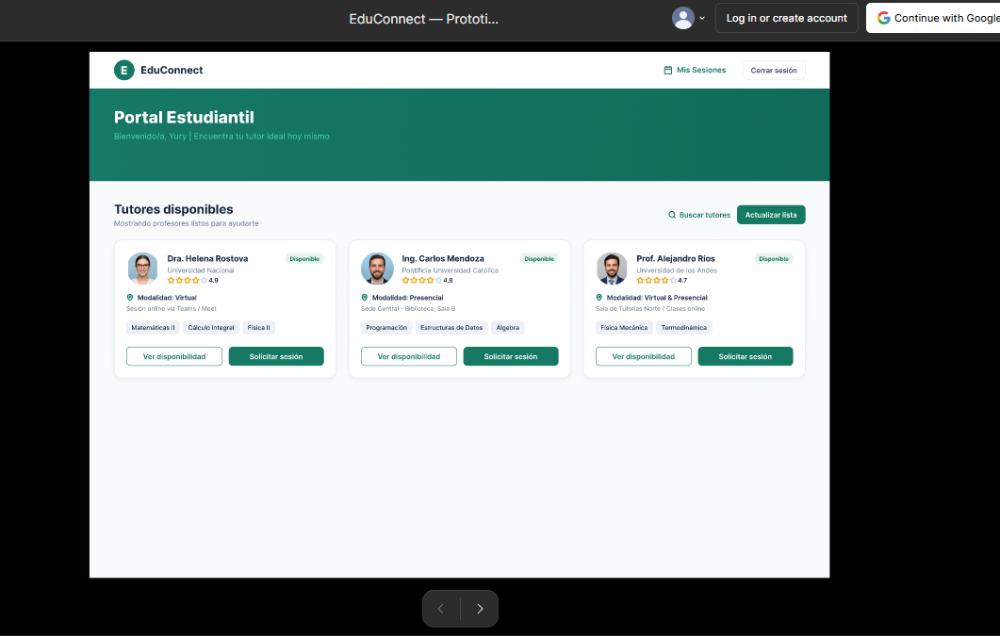
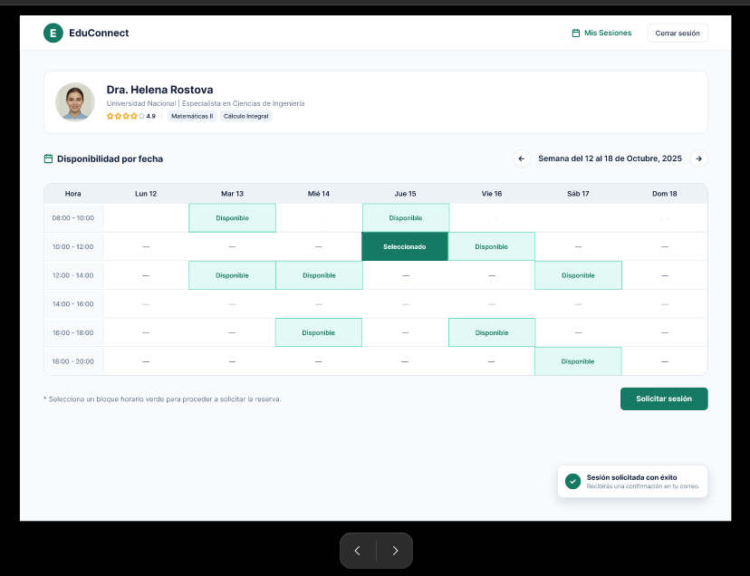
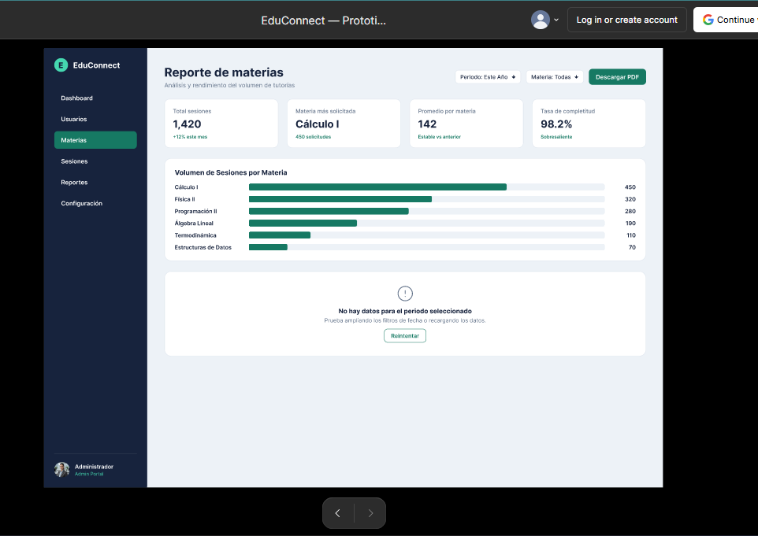
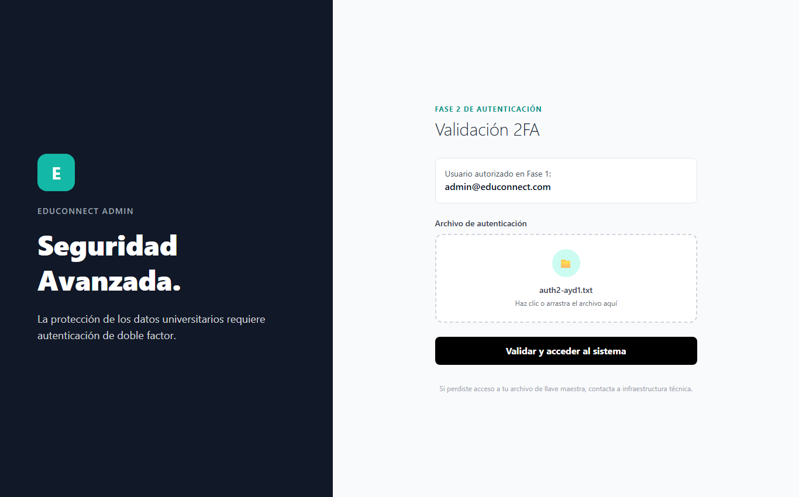
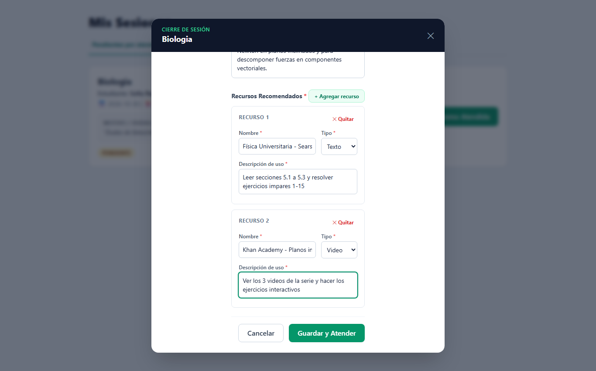
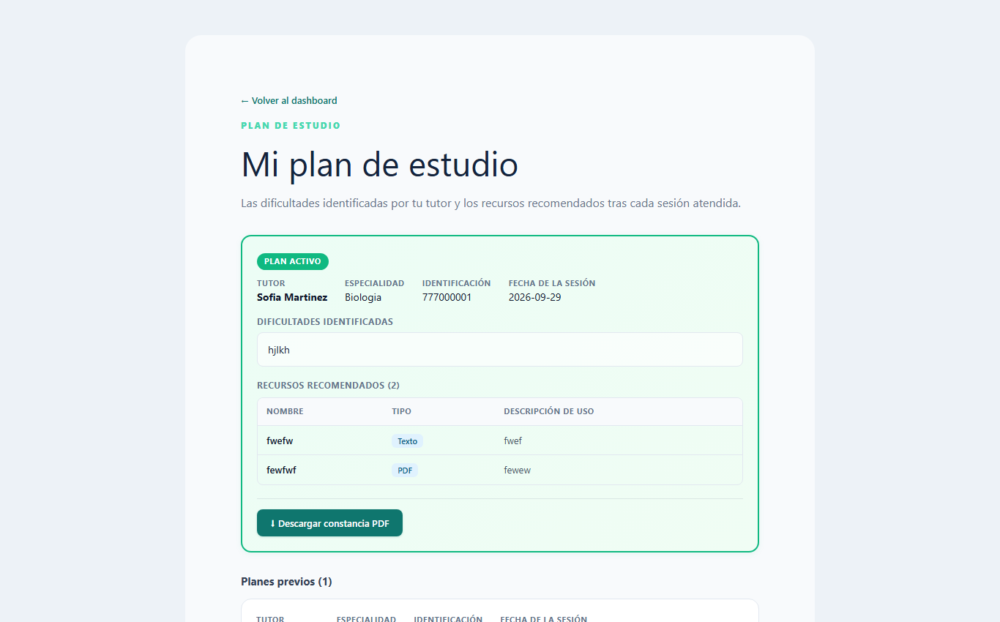
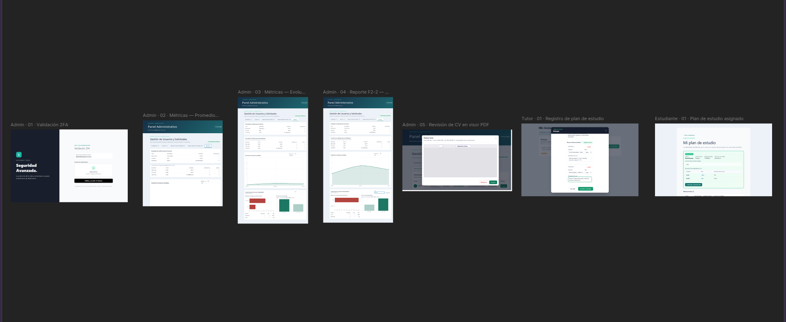

# Guía de estilos y prototipos de EduConnect

> **Responsable:** Yury  
> **Propósito:** definir la identidad visual de EduConnect y documentar los prototipos interactivos utilizados como referencia para la maquetación.

---

## 1. Introducción

EduConnect es una plataforma académica que conecta a estudiantes con tutores para buscar apoyo, consultar disponibilidad y agendar sesiones de tutoría. El sistema de diseño busca transmitir confianza, claridad y acompañamiento, reduciendo la carga cognitiva en tareas frecuentes como registrarse, buscar un tutor y administrar una sesión.

Los criterios descritos en esta guía sirven como referencia para las vistas de **Estudiante**, **Tutor** y **Administrador**, tanto en el prototipo de Figma como en la implementación frontend.

## 2. Principios visuales

- **Claridad primero:** la información académica, los horarios y el estado de las sesiones deben ser fáciles de escanear.
- **Confianza y cercanía:** se utilizan colores sobrios con acentos turquesa y esmeralda para comunicar acompañamiento y disponibilidad.
- **Consistencia:** los botones, tarjetas, tablas, badges, formularios y modales mantienen las mismas reglas en todos los módulos.
- **Prevención de errores:** las acciones sensibles requieren confirmación y los estados inválidos se comunican cerca del campo o elemento afectado.
- **Diseño responsive:** las vistas se adaptan a escritorio, tablet y móvil sin perder la jerarquía de la información.

## 3. Guía de estilos

### 3.1 Paleta de color

| Uso | Nombre | Valor | Aplicación |
|---|---|---|---|
| Primario oscuro | Azul petróleo | `#102C46` | Encabezados, paneles de marca y fondos de navegación. |
| Primario | Esmeralda | `#167963` | Botones principales, enlaces activos y acciones de confirmación. |
| Primario hover | Esmeralda profundo | `#106C58` | Estado hover y énfasis de acciones principales. |
| Acento | Turquesa | `#45D8B0` | Indicadores de disponibilidad, detalles de marca y elementos destacados. |
| Fondo general | Gris azulado claro | `#EDF2F7` | Fondo de la aplicación y separación entre superficies. |
| Superficie | Blanco | `#FFFFFF` | Tarjetas, formularios, tablas y modales. |
| Texto principal | Azul grisáceo | `#17233D` | Títulos, datos y contenido principal. |
| Texto secundario | Gris pizarra | `#6A768C` | Descripciones, metadatos y ayuda contextual. |
| Éxito | Verde | `#14735E` | Confirmaciones, sesiones atendidas y estados activos. |
| Advertencia | Ámbar | `#9A6A00` | Sesiones pendientes, avisos y estados que requieren atención. |
| Error | Rojo carmesí | `#A42E3A` | Validaciones fallidas, rechazos, cancelaciones y acciones destructivas. |

Los colores de estado deben acompañarse de texto o un icono; no se debe comunicar información únicamente mediante color.

### 3.2 Tipografía

La familia principal es **Inter**, seleccionada por su legibilidad en formularios, tablas y datos de horarios.

| Elemento | Tamaño orientativo | Peso | Uso |
|---|---:|---:|---|
| Título de página | 36–48 px | 800–900 | Nombre del módulo o encabezado principal. |
| Título de sección | 26–38 px | 700–800 | Agrupación de contenido dentro de una vista. |
| Título de tarjeta | 16–20 px | 700–800 | Nombre del tutor, sesión o métrica. |
| Texto base | 14–17 px | 400 | Descripciones y contenido general. |
| Etiqueta | 12–13 px | 700–800 | Campos, metadatos, tablas y badges. |
| Texto auxiliar | 12–13 px | 400–500 | Ayudas, restricciones y notas secundarias. |

La jerarquía se construye con tamaño, peso y contraste. Se evita usar mayúsculas sostenidas en textos largos y se mantiene una altura de línea cómoda para la lectura.

### 3.3 Espaciado, bordes y superficies

- Se utiliza una escala de espaciado basada en múltiplos de 4 px, con valores frecuentes de 8, 12, 16, 20, 24 y 32 px.
- Los controles y tarjetas utilizan bordes suaves, principalmente de `1px solid #DFE6EE`.
- Las tarjetas y paneles tienen radios entre 10 y 22 px según su tamaño; los controles pequeños utilizan radios de 8 a 12 px.
- Los badges de estado y contadores utilizan forma de píldora (`border-radius: 999px`).
- Las sombras son discretas y se reservan para superficies elevadas, como modales, tablas y tarjetas de métricas.
- Los campos de entrada muestran un borde esmeralda y un halo suave al recibir foco.

## 4. Componentes reutilizables

### 4.1 Botones

- **Primario:** fondo esmeralda, texto blanco; se utiliza para acciones como `Programar`, `Guardar` o `Aprobar`.
- **Secundario:** fondo blanco o transparente con borde; se utiliza para volver, consultar detalles o cancelar una acción no destructiva.
- **Destructivo:** borde o fondo rojo claro con texto rojo; se utiliza para cancelar una sesión, rechazar una cuenta o deshabilitar un usuario.
- **Deshabilitado/cargando:** reduce la opacidad y bloquea la interacción mientras se procesa la solicitud.

Los botones deben usar verbos claros y mantener una jerarquía visible cuando aparecen varias acciones juntas.

### 4.2 Tarjeta de tutor

La tarjeta de tutor presenta la información necesaria para decidir si se desea agendar una sesión:

1. Fotografía o avatar del tutor.
2. Nombre y datos académicos principales.
3. Materias o especialidades disponibles.
4. Años de experiencia y disponibilidad.
5. Acciones `Ver horarios` y `Programar`.

La disponibilidad se comunica mediante un badge textual, por ejemplo `Disponible`, acompañado de un indicador visual. Las tarjetas deben conservar la misma estructura cuando se muestran en el catálogo o en resultados filtrados.

### 4.3 Tablas administrativas

Las tablas se utilizan para gestionar estudiantes y tutores. Deben incluir:

- Encabezados breves y visibles.
- Filas con suficiente separación vertical.
- Información secundaria debajo del dato principal cuando sea necesario.
- Badges para rol y estado.
- Acciones agrupadas al final de cada fila.
- Desplazamiento horizontal controlado en pantallas pequeñas.

Cuando la tabla no contiene registros, se muestra un estado vacío explicativo en lugar de una superficie en blanco.

### 4.4 Badges y estados

| Estado | Tratamiento visual | Ejemplo |
|---|---|---|
| Activo/disponible | Fondo verde claro, texto verde y punto indicador | `Disponible` |
| Pendiente | Fondo ámbar claro, texto ámbar | `Pendiente` |
| Atendido | Fondo verde claro, texto verde | `Atendida` |
| Cancelado/rechazado | Fondo rojo claro, texto rojo | `Cancelada` |
| Rol | Fondo neutro o verde según el rol | `Estudiante`, `Tutor` |

### 4.5 Formularios

Los formularios agrupan los campos por contexto y colocan la etiqueta directamente encima del control. Los campos obligatorios deben identificarse de forma consistente y los errores deben explicar cómo corregir el valor.

Los formularios de registro pueden incluir datos personales, datos académicos, contraseña y fotografía. El selector de horarios utiliza opciones visibles para días y horas, bloqueando fechas pasadas y espacios ya ocupados.

### 4.6 Modales y confirmaciones

Los modales se reservan para tareas que requieren atención focalizada: consultar el horario de un tutor, programar una sesión o confirmar una cancelación. Deben incluir título, contexto de la acción, controles principales y una forma clara de cerrar o volver atrás.

Las acciones destructivas siempre solicitan confirmación y explican el efecto que tendrá la decisión.

## 5. Aplicación por módulo

### 5.1 Estudiante

El flujo del estudiante prioriza el descubrimiento y la reserva: registro, catálogo de tutores, filtros, consulta de horarios, programación, sesiones activas e historial. Las tarjetas y filtros deben permitir comparar tutores sin abrir múltiples pantallas innecesariamente.

### 5.2 Tutor

El flujo del tutor prioriza la gestión de disponibilidad y sesiones: registro profesional, configuración del horario, actualización del perfil y atención de sesiones pendientes. Los conflictos de horario se muestran antes de guardar cambios.

### 5.3 Administrador

El panel administrativo prioriza la supervisión y la toma de decisiones: pestañas por tipo de usuario, búsqueda, tablas, estados, acciones de aprobación o rechazo y reportes. Los datos deben ser compactos, comparables y fáciles de filtrar.

## 6. Prototipos en Figma

### 6.1 Archivo de diseño

[Abrir archivo editable de diseños en Figma](https://www.figma.com/design/WK53bf0D4M3PiP5elIF0bz/EduConnect-%E2%80%94-Prototipos-interactivos-Yury)

Este enlace contiene las pantallas y componentes utilizados para definir la propuesta visual de EduConnect.

### 6.2 Prototipo interactivo

[Abrir prototipo interactivo de EduConnect](https://www.figma.com/proto/WK53bf0D4M3PiP5elIF0bz/EduConnect-%E2%80%94-Prototipos-interactivos-Yury?scaling=min-zoom&content-scaling=fixed&page-id=12%3A2&node-id=12-3)

El prototipo permite recorrer las interacciones principales y validar los flujos antes de la implementación.

## 7. Capturas de wireframes y mockups

Las siguientes capturas corresponden a los wireframes y mockups diseñados para cada rol de EduConnect.

### 7.1 Módulo Estudiante

**Descripción de la captura:** catálogo de tutores, filtros de búsqueda, consulta de disponibilidad y programación de una sesión.

### 7.2 Módulo Tutor

**Descripción de la captura:** perfil profesional, configuración del horario y listado de sesiones pendientes.

### 7.3 Módulo Administrador

**Descripción de la captura:** gestión de usuarios, filtros, tabla de estados, acciones administrativas y reportes.

## 8. Criterios de validación

Antes de considerar una vista terminada, se verifica que:

- Mantenga la paleta, tipografía y jerarquía definidas en esta guía.
- Use los componentes reutilizables en lugar de crear variantes visuales innecesarias.
- Muestre estados de carga, vacío, éxito, advertencia y error cuando correspondan.
- Sea navegable en pantallas pequeñas sin ocultar acciones importantes.
- Tenga textos, botones y mensajes coherentes con el rol del usuario.
- Coincida con los flujos aprobados en el prototipo interactivo de Figma.

---

## 9. Actualización de la Fase 2

> **Responsable de la actualización:** Wade (202308940) — Paquete D

La Fase 2 conserva la paleta, la tipografía y los componentes descritos en las secciones anteriores. Esta sección documenta los componentes nuevos y las reglas para usarlos de forma consistente.

### 9.1 Visualización de datos

Los reportes analíticos se construyen con **Chart.js** (`react-chartjs-2`).

| Elemento | Color | Uso |
|---|---|---|
| Serie principal | Esmeralda `#167963` | Línea de evolución de sesiones y barra destacada de horarios. |
| Relleno o serie secundaria | Esmeralda translúcido `rgba(22, 121, 99, 0.15–0.35)` | Área bajo la línea y barras no destacadas. |
| Dato negativo | Rojo `#B4413C` | Barras de tasa de cancelación. |

Reglas:

- **Un gráfico, una pregunta:** la evolución usa línea (tendencia en el tiempo); las cancelaciones usan barra horizontal (comparación entre materias de nombre largo); los horarios usan barra vertical en orden cronológico.
- **El dato importante se resalta y se dice en texto:** la franja de mayor demanda se pinta con el color pleno y se repite en el texto "Franja con más demanda".
- **El color nunca es la única señal:** cada gráfico se acompaña de una tabla o de un texto con los valores.
- **Tooltips con contexto:** muestran el valor y su base, por ejemplo "66.7% (2 de 3 sesiones)".
- **Ejes legibles:** las cantidades empiezan en cero y no usan decimales; los porcentajes van de 0 a 100 %.

### 9.2 Filtros de reportes

- Cada reporte agrupa sus filtros en la esquina superior derecha de su tarjeta.
- El periodo se elige con `input type="month"` y la agrupación con un `select` ("Mes" o "Semana").
- Cuando hay un filtro activo, aparece el botón de texto "Limpiar filtro".
- Al cambiar un filtro, la sección muestra "Cargando…" y se actualiza sin recargar la página.

### 9.3 Tablas de calificaciones

- Columnas numéricas (promedio, cantidad) alineadas a la derecha.
- Promedio con dos decimales y estrella: `4.67 ★`.
- Sin calificaciones: texto "Sin calificaciones" en lugar de `0.00 ★`, para no confundir "sin datos" con "calificación baja".
- Orden descendente por promedio, de modo que el mejor y el peor desempeño queden en los extremos.

### 9.4 Estados de carga, vacío y error

| Estado | Tratamiento | Ejemplo |
|---|---|---|
| Carga | Texto gris pizarra en el lugar del contenido | "Cargando…" |
| Vacío | Mensaje que explica la causa, en lugar del gráfico o tabla | "No hay sesiones atendidas en el período seleccionado." |
| Error | Texto rojo dentro de la tarjeta afectada; el resto del panel sigue funcionando | "No se pudieron cargar los reportes analíticos." |

### 9.5 Otros componentes nuevos

- **Zona de carga de archivos:** borde punteado, icono y texto de acción ("Haz clic o arrastra el archivo aquí"). Admite arrastrar y soltar y, al cargar, muestra el nombre del archivo. Se usa en el 2FA del administrador y en el registro con carnet o CV.
- **Visor PDF embebido:** `iframe` dentro del modal de revisión, con título accesible ("Visor de documento PDF"), para revisar carnet o CV sin descargarlos.
- **Insignia "Plan activo":** píldora verde con texto en mayúsculas que identifica el plan de estudio vigente.
- **Recursos dinámicos del plan:** filas que se agregan con "+ Agregar recurso"; cada una pide nombre, tipo (Texto, Video, PDF o Enlace) e instrucción.

### 9.6 Pantallas de la Fase 2

| Vista | Rol | Captura |
|---|---|---|
| Validación 2FA | Administrador |  |
| Métricas: promedios de calificaciones | Administrador |  |
| Métricas: evolución de sesiones | Administrador |  |
| Reporte F2-2: cancelaciones y horarios | Administrador |  |
| Revisión de CV en visor PDF | Administrador |  |
| Registro de plan con recursos | Tutor |  |
| Plan de estudio asignado | Estudiante |  |

### 9.7 Prototipos de la Fase 2 en Figma

Las vistas de la Fase 2 se documentan en un archivo de Figma independiente del de la Fase 1 (sección 6).

- [Abrir archivo de diseño de la Fase 2](https://www.figma.com/design/EN2iwgvgLWbNNp5PoZprcY/EduConnect-%E2%80%94-Prototipo-Fase-2)
- [Abrir prototipo interactivo de la Fase 2](https://www.figma.com/proto/EN2iwgvgLWbNNp5PoZprcY/EduConnect-%E2%80%94-Prototipo-Fase-2?node-id=1-3&scaling=min-zoom)

El prototipo incluye las pantallas de la tabla 9.6 organizadas en dos flujos:

- **Administrador:** validación 2FA → métricas de calificaciones → evolución de sesiones → reporte F2-2 → revisión de CV en visor PDF.
- **Tutor y estudiante:** registro del plan de estudio con recursos → consulta del plan asignado.

