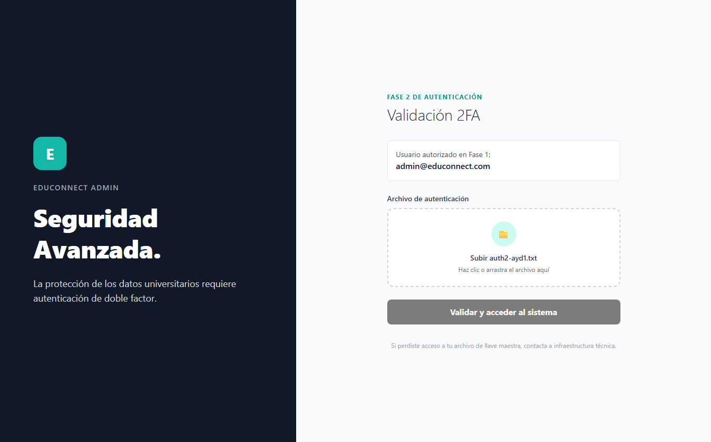

# Evaluación y Aplicación de Principios Heurísticos de Jakob Nielsen

## 1. Introducción
El diseño de interfaces de EduConnect se fundamenta en la aplicación de las 10 heurísticas de usabilidad establecidas por Jakob Nielsen. A continuación se detallan y justifican los 6 principios seleccionados, acompañados de su evidencia de implementación en la plataforma.

---

## 2. Principios Seleccionados y Evidencia de Aplicación

### Heurística 1: Visibilidad del Estado del Sistema
* *Justificación:* Los usuarios deben saber en todo momento el resultado de sus acciones y el estado de la comunicación con el servidor.
* *Aplicación en EduConnect:*
  * *Skeletons de Carga:* En el catálogo de tutores (StudentDashboard.jsx), al consultar la base de datos se despliega una cuadrícula animada de carga tipo pulso (pulse), indicando que el contenido está procesándose.
  * *Insignias de Disponibilidad:* Cada tarjeta de tutor muestra un badge visual con punto parpadeante (● Disponible) o advertencias en rojo/ámbar si el tutor no labora.
  * *Notificaciones Toast y Modales:* Respuestas visuales instantáneas mediante SweetAlert2 tras aprobar, rechazar o cancelar una sesión.

  *Evidencia visual — pantalla Catálogo de tutores:* La captura muestra las insignias "Disponible" y el estado visible de cada tutor en las tarjetas del catálogo.
  

### Heurística 2: Coincidencia entre el Sistema y el Mundo Real
* *Justificación:* El sistema debe emplear lenguaje, terminología y conceptos propios del entorno universitario sin jerga técnica de base de datos.
* *Aplicación en EduConnect:*
  * Uso de términos comunes para la comunidad académica de la USAC: "Carnet", "Tutoría", "Horario de Atención", "Materia", "Semestre", "DPI".
  * Representación horaria estándar (formato 24 hrs y bloques de 60 minutos reconocibles).

  *Evidencia visual — pantalla Registro de estudiante:* La captura muestra el campo "Carnet universitario" y el vocabulario utilizado por la comunidad académica.
  

### Heurística 3: Control y Libertad del Usuario
* *Justificación:* Los usuarios a menudo eligen funciones por error y requieren una salida de emergencia clara sin pasar por estados complejos.
* *Aplicación en EduConnect:*
  * *Limpieza Rápida de Filtros:* En el panel de búsqueda avanzada (AdvancedFilters.jsx), se incluye el botón "Limpiar filtros", que restablece el catálogo al estado inicial con un solo clic.
  * *Cierre de Modales:* El modal de horarios (TutorScheduleModal.jsx) cuenta con botón de escape rápido (✕), botón de cierre inferior y descarte al hacer clic fuera del contenedor.

  *Evidencia visual — pantalla Confirmación de cancelación:* La captura muestra las opciones "Sí, cancelar" y "No", que permiten confirmar o abandonar la acción antes de modificar la reserva.
  

### Heurística 4: Consistencia y Estándares
* *Justificación:* Mantener las mismas convenciones gráficas y de interacción a lo largo de todas las vistas para reducir la curva de aprendizaje.
* *Aplicación en EduConnect:*
  * *Paleta Unificada de Tailwind CSS:* Botones primarios en tonalidades Esmeralda (bg-emerald-700 / hover:bg-emerald-800), acciones destructivas en rojo carmesí y elementos secundarios en Slate.
  * *Diseño Estandarizado de Tarjetas:* Las tarjetas de tutor en la vista principal y en los resultados de búsqueda mantienen exactamente la misma disposición (fotografía a la izquierda, credenciales al centro, acciones al pie).

  *Evidencia visual — pantalla Paneles de tutor:* La captura muestra la estructura visual uniforme de las tarjetas, botones y acciones del panel.
  

### Heurística 5: Prevención de Errores
* *Justificación:* El sistema debe impedir que el usuario ejecute acciones erróneas antes de que se produzca un fallo en el servidor.
* *Aplicación en EduConnect:*
  * *Bloqueo de Horarios Ocupados:* En el selector de bloques de tutoría (TutorScheduleModal.jsx), los slots que colisionan con sesiones ya reservadas se renderizan atenuados, deshabilitados y con etiqueta ✕ Ocupado.
  * *Restricción de Fechas Pasadas:* El selector HTML de tipo date cuenta con atributo min configurado en la fecha actual (CURDATE()), bloqueando fechas retroactivas.
  * *Modales de Confirmación:* Diálogos previos obligatorios con SweetAlert2 antes de cancelar una sesión o dar de baja una cuenta.

  *Evidencia visual — pantalla Actualización de horario:* La captura muestra el bloqueo de una actualización incompatible y el mensaje explicativo que evita continuar con datos inválidos.
  

### Heurística 6: Reconocimiento antes que Memorización
* *Justificación:* Minimizar la carga cognitiva haciendo visibles los elementos, opciones y acciones, sin forzar al estudiante a recordar nombres exactos.
* *Aplicación en EduConnect:*

  * *Selectores Asistidos:* La búsqueda por materia utiliza un menú desplegable (`select`) alimentado dinámicamente desde el endpoint `/tutors/subjects-catalog`, evitando errores tipográficos.
  * *Controles Visuales (Sliders e Inputs Numéricos):* Los filtros de años de experiencia y rangos de edad muestran el valor activo en tiempo real.

  *Evidencia visual — pantalla Búsqueda y filtros:* La captura muestra el menú de materias, el slider y los valores visibles para seleccionar opciones sin memorizar nombres o rangos.
  

---

## 3. Aplicación de las heurísticas en las vistas de la Fase 2

> **Responsable:** Wade (202308940) — Paquete D

Las nuevas funcionalidades de la Fase 2 (verificación con token y 2FA, visor de documentos PDF, planes de estudio estructurados, calificaciones y reportes analíticos) mantienen los mismos seis principios. A continuación se justifica su aplicación en las nuevas pantallas.

### Heurística 1: Visibilidad del estado del sistema

* *Aplicación en la Fase 2:*
  * *Validación 2FA del administrador:* al seleccionar el archivo de autenticación, la zona de carga reemplaza el texto "Subir auth2-ayd1.txt" por el nombre del archivo elegido, y el botón cambia a "Validando credenciales..." mientras el servidor responde.
  * *Panel de Métricas:* cada reporte muestra "Cargando…" mientras consulta la API, y cada tabla indica la cantidad de calificaciones con la que se calculó cada promedio.
  * *Plan de estudio:* el plan más reciente del estudiante se identifica con la insignia "Plan activo".

  *Evidencia visual — pantalla Validación 2FA:* la captura muestra el archivo cargado y listo para validar.
  

### Heurística 2: Coincidencia entre el sistema y el mundo real

* *Aplicación en la Fase 2:*
  * *Calificaciones en estrellas:* los promedios se presentan como `4.67 ★` sobre una escala de 0 a 5, el mismo modelo que el usuario conoce de cualquier servicio de reseñas.
  * *Lenguaje de horario académico:* la demanda se expresa en franjas como "08:00 - 09:00" y la evolución en meses y semanas, no en fechas técnicas ni identificadores.
  * *Vocabulario académico:* "Dificultades identificadas", "Recursos recomendados" y "Constancia de tutoría" corresponden a los términos que usan tutores y estudiantes.

  *Evidencia visual — pantalla Métricas:* la captura muestra los promedios de tutores y estudiantes en estrellas.
  

### Heurística 3: Control y libertad del usuario

* *Aplicación en la Fase 2:*
  * *Filtros reversibles:* los reportes de evolución de sesiones y de cancelaciones incluyen el botón "Limpiar filtro", que regresa al periodo completo con un solo clic.
  * *Cambio de agrupación:* el administrador alterna entre "Mes" y "Semana" sin perder el filtro aplicado.
  * *Salidas claras:* los modales de revisión de CV y de registro del plan de estudio permiten cerrar o cancelar sin guardar cambios.

  *Evidencia visual — pantalla Reporte F2-2 filtrado:* la captura muestra el filtro por mes aplicado y el botón "Limpiar filtro".
  

### Heurística 4: Consistencia y estándares

* *Aplicación en la Fase 2:*
  * *Mismo patrón de tabla:* las tablas de promedios de tutores y de estudiantes comparten columnas, alineación numérica a la derecha y la misma leyenda "Sin calificaciones".
  * *Mismo control de filtro:* todos los reportes usan el mismo selector de mes (`input type="month"`) y el mismo botón "Limpiar filtro".
  * *Paleta compartida:* los gráficos usan el esmeralda primario de la guía de estilos (`#167963`) para los datos principales y rojo para las cancelaciones, igual que las acciones destructivas.

  *Evidencia visual — pantalla Evolución de sesiones:* la captura muestra los controles de filtro y el gráfico con la paleta del sistema.
  

### Heurística 5: Prevención de errores

* *Aplicación en la Fase 2:*
  * *Archivo 2FA validado antes de enviar:* la pantalla rechaza cualquier archivo que no se llame `auth2-ayd1.txt` y mantiene deshabilitado el botón "Validar y acceder al sistema" hasta que haya un archivo válido.
  * *Fechas válidas por construcción:* el selector `type="month"` solo permite elegir meses existentes; además, el backend responde 400 si recibe un formato distinto de `YYYY-MM`.
  * *Campos obligatorios en el plan de estudio:* no se puede marcar una sesión como atendida sin registrar las dificultades identificadas, y cada recurso exige nombre, tipo e instrucción.
  * *Acciones solo cuando corresponden:* calificar o reportar solo se habilita en sesiones con estado "Atendido".

  *Evidencia visual — pantalla Validación 2FA:* la captura muestra el botón deshabilitado mientras no se carga el archivo correcto.
  

### Heurística 6: Reconocimiento antes que memorización

* *Aplicación en la Fase 2:*
  * *Detalle en el gráfico:* al pasar el cursor sobre una barra de cancelación se muestra "66.7% (2 de 3 sesiones)", sin obligar a consultar la tabla.
  * *Dato clave resaltado:* el gráfico de horarios resalta la barra de mayor demanda y la indica en texto: "Franja con más demanda: 08:00 - 09:00".
  * *Visor PDF embebido:* el administrador revisa el CV o el carnet dentro del mismo modal de aprobación, sin descargar el archivo ni recordar qué documento correspondía a cada usuario.

  *Evidencia visual — pantalla Revisión de CV:* la captura muestra el documento abierto en el visor junto a las acciones de aprobación.
  
